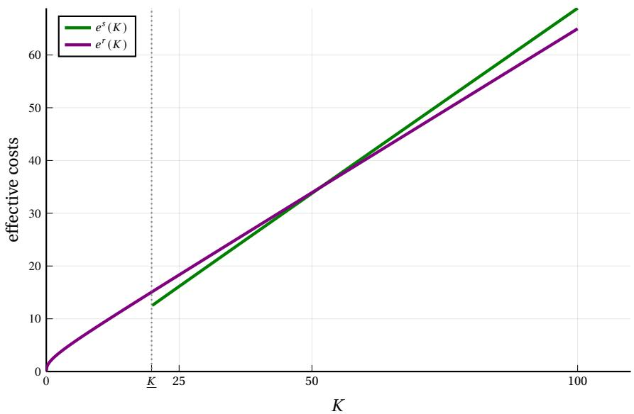
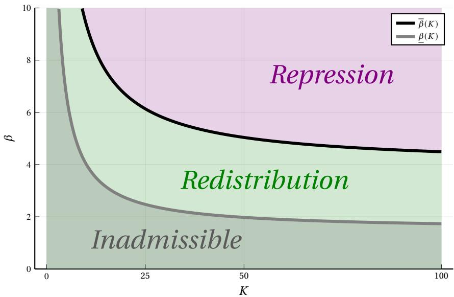
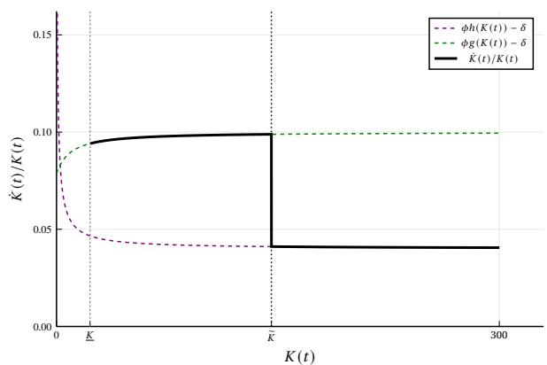
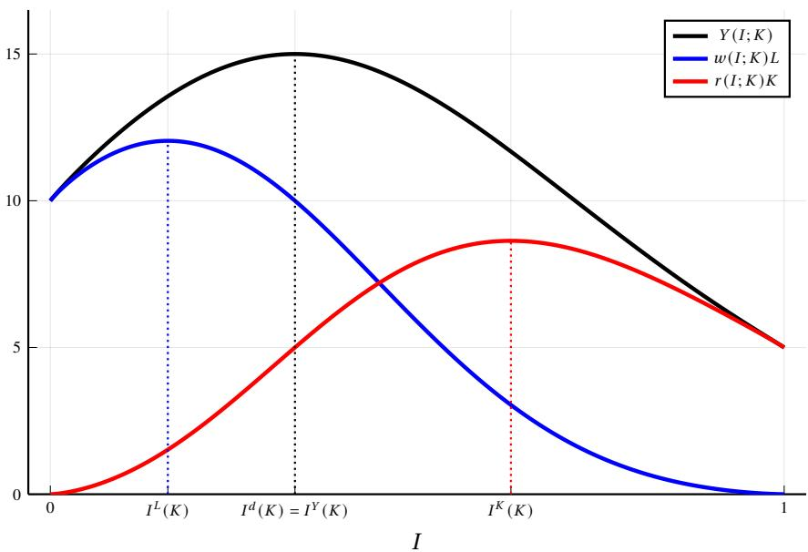
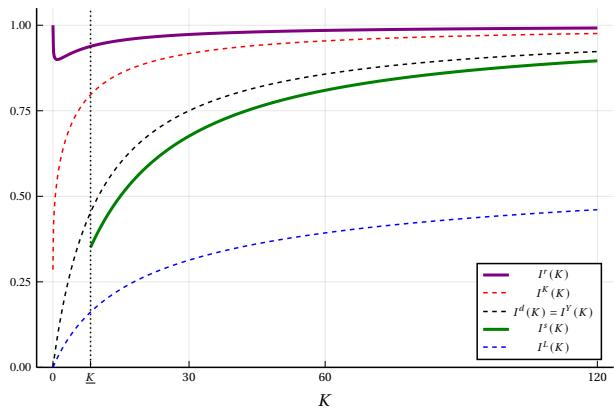
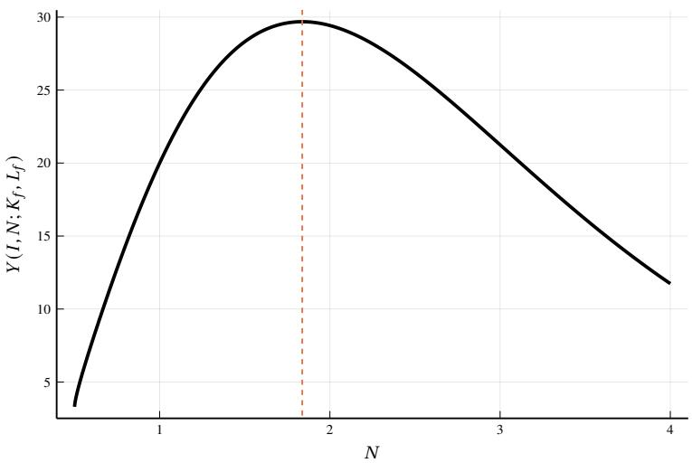
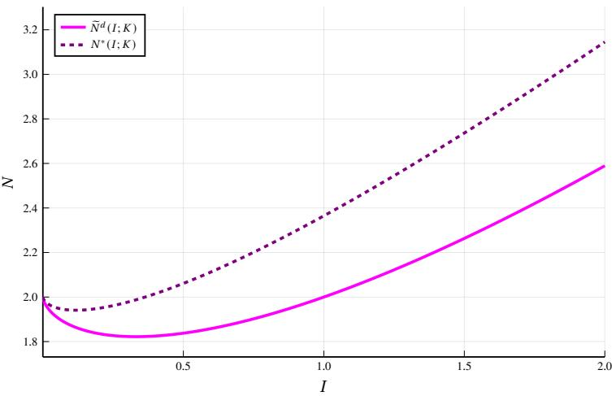

# Automation and Repression 通俗讲解

### 0. 整体创新点通俗解读

这篇论文表面上是经济学，但内核其实是在回答一个所有人都隐隐感到、却没人认真建模的问题：**如果 AI 和自动化真的把工人逼到墙角，资本家会掏钱安抚，还是掏枪镇压？** 论文的答案冷峻得惊人——只要革命威胁不是特别弱，长期均衡一定是镇压。下面我把这个逻辑拆给你看。

---

**痛点直击**

之前的自动化研究（Acemoglu-Restrepo 那一脉的 task-based 模型）是“真空里的经济学”，难受的地方主要有三处：

- **政治维度完全缺席**：模型只算生产率账——automation 增加、labor share 下降、资本回报上升，故事到此为止。工人被当成了 NPC，不会反抗。但现实里的资本家（Kai-Fu Lee、Jack Ma、Palantir 的 Karp）嘴上天天念叨"pitchforks"，说明他们比学界更早意识到了这个风险。
- **外部性没人管**：分散化的资本家各自做 automation 决策，每个人只算自己的利润账。多自动化一个 task，自己的利润涨，但整个社会的 revolt 风险也在涨——而这个成本是摊到**所有**资本家头上的（revolt 一旦成功，资本全部充公）。典型的公地悲剧：每个人理性，集体走向悬崖。
- **两张牌怎么打没有理论**：就算存在一个代表全体资本家的 capitalist state，它手里有两张牌——redistribution（再分配）和 repression（镇压）——什么时候打哪张？什么时候混着打？文献里是完全的空白。这篇论文就是第一个把 **revolution 约束** 塞进 automation 模型的工作。

---

**通俗比方**

我用两个比方，第二个是全文的命门。

**比方一：公共草坪停车（解释外部性）**

- 想象小区里每家都往公共草坪上停车，每家多停一辆自己方便，但草坪被毁的风险由全小区承担。放到论文里：**“停车”=多自动化一个 task，“草坪被毁”=revolt 成功、资本归零**。所以分散均衡必然出现**过度自动化**——相对于资本家作为一个阶层的集体利益而言。

**比方二：按量计费 vs 包月套餐（这是全文的灵魂）**

- **Redistribution 是按量计费**：automation 程度越高 → 工资被压得越低 → 劳动份额越小 → 工人越愤怒 → 你要支付的转移支付/公共品就越多。**安抚费账单和自动化规模成正比增长**。
- **Repression 是包月套餐**：花一笔固定的钱（产出的 R 比例）养一套压制机器，把 revolt 概率压到 χ，之后**想自动化多少自动化多少，边际成本为零**。
- 商业常识：**规模越大，包月越划算**。当你的“业务量”（本质上由资本存量 K 决定，因为 K 越大 automation 越有利可图）超过某个临界点，你必然从按量计费切换到包月。

这就是论文最核心的结论——**automation 与 repression 是互补品**。自动化不需要配合一个福利国家，它天然配合一个高压国家。

---

**关键一招**

作者没有发明新的生产函数，而是干了三件结构性的“嫁接”手术。

**第一招：把 global games 焊进 task-based 模型**

- revolt 不是拍脑袋给个概率，而是一个协调博弈：成功当且仅当参与比例 ≥ θ（政权强度），每个工人只能看到 θ 的噪声信号。
- Morris-Shin 式的 global game 给出唯一的成功概率：**(w+c)/b**，而革命成功的非货币收益 b 又被设定为与人均资本回报成比例：**b = β·rK/L**。
- 这一步的巧妙之处：revolt 概率被改写成了**劳动收入与资本收入之比的函数**——不平等本身直接、显式地进入政治风险。automation 压低 w、抬高 rK，于是自动抬高革命概率，链条完全打通。

**第二招：一个漂亮的“消去”（Proposition 3）**

- 当 capitalist state 只能规管 automation 时，多自动化一点是双刃剑：资本回报 rK 上升（好），但 revolt 概率下降（坏）。
- 因为 b ∝ rK，这两个效应在目标函数里**精确抵消**，整个优化问题坍缩为“最大化劳动收入 wL”。
- 直觉上很有讽刺意味：资本家想让钱安全，最优策略恰恰是让工人的日子好过——所以它会把 automation 压到 **I^L**，甚至低于市场均衡 I^d。但即便如此，revolt 风险依然消不掉，于是它必须启用另外两张牌。

**第三招：single-crossing property + 动态收敛（Lemma 4 + Theorem 1）**

- 定义两种制度的“有效成本”（相对于无革命威胁时的理想 payoff 的损失）：**e^r(K)** 和 **e^s(K)**。
- Lemma 4 证明这两条成本曲线**只交叉一次**：一旦在某个 K 处镇压更便宜，对所有更大的 K 都更便宜。

- 背后还是那个比方：K 变大 → 均衡 automation 变高 → 再分配的按量账单越来越贵，而镇压的包月费纹丝不动。
- 动态上（Theorem 1）：只要 revolt 威胁不太弱（**β > β̄(∞)**），资本积累把 K 推向无穷，经济**长期必然收敛到 repression**。要么一开始就镇压，要么先温和地搞 redistribution，等 K 越过临界值 K̃ 再“变脸”。

上面这张参数空间图非常直观：横轴 K，纵轴 β（工人革命的动机强度）。**β̄(K) 这条分界线随 K 递减**——资本越多，镇压的门槛越低。绿区是 redistribution，蓝区是 repression，而资本积累是一条向右的水平箭头，注定钻进蓝区。

这张图展示最戏剧化的路径：经济从 redistribution 起步（K(0) < K̃），资本按 φg(K)−δ 的路径持续积累，**到达 K̃ 的那一刻整体切换到 repression**，之后一路镇压 + 走向接近完全自动化，增长率收敛到 φ(1−R)−δ。

---

**为什么这套结论“杀不死”——两个稳健性检验**

- **创造新任务也救不了场（Section 7）**：允许企业额外投资 labor-intensive 的 new tasks（AI 领域说的“新岗位”）。分散均衡确实会**投资不足**——同样的外部性，企业创造新任务能抬高 labor share、降低 revolt 风险，但没人愿意为此买单。capitalist state 会纠正这个扭曲。但 Proposition 11 证明了一件漂亮的事：**repression 的门槛 β̄(K) 一个数都不变**。新任务不改变 automation 与 repression 的互补性。
- **民主制度也保不住（Section 8）**：如果起点是民主，工人多数会把税拉到制度上限 τ̂。当资本存量足够大、民主税负超过“政变 + 镇压”的总代价时，资本家会选择**推翻民主**。用的是同一套 single-crossing 逻辑：K 越大，coup 的吸引力越单调上升。

---

**一句话带走**

这篇论文用一套干净的模型证明了一个不太舒服的预言：**自动化不会自动催生福利国家，而是自动滑向高压国家**——不是因为资本家在道德上邪恶，而是因为一个纯粹的成本结构问题：**repression 是固定成本，redistribution 是变动成本，而资本积累不断把业务规模推向“包月更划算”的那一边**。另外别忘了，模型里 repression 的成本 R 是外生给定的；现实中 AI 本身还在让监控和镇压变得更便宜（Beraja 等人的 "AI-tocracy" 论文说的就是这个），这意味着真实世界的结论只会比模型更强，不会更弱。

### 1. Task-Based Automation Model with Global-Game Revolt

**痛点直击**

要回答“AI 自动化会不会把社会逼向镇压”，旧的两套工具箱各缺一块，而且缺得很难受：

- **自动化这边**（Acemoglu-Restrepo 的 task-based 框架）：
  - 能精确算出自动化如何压低 **labor share**、抬高 **capital share**（即 displacement effect）；
  - 但政治在模型里根本不存在——像一台只测风速的气象仪，知道风暴在酝酿，却不管船翻不翻；
  - 致命盲区：自动化决策有**政治 externality**。每个资本家只盯着 r 和 w 的成本差做选择，没人会为“大家一起自动化 → 不平等拉大 → 工人掀桌 → 资本充公”这条链付一分钱账。
- **革命理论这边**（Morris-Shin 的 global game 文献）：
  - 能刻画暴动的**协调问题**——“别人冲不冲，我冲不冲”；
  - 但不平等是外生喂进去的参数——知道火药何时炸，却不知道火药是谁在生产；
  - 经典顽疾：coordination game 有**多重均衡**，“全冲”和“全不冲”都 self-fulfilling。revolt 概率本身定不下来，后面一切“政府该怎么应对”的最优政策分析全是空中楼阁。

这个问题的正确答案形态是一个 **feedback loop**：技术选择内生地制造不平等 → 不平等内生地决定暴动概率 → 暴动概率反过来约束技术选择。此前没人把环焊死，本文是第一个。

| 维度 | Task-based 自动化文献 | Global game 革命文献 | 本文 |
|---|---|---|---|
| 自动化水平 I | 内生 | 不存在 | 内生 |
| 不平等 | 内生 | 外生参数 | 内生，由 I 驱动 |
| 暴动概率 | 不建模 | 唯一，但给定 | 唯一，且是 I 的函数 |
| 政治对技术的反馈 | 无 | 无 | 有 |

---

**通俗比方**

把整个经济想象成一座工厂，门外站着一群观望的工人：

- **工厂内部是 task-based 生产**：一条 [0,1] 的连续流水线，每个工位既能由**机器人**干、也能由**人**干（y(i) = k(i) + l(i)，完美替代），最后用 CES aggregator 把所有工位的产出卷成总产出 Y。老板划一道门槛 I，门槛以下的工位全部换成机器——这就是**自动化水平**。
- **工厂外部是一场 global game**：每个工人要不要冲进去，心里算的是一笔账：
  - **分子（不冲的代价）**：工资 w + 参与的直接成本 c；
  - **分母（冲的收益）**：暴动成功后分到的人均资本饼，b = β·rK/L。

**survival probability = (w+c)/b**，本质是“**手里的鸟 ÷ 林子里的鸟**”。老板每多自动化一个工位，工人手里的鸟就瘦一分、林子里的鸟就肥一分——比值一掉，政权就悬。

至于“猜别人冲不冲”的心机博弈，就是标准的 **bank run 逻辑**（Morris-Shin 本人就是研究 currency attack 的，文献中 Goldstein-Pauzner 的 bank run 是同款结构）：每个工人对 **regime strength θ** 只能收到一个**带噪声的私有信号**。噪声的存在打碎了 self-fulfilling 预期，把无穷多个均衡筛成**唯一一个阈值均衡**——信号够差就上，够好就撤，中间只有一个临界点。

上图是这座工厂的均衡解剖：产出 Y 在 I^d 处封顶，但工资 wL 和资本回报 rK 各怀私心，分别想停在 I^L 和 I^K，排序恰好是 **I^L < I^d = I^Y < I^K**。市场恰好落在 I^d——这是竞争效率的胜利，也是政治风险的埋雷点：没有任何一个资本家为这个风险付过账。

---

**关键一招**

作者没有重造任何轮子，而是在两个模型的**接口处动了三刀**，每一刀都便宜且致命：

- **第一刀：让暴动的奖品 b 内生化**。
  - 直接规定 b = β·rK/L——暴动的战利品，就是被充公的人均资本收入；
  - 这一刀把政治激励与经济中的 **factor share** 焊死：资本家越富，暴动诱惑越大；自动化越狠，两边的剪刀差越夸张。

- **第二刀：目标函数里的漂亮消元**（全文的引擎）。
  - 当国家手里**只有 regulation 这一件工具**时，capitalist state 想最大化期望回报 Pr(survival)·rK，把 survival probability 代入：
  - Pr(survival)·rK = ((w+c)/b)·rK = (1/β)·(w+c)·L；
  - **rK 项被完全约掉**。一个以保卫资本为天职的国家，其目标竟然退化成**最大化工资总额 wL**（Proposition 3）——它在数学上被“工会附身”了；
  - 这个退化不是 bug，而是引擎：既然只用管制会把国家逼成工会（I^0 = I^L，自动化被死死压低），它就必须另找工具——redistribution 或 repression——把自动化捞回来。论文后半部所有 trade-off 分析，都是这一刀的涟漪。

- **第三刀：用 uniform 分布的对称性拍死均衡唯一性**。
  - Lemma 1 证明 Pr(x ≤ x̂ | θ=θ̂) = Pr(θ ≥ θ̂ | x=x̂)，效果是：**边际暴动者**对自己胜率的信念恰好均匀分布在 [0,1]；
  - 再取极限 θ̄→1、θ_→0，survival probability 收敛成干净的闭式 **(w+c)/b**；
  - 于是政治风险不再是一种模糊的“氛围”，而是一个可求导、可优化的**标量指标**。

三刀下去，环闭上了：**I → (s_L, s_K) → (w+c)/(rK/L) → 暴动概率 → 最优 I**。每一环都是闭式表达，“管制 vs 再分配 vs 镇压”的争论就此从哲学问题变成了求导问题。

上图的回报：环闭合之后，四种情形下的最优自动化水平立刻分层站好——**I^0（只管制）< I^s（再分配）< I^d（放任市场）< I^r（镇压）**。镇压之下自动化冲得最猛，这正是全文主命题“**automation 与 repression 互补**”的模型根源。

### 2. Regulation-Only Collapse to Labor-Income Maximization

**核心一句话**：资本主义国家（capitalist state）手头只有“调节自动化程度”这**一个**旋钮时，它看似在为自己精打细算，但数学上把目标函数推到底，会惊奇地发现它的最优策略**恰好等价于最大化工人的工资总额**——不是良心发现，而是被模型结构“绑架”的结果。

---

**痛点直击**

先看这个模型里资本家有多难受：

- 分散的市场均衡里，每个资本家各自追逐利润，**完全无视**自己的自动化决策会推高叛乱概率——这是典型的**外部性**：收益归自己，政治风险由全体资本家分摊。
- 资本家的期望收益 = **P(政权存活) × rK**。一旦叛乱成功，资本被永久没收，rK 直接归零。这是悬在头顶的“革命约束”。
- 直觉上你可能以为：国家拿着自动化旋钮，会在“多赚资本回报”和“多担叛乱风险”之间找个折中点，比如选个中等自动化水平。
- 但模型的结论远比这更极端——它根本不选中间点，而是**一头扎向劳动者的最优解**。这就叫 **collapse（坍缩）**：目标的自由度被数学结构压缩到只剩一维。

---

**通俗比方**

想象你是村口唯一的**放贷人**：

- 你借出去的钱越多（rK 越大），利息收入越高。
- 但借得越多，村民“掀桌子赖账”的动力也越大——而且模型设定这个动力**和你的利息收入成正比**（b = β·rK/L）。
- 结果是什么？你多放一块钱贷，多赚的利息**恰好**被村民多出来的赖账概率**一比一吃掉**。rK 在你的期望收益里完全被“对冲”干净了。
- 剩下唯一能压低赖账概率的杠杆是什么？**让村民手里的工资 (w) 高一点**，让他们觉得“掀桌子不划算”。
- 所以这个放贷人的最优策略不是少放贷或多放贷，而是反过来**替村民争取高工资**——荒谬吗？但这就是冷冰冰的精算结果。

用博弈论的话说：这其实是**角点式的均衡选择**——当两个互为镜像的风险渠道（收益渠道与风险渠道）在数学上严格抵消时，你的目标函数会退化成一个和自身利益“看似无关”的量。

---

**关键一招**

作者没有重新发明任何东西，只是做了一个**极其巧妙的代入**，然后让 rK 自己“消失”：

- 出发点是国家的期望收益：
  - P(存活) × rK
- 第一步代入（Proposition 1）：存活的概率等于 **(w + c) / b**，其中 b 是叛乱成功的奖励；
- 第二步代入（论文式 (2)）：**b = β · rK / L**，即叛乱奖励与人均资本收益成正比——这是整个坍缩的**枢纽假设**；
- 把两步串起来：
  - 期望收益 = (w + c) / (β·rK/L) × rK = **(w + c)L / β**
- 看清楚发生了什么：**分子分母里的 rK 精确约掉了**。国家千算万算，最终手里攥着的目标函数里只剩 **wL**——纯纯的工资单。

于是在均衡里：

- 国家把自动化水平直接压到**最大化劳动收入的水平** $I^0(K) = I^L(K)$；
- 这比市场均衡的 $I^d$ 和资本家心心念念的 $I^K$ 都要**低**；
- 排序固化为一条铁律：$I^L < I^d = I^Y < I^K$，国家选最左边那个。

上图（论文 Figure 2a）正是这个排序的可视化：最底下那条线就是 regulation-only 的 $I^0$，它被死死压在市场均衡 $I^d$ 之下。

---

**为什么这个“坍缩”是全文的枢纽**

- 它解释了为什么**纯调节远远不够**：国家被迫过度牺牲资本收益来买平安，自动化被压得远低于市场水平；
- 所以国家必然去寻找**第二个工具**：要么**再分配**（redistribution，用公共品稀释叛乱动机），要么**镇压**（repression，直接把风险打到 χ）；
- 整篇论文后半部分的核心张力——**automation 与 repression 的互补性**——正是从这个“只靠调节会坍缩到劳动收入最大化”的痛点里生长出来的；
- 换句话说，这个 proposition 是全文的“反面铺垫”：先证明单工具的失灵有多彻底，后面引入再分配与镇压的权衡才有戏可唱。

**记住这个直觉**：当你的风险敞口和你追逐的收益**严格同比例放大**时，追逐本身就没有意义——最优策略会坍缩到最大化对方的保留效用上。这和谈判理论里的“让利以维持合作”是同一个骨架。

### 3. Complementarity between Automation and Repression (Static)

这篇论文看着像政治经济学，骨子里其实是个 **mechanism design** 问题：当一个 agent 的技术选择会改变博弈的收益结构时，一个有强制力的第三方该如何选工具？作者的核心贡献“静态互补性”一句话概括：**镇压的相对价格是自动化程度的减函数**。下面拆开讲。

---

**痛点直击**

之前的做法难受在哪？难受在“工具不配套”：

- 传统 task-based 模型里，自动化决策和政治风险是**割裂**的。个体资本家只比较 r 和 w，谁便宜用谁，完全不 internalize“我把工人逼急了、revolt 成功、资本被没收”这个尾部风险。结果是**过度自动化**——collectively 给自己挖坑。
- 资本主义国家想收拾局面，手头两个工具各有隐疾：
  - **只规制**：为了让 revolt 概率降下来，国家必须把自动化压到 $I^L$——低到接近“劳动收入最大化”的水平。Proposition 3 说得很直白：只有规制时，国家的目标函数**塌缩成最大化工资单**。资本家等于替工人打工，肉疼。
  - **再分配**：这把工具的真正问题是**它的价格是内生的**。Lemma 2 给出最优税率 $\tau^*(s_L) = \frac{\alpha - 2s_L}{2\alpha - 2s_L}$，对 $s_L$ 求导为负。翻译一下：自动化越深 → 劳动份额 $s_L$ 越低 → 需要的税率越高 → 资本家税后收入被越啃越多。**自动化每推进一步，糖就涨价一次。**
- 所以核心痛点是：再分配是一个**边际成本递增**的维稳工具，它天然撑不起高自动化社会。这是"it's taxes or pitchforks"在模型里的样子——而作者要告诉你的是，还有第三个选项，而且**这个选项越自动化越香**。

---

**通俗比方**

想象你是工厂老板，不断买机器换人。工人不高兴，随时可能砸机器（revolt 成功 = 资本永久没收）。你手上两个维稳方案：

- **发糖**（再分配）：给工人发福利堵嘴。麻烦在于糖的需求量和你的自动化速度**绑定**——机器换人越多，工资越低、怨气越大，堵嘴的糖越贵，而糖钱全从你利润里出，且是**递增地**出。
- **请保安**（镇压）：雇一队人守住大门。保安费是**固定抽成**，按产出比例 R 收取——不管你自动化到什么程度，**保安费不涨价**。

直觉结论：自动化程度低时，糖便宜又够用，没人愿意用保安这种“伤面子”的手段；自动化狂飙之后，糖价贵到离谱，保安费却纹丝不动——资本家嘴上喊着防"pitchforks"，手上已经开始拨款买"guns"了。这就是**互补性**的全部内容：镇压让你敢放开自动化，自动化反过来让镇压越来越划算。两个东西互相成就。

---

**关键一招**

作者没有发明新机器，而是做了两次精巧的“变量替换”，把政治问题翻译成可比较的成本函数：

- **第一刀：把政治风险翻译成份额比。** Global game（Morris & Shin）算出 regime 存活概率为 $\frac{w+c}{b}$，而 $b = \beta \frac{rK}{L}$，代入后存活概率 = $\frac{1}{\beta} \cdot \frac{s_L}{s_K}$。这一步把“政治生存”和“分配格局”**焊死**在一起：你要活得久，就得让 $s_L / s_K$ 别太难看。
- **第二刀：让两种工具的成本结构显形。**
  - **再分配**：国家选 τ，工人的不 revolt 机会成本变成 $w(1-\tau) + \alpha \tau Y/L$，相当于往分子里人为塞了一块“虚拟劳动收入”。代价是资本家收入乘以 $(1-\tau)$，而 τ 必须随 $s_L$ 下降而涨——**这是一个给自己不断加税的方案**。
  - **镇压**：直接把存活概率固定为 $1-\chi$，**把政治风险从目标函数里整个拿掉**。国家的优化问题退化为最大化 $(s_K - R)Y$。更妙的是，镇压成本等效于对资本家的“比例税” $R/s_K$——自动化越高 $s_K$ 越大，这个**有效税率反而被稀释**。所以 Proposition 4 给出一个反直觉结论：镇压下的自动化水平 $I^r$ 不仅高于市场均衡 $I^d$，甚至高于“资本家本来的最爱” $I^K$。政治约束一解除，自动化比没人管的市场还猛。

两种工具的对比一目了然：

| 工具 | Revolt 概率的处理 | 成本结构 | 支持的自动化水平 |
|---|---|---|---|
| 纯规制 | 内生（压低自动化换安全） | 零直接成本，牺牲产出 | $I^0 = I^L$（最低） |
| 再分配 | 内生（抬高税后劳动回报） | 税率 τ 随自动化**递增** | $I^s$（中等） |
| 镇压 | 外生（固定为 χ） | 固定比例 R，**不随自动化涨** | $I^r$（最高，甚至 > $I^K$） |

- 有了这两刀，比较就是水到渠成。定义两个“有效成本”：$e^r = u^K - u^r$ 和 $e^s = u^K - u^s$（$u^K$ 是无 revolt 威胁时的收益上限）。**Lemma 4 证明这对成本在资本存量 K 上满足严格单交叉**：一旦在某点镇压占优，之后永远占优。看 Figure 3 的几何直观——绿色曲线（再分配成本）随 K 一路走高，紫色曲线（镇压成本）反而趋平往下压：

- 翻译成政策语言就是 Proposition 6 和 Figure 4：存在阈值 $\bar{\beta}(K)$，revolt 冲动 β 超过它就选镇压；而 $\bar{\beta}(K)$ 随 K **递减**——资本存量越大，镇压的门槛越低。除非威胁很弱或资本很少，否则资本家国家的选择收敛到镇压：

- 最后补一张总览图，看政治约束被一个个解除后，自动化如何一路放开——从左到右：$I^0 < I^s < I^d < I^K < I^r$：

---

**收个尾**

给这个结果一个“CS 式”的读法：这其实是个**反向的 mechanism design**。通常我们设计机制去 internalize externality；这里作者展示的是，当一个有强制力的 agent 发现自己可以**选择“退出博弈”**（镇压直接把存活概率 exogenize）时，它不会去修补 externality，而是干脆**消灭博弈本身**——代价是一笔固定抽成，收益是让所有扭曲归零、还能反向踩油门。互补性的本质就在这：automation 压低了博弈参与方的保留收益（工人的 w），repression 直接免除了给这个收益定价的必要。两者作用于同一个目标函数的不同自由度，一方的增强让另一方的影子价格持续下跌。

### 4. Long-Run Convergence to Repression under Capital Accumulation

**痛点直击**

先明确这个结论在回答什么。

- 论文的基线设定：**automation** 抬高 **capital share**、压低 **labor share**，而工人 revolt（用 **global game** 建模）的成功概率随资本/劳动收入不平等上升。于是资本家集体被迫交一笔“政权生存税”
- 应对暴动威胁只有两条路，且成本结构截然不同：
  - **Redistribution**：用转移支付（public good）抬高工人造反的机会成本。致命弱点——automation 越深，labor share 越低，安抚所需的税率就越高。论文算得很清楚：当 K→∞、经济走向 fully automated 时，最优税率 **τ → 1/2**，即要把半个蛋糕分出去买平安
  - **Repression**：直接镇压，代价是产出的固定比例 **R**。这是 **fixed cost**，不随不平等程度恶化而额外膨胀
- 静态地比较两者优劣全是参数游戏，看不出方向性。真正的痛点是：**在资本持续积累的动态经济里，“福利 vs 警棍”的拉锯战是否存在一个可证明的终局？** 如果答案依赖初始条件或外生冲击，模型就只是描述性的，谈不上洞见

---

**通俗比方**

这是一道随“用量”增长的 SaaS 计费选择题。

- **Redistribution = pay-per-use**：自动化每扩张一分，安抚账单跟着涨一截
- **Repression = flat-rate 订阅**：无论自动化多深，镇压开销锁死在 R
- 用量小的时候按量付费当然便宜——没人一上来就上高压手段
- 但 **capital accumulation** 是自动化的永动机：K↑ → automation 更有利可图 → labor share 进一步被压扁 → 按量付费的账单向 50% 产出的上限狂奔
- 终局只有一个：**当用量足够大，一切理性用户都会切换到 flat-rate**。这不是意识形态选择，是成本结构逼的

上图紫线是 repression 的**有效成本**，绿线是 redistribution 的有效成本。二者只交叉**一次**——过了交点，镇压永久更便宜。这就是 Lemma 4 的 **single-crossing property**：一旦在某个 K 上镇压占优，之后所有更大的 K 都占优，**决策翻面后不可逆**。

---

**关键一招**

作者没有硬啃无限期动态规划，而是做了一个降维打击：**把整个动态问题压缩成一条关于资本存量 K 的单调递减阈值曲线 β̄(K)，然后用比较静态一锤定音**

- 发动机是两段互补性串成的链条：
  - **K 与 automation 互补**：资本越多，多自动化一个 task 的边际回报越高，均衡自动化水平 I(K) 随 K 单调上升
  - **automation 与 repression 互补**：镇压下最优自动化 I^r 甚至超过“无威胁时资本家想要的” I^K——因为更高的 capital share 直接稀释了镇压的有效税率 R/s_K；而 redistribution 下自动化是被刻意压制的（I^s < I^d）
  - 串联起来：**K ↑ → automation ↑ → labor share ↓ → redistribution 成本膨胀 → repression 相对价格下跌**
- 技术落点：证明 **β̄(K) 关于 K 严格递减**，且极限为 β̄(∞) = α / [4(1−χ)(1−R)]。直觉是——资本越多，镇压能让你在高自动化水平上攫取 s_K ≈ 1 的资本份额、只付固定 R，因此能容忍的暴动威胁参数 β 就越高
- 有了单调阈值，Theorem 1 把终局三分天下：

| β 所处区间 | 演化路径 |
|---|---|
| β ≤ β̄(∞) | 威胁太弱，**永远留在 redistribution**（唯一例外分支） |
| β̄(∞) < β < β̄(K(0)) | **先福利、后镇压**：初期 K 小、靠转移支付买平安；资本积累跨过临界值 K̃ 后，体制切换为 repression |
| β > β̄(K(0)) | 威胁太强，**从第一天起就直接镇压** |

右图即中间分支的宿命轨迹：经济从 redistribution 起步，资本曲线爬升，触碰 K̃ 的瞬间切换 repression，之后增长率收敛到 **φ(1−R)−δ**，automation 走向 100%

- 两个值得玩味的细节：
  - **切换是内生的**——不需要任何外生冲击。资本家越成功地积累资本、越深地自动化，就越是在亲手拆除 redistribution 的经济可行性：温和的福利资本主义在动态意义上是自我瓦解的
  - **state 选的不是增长最大化**（Remark 7）：它比较的是期望收益 (1−χ)ν^r 与 P^s ν^s。即使 redistribution 分支的实现增长率 φ/2−δ 更高（当 R > 1/2 时），只要镇压的“生存概率 × 可支配收入”更高，它照样选镇压——资本家的最优 ≠ 经济的最优

### 5. New Tasks: Underinvestment and Invariant Repression Threshold

**痛点直击**

主模型（Section 5）留了一道敞开的伤口：它假设技术进步只有一种形态——**automation**，机器只会抢任务、不会创造任务。这就很尴尬了，因为 Acemoglu 和 Restrepo 自己的成名理论反复强调技术的另一面——**new labor-intensive tasks** 会不断把劳动力吸回去（1940–2018 年美国大部分新职业就是这么诞生的）。

这个漏洞对论文的核心结论是致命威胁：

- 如果新任务源源不断，**labor share** 就不会一路崩塌
- labor share 稳住，工人参与 **revolt** 的机会成本就高，革命概率被压低
- 革命概率低，capitalist state 就犯不着选昂贵的 **repression**，选便宜的 **redistribution** 就够了

换句话说，这是冲着“**automation 与 repression 互补**”这个核心结论来的最锋利的反例：也许资本主义根本不会滑向镇压，只要给新任务开绿灯就够了。Section 7 就是在回答：你给再多解药，这个互补性还是杀不死。

---

**通俗比方**

把经济想象成一家工厂，老板手里有两个旋钮：

- **裁员旋钮**（automation level，I）：把任务从人手里转给机器
- **扩产旋钮**（range of new tasks，N）：开辟新的劳动密集型业务线，需要雇人。但开新线有**协调成本**（coordination costs，q(N) 递减，Becker–Murphy 式的分工代价），所以产出对 N 是**单峰**的——先升后降：

现在有两类决策者，看到的东西完全不同：

- **车间经理**（decentralized firms）：只对本车间产出负责。扩产扩到“新业务线的边际产出 = 协调成本”就停手。他看不见——也没激励去看——“多雇一个工人，全厂闹事概率就降一点”这种**全局正外部性**
- **董事长**（capitalist state）：他算的是全厂的账，手里有一个隐藏恒等式——政权存续概率 ∝ s_L/s_K，而资本回报 ∝ s_K，两者相乘时 **s_K 恰好约掉**，于是他等价于在最大化**劳动收入** s_L·Y。既然雇人能抬升 s_L，他自然比经理们**更激进地扩产**

于是出现系统性偏差：市场经济的“无形之手”太短，够不到政治风险那一格。下图就是两者最优 N 的落差：

但最妙的部分不在 underinvestment，而在第二层：**不管盘子做多大，切蛋糕的刀法只看比例**。

---

**关键一招**

作者没有重写任何模型，只做了一次教科书级的操作：**换元 + 解耦**（变量替换 z = I/N）。

关键观察：收入份额 s_L、s_K 只依赖**自动化任务占比** z = I/N，与任务总量 N 无关。于是把产出改写为：

- Y(I, N; K) = (q(N)·N)^{1/(σ−1)} × [只含 z 和 K 的项]

而 capitalist state 的目标（无论镇压还是再分配）都是“某个只含 z 的函数 F(z) × Y”的形式，所以整个问题被**劈成两半**：

- **外层**：选 N 最大化 (q(N)N)^{1/(σ−1)}——纯生产问题，与政治完全无关。解出来正是**产出最大化**的任务范围 Ñ^Y
- **内层**：选 z——**逐字逐句退回基准模型**，和没有新任务时的 I^r(K)、I^s(K) 一模一样

最终最优解是**按比例缩放**（Proposition 10）：

- Ĩ^r(K) = Ñ^Y(K) · I^r(K)
- Ĩ^s(K) = Ñ^Y(K) · I^s(K)

也就是：**先定盘子大小，再切比例**。政治决策被压缩到 z 这单一维度上，与基准模型**完全同构**。

于是镇压阈值原封不动（Proposition 11）：

| 模型 | 镇压阈值（β 高于此值即选 repression） |
|---|---|
| 基准（无新任务） | β̄(K)，由 (27) 式给出 |
| 扩展（有新任务） | β̃(K) **逐项相等** |

背后是一次漂亮的**约分**：阈值表达式里出现的产出比值 Y(I^s;K)/Y(I^r;K)，在换元之后两边的 (q(N)N) 因子直接对消，剩下的每一项都与基准模型一一对应。所以那张阈值相图被“原样照搬”：

后果链条非常干脆：

- Proposition 6 的全部 comparative statics 原样成立
- Theorem 1 作为**直接推论**成立：只要 revolt 威胁不太弱（β > β̄(∞)），经济长期仍收敛到 **repression**
- 新任务这剂“解药”唯一的疗效是让盘子更大（N 更高、Y 更高），但**改变不了切蛋糕的方式**

一句话总结这个技术点：**新任务只能稀释革命的“浓度”，稀释不了镇压的“阈值”**——因为政治由份额决定，而份额只认比例、不认绝对量。

### 6. Capitalist Coup against Democracy

**痛点直击**

这个结论的痛点在于：**民主制对资本家是一种“按比例抽血”的机制，而且这种痛苦是自我加剧的**。

- 民主制下，工人是多数票，会把税率推到制度允许的上限 τ̂。资本家只能被动接受，拿到的净收入是 (1-τ̂)·rK
- 关键的“很难受”之处：随着资本存量 K 积累、自动化水平 I 上升，资本份额 s_K 趋近于 1，产出 Y ≈ K。此时资本家的税基**线性膨胀**——你越富、越自动化，民主每年从你身上抽走的绝对金额就越大
- 这是一种“**成功的诅咒**”：自动化让你赚得更多，但民主的分配规则让这笔钱越来越多地流向工人。资本家对民主的忍耐度，本质上是在忍耐一个不断涨价的服务

---

**通俗比方**

这就是经典的“**抽成 vs 包月**”权衡：

- **民主制 = 按收入抽成**：赚得越多，交得越多，没有上限
- **政变 + 镇压 = 包月套餐**：付一笔固定的费用 R（产出比例的镇压成本），外加一次性的“套餐开通费”（政变失败概率 χ 带来的风险），之后随便你自动化到什么程度，成本不再增长

一开始你穷，抽成便宜、包月不划算，忍着；当收入跨过临界点，包月远比抽成省。论文的 **Lemma 11**（单交叉性质，single-crossing property）就是这个直觉的数学化身：民主收益曲线和压制收益曲线在 K 轴上至多相交一次——**一旦你某天觉得政变更划算，之后永远觉得更划算**，没有回头路。

上图就是这种成本结构的直观呈现：压制成本（紫线）是“固定”的，而再分配成本（绿线）随 K 增长——把“再分配”换成“民主税收”，逻辑完全同构。

---

**关键一招**

作者并没有为民主政变重新建模，而是**巧妙地把第 5–6 节“再分配 vs 压制”的整套框架原样移植过来**，做了一次变量替换：

- 民主制下的强制税率 τ̂，在数学结构上完全扮演了此前“再分配情景”中税负 τ^s 的角色
- 政变后的镇压成本 R 与失败概率 χ，与第 5.2 节的压制设定**逐字对应**
- 于是 Lemma 4 的单交叉证明可以原封不动地复制，直接得到 Lemma 11，再推出 Proposition 12

核心的临界条件（当 K → ∞）干净得惊人：

| 政体 | 资本家极限收益 |
|---|---|
| 维持民主 | **(1 − τ̂) · K** |
| 发动政变 + 镇压 | **(1 − χ)(1 − R) · K** |

只要民主的税收能力不太弱，即 τ̂ > τ̄(K) = 1 − (1−χ)(1−R)，且资本存量跨过阈值，资本家的最优策略就是：**先享受民主红利积累资本，等自动化程度和财富规模到位，再一次性发动政变关掉民主**。

这就是论文标题背后的政治剧本：“pitchforks”（工人造反的威胁）最终被“guns”（国家暴力机器）取代——而且讽刺的是，让资本家有动力掏钱买枪的，恰恰是民主制度本身无法满足的、由自动化无限放大再分配需求。
