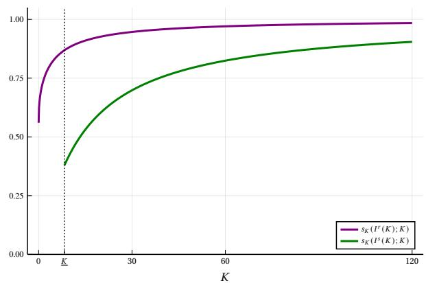
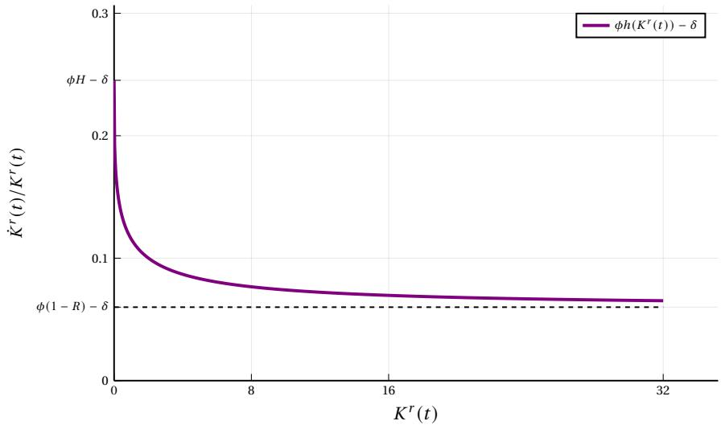
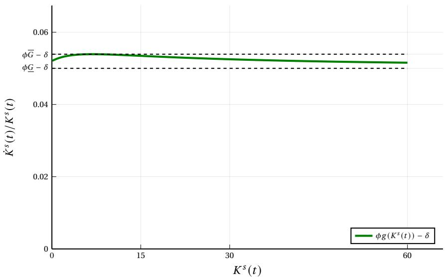
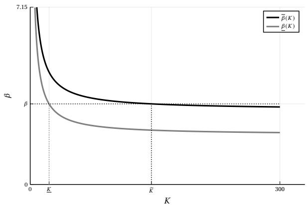

# Automation and Repression 原文翻译

# 自动化与镇压

Daron Acemoglu† A. Arda Gitmez‡ Mehdi Shadmehr§

2026年6月5日

我们考虑一个嵌入于政治环境中的自动化模型，在该环境中工人可以发动起义（建模为 global game），且资本与劳动之间更大的不平等会增加起义发生的可能性。分散化的自动化决策提高了资本在国民收入中的份额，并增加了起义成功的可能性。资本主义国家（代表资本所有者）倾向于对自动化水平施加管制，以减轻成功起义的威胁。资本主义国家还可以通过税收体系向工人进行再分配，或镇压政治行动，从而为进一步的自动化创造更大的空间。我们刻画了对自动化的管制、再分配与镇压之间的权衡。

我们的主要结果是自动化与镇压之间的互补性。除非起义威胁相当微弱或资本存量非常低，否则资本主义国家都偏好镇压。更高的资本存量反过来鼓励更多的自动化，从而也带来更多的镇压。在包含资本积累的完整动态模型中，从长期来看，经济会趋向镇压（同样，除非起义威胁非常微弱）。我们还证明，当企业还可以额外投资于新的劳动密集型任务时，同样的结论依然成立。最后，我们表明，以民主制度为起点，资本积累以及由此带来的更大程度的自动化，会促使资本家支持推翻民主的政变，并建立镇压性体制。

关键词：自动化、民主、global games、任务、镇压、起义。   
JEL 分类号：J23, O33, P10, P16。

## 1 引言

机器人技术以及如今人工智能（AI）的进步极大地扩展了可被自动化的任务集合。自动化能够降低成本、推动经济增长，但也会造成工人被替代，并往往加剧不平等——既包括资本与劳动之间的不平等，也包括工人内部的不平等。许多商界领袖一方面对进一步自动化的前景感到振奋，另一方面又对下一波大规模自动化所带来的政治风险忧心忡忡，因而左右为难。

AI投资人、谷歌中国前总裁及微软亚洲前院长李开复如是说：“这才是自动化带来的真正深层威胁：由普遍失业和畸形不平等所引发的巨大社会动荡、公众骚乱和政治崩溃”（Lee, 2022）。中国电商巨头阿里巴巴的创始人马云对此表示赞同，并指出“（自动化带来的）未来三十年的社会冲突将波及各行各业、各个阶层”（Solon, 2017）。抑或，正如著名科技企业家、风险投资家Nick Hanauer更为生动的表述：“如今我在我们的未来中看到了什么？我看到的是干草叉……或者，是一场暴动”（Hanauer, 2014）。这些科技企业家在某种意义上是在重新发现卡尔·马克思（Karl Marx）1867年所作的预言：“只是自机器问世以来，工人才开始与劳动资料本身作斗争……他反抗的正是生产资料的这种特定形式”（Marx, 1867, Ch. 15, Sec. 5）。正是诸如此类的恐惧，驱使许多美国富人修建加固地堡，以求在动乱中自保（Rushkof, 2022; Caramela, 2024）。

面对不断扩张的自动化，更大规模的再分配或许是避免社会冲突的一条途径。由包括Hanauer在内的100位百万富翁联署的2025年达沃斯峰会公开信，一针见血地点明了这一抉择：“要么纳税，要么面对干草叉。”1正是这些考量，促使许多科技企业家转而支持全民基本收入或全民基本分红之类的方案，以遏制民众的不满与政治风险。

然而，许多富人和商界领袖也认识到，在一个由自动化主导的世界中维持秩序，可能需要诉诸镇压及其他强力手段，以保护他们的收入与利润。X公司前首席商务官Mo Gawdat将许多科技领袖的态度概括为：先全速奔向全面自动化，然后再动用其他工具去控制失去工作的民众：“……于是你将会看到一个这样的世界：不幸的是，其中将充斥着大量的控制、大量的监控、大量的强制服从……”（Bartlett, 2025）。类似地，Palantir创始人兼CEO Alex Karp对他眼中AI及其他自动化技术将造就的政治经济学总结如下：“会有起伏。会有一场革命。有些人会掉脑袋。我们预期会见到真正出人意料的事情，并且要赢”（Brancolini, 2025）。在他们的近著中，Karp and Zamiska (2025) 发问：“为放弃暴动的威胁，公众应当要求什么？”(pp. 77–78)；他们的答案包括“甘愿约束选择”(p. 209)、“重新拥抱集体经验、共同的目标与身份认同、公民仪式”(p. 217)，以及在执法中运用软件技术（pp. 174–175）。

尽管这些争论在大众媒体和商业世界中备受瞩目，但据我们所知，迄今尚无针对这些问题的经济学分析。本文朝这一方向迈出了第一步，将因资本与劳动之间的不平等而触发的暴动纳入一个基于任务的自动化模型。具体而言，我们从一个框架出发：利润最大化的资本家选择自动化的程度，且经济中存在彼此分立的资本家（即资本所有者）与依靠劳动收入为生的工人。在这一框架中，我们引入了工人的暴动决策，而暴动需要工人之间的相互协调。我们沿循Morris and Shin (1998, 2003)的做法，将起义中的协调建模为一个全局博弈（global game）：只有当足够比例的工人参与时，暴动才会成功；每个工人都会收到关于成功阈值的信号，并据此决定是否参与。一旦暴动成功，资本存量将被永久没收，这构成了资本家必须纳入考量的重大政治风险——类似于Acemoglu and Robinson (2000, 2001b, 2006)中的革命约束。

自动化加剧了资本与劳动之间的不平等，并使暴动更有可能发生。在分散化的竞争均衡中，利润最大化的资本家会忽略其自动化决策对暴动发生概率的影响，从而导致相对于资本家作为一个群体所偏好的水平而言过度的自动化。

本文的主体部分聚焦于对一个代表资本家的国家——即“资本家国家”——所做决策的静态与动态分析，这些决策涉及对自动化的监管，以及旨在遏阻暴动的再分配与镇压。由于分散化的自动化决策会给资本家施加外部性，在其他条件相同的情况下，资本家国家会偏好更低的自动化水平。然而，与此形成鲜明对照的是，如果能够规避暴动风险，资本家国家会选择比分散化均衡更高的自动化水平——因为这将通过压低劳动份额，最大化资本家作为一个群体的回报。这两种相互冲突的冲动自然引出了一个问题：资本家国家能否运用其他手段来降低暴动风险，从而更接近资本家所期望的自动化水平。

我们考察了两种此类策略。第一，国家可以对收入征税，并以公共品的形式对税收收入进行再分配。失去公共品的风险会抑制工人参与暴动的意愿。我们证明，借助再分配，资本家国家能够提高自动化水平，而不会引发很高的暴动概率。然而，随着自动化水平的上升和/或资本存量的增长，所需的再分配规模也随之扩大，而这在资本家看来代价愈发高昂。

第二，国家可以选择实施有成本的镇压。两者的主要区别在于：镇压的成本是固定的（占产出的一个比例），而再分配的成本则随为降低暴动风险所必需的转移支付规模而上升，且这一规模会随自动化程度的提高而增长。因此，更高的自动化（以及更高的资本存量）有利于镇压。基于同样的逻辑，在镇压之下，资本家国家所偏好的自动化水平要高于再分配之下。2

本文的主要结果取决于再分配与镇压之间的比较——这正是那些忧心自动化政治影响的商界领袖与政治家们所热议的两种策略。我们分析中最重要的、且据我们所知是全新的结论，是自动化与镇压之间的互补性。更高的自动化降低了国民收入中的劳动份额，而由于暴动的激励与资本份额相对于劳动份额的对比相关，自动化便提高了暴动成功的概率。资本家国家试图借助镇压或再分配来抵消这一效应。由于再分配相对于镇压存在一项额外成本——更高的自动化需要更多的再分配——不断增长的自动化便有利于镇压。本文的所有结论皆立足于这一互补性。

这些结果包含若干比较静态分析的结论。首先，更高的镇压成本、镇压之下更高的叛乱风险以及更高的公共品收益都有利于再分配。其次，更强的叛乱威胁有利于镇压（因为较弱的威胁可以用低成本的再分配来有效应对）。第三，也是最重要的一点，更高的资本存量有利于镇压。这最后一项结果的产生，是因为资本存量与自动化互补（自动化的均衡水平随资本存量的增加而提高），而正如我们所强调的，镇压同样与自动化互补。因此，更大的资本存量也与镇压互补——镇压使资本主义国家能够设定比再分配情形下更高的自动化水平。

在论文的第二部分，我们将资本积累内生化。这一动态分析的主要结果同样取决于自动化与镇压之间的互补性。

更具体地说，我们的动态刻画表明，视镇压成本而定，经济可能处于两种体制之一：一种是在渐近意义上（即随着资本存量水平的增长）选择镇压的体制，另一种则是在渐近意义上选择再分配的体制。如果在渐近意义上更受偏好的是再分配（当镇压成本非常高，或者叛乱威胁非常弱时，即属于这种情形），那么我们的分析表明，经济从再分配起步，并且只要叛乱没有成功，就会一直维持再分配。如果在渐近意义上更受偏好的是镇压，那么经济的均衡路径便取决于初始资本存量。如果资本存量高于某一门槛水平，经济从一开始就实行镇压，并且均衡的镇压会持续下去（同样以未发生成功的叛乱为前提）。在这种情况下，随着资本不断积累，自动化水平持续提高，最终消除所有劳动密集型任务。工人则在镇压之下受到控制。如果资本存量低于这一门槛，经济从再分配起步，随后转向镇压（除非在这一转变发生之前出现了成功的叛乱）。

总而言之，我们的完整动态模型表明，只要叛乱威胁不是很弱，经济最终都将收敛于镇压，“草叉”将遭遇资本主义国家的“枪炮”。与静态模型中一样，在叛乱威胁较弱时，低成本的再分配能够显著降低叛乱成功的概率。尽管如此，只要叛乱威胁足够强，随着资本存量的增长，社会就会收敛于镇压。这或者是因为从一开始就选择了镇压，或者——更有意思的是——因为社会从再分配起步，而一旦资本存量达到某一临界水平，便转而采用镇压。换言之，自动化与镇压之间的互补性塑造了资本主义国家在应对叛乱威胁时的长期选择。

在一个扩展中，我们研究了企业还可以额外引入新的劳动密集型任务的情形。我们表明，新任务存在投资不足——因为企业没有把这些任务带来的更高劳动份额所隐含的叛乱风险下降考虑在内。尽管如此，镇压与再分配之间的权衡并未改变，而且在与本文主要分析相同的条件下，经济在长期中仍会收敛于镇压。

最后，在进一步的扩展中，我们表明，如果社会最初从民主制度起步，那么随着资本存量水平的提高，民主决策对资本家而言会变得越来越难以接受，社会将经历一场反民主政变，从而再次转向镇压。

本文与若干文献相关，不过我们尚未见到任何其他将革命的政治经济学与自动化模型相结合的分析。

首先，我们建立在诸如 Acemoglu and Autor (2011) 和 Acemoglu and Restrepo (2018b, 2019) 等自动化模型的基础之上，同时也借鉴了革命模型，包括 Acemoglu and Robinson (2000, 2001b, 2006) 以及将全局博弈应用于叛乱与起义的研究 (Morris and Shin, 1998, 2003; Bueno de Mesquita, 2010; Boix and Svolik, 2013; Chen et al., 2016; Boleslavsky et al., 2021; Morris and Shadmehr, 2023)。

其次，有越来越多的文献研究关于自动化的政治与社会反应的历史证据。例如，Caprettini and Voth (2020) 表明，1830 年的 Swing Riots 与节约劳动的脱粒机的使用相关联；Falcone and Rosenberg (2023) 和 Bustos et al. (2016) 则记录了自 20 世纪 90 年代中期以来，节约劳动的农业现代化如何在巴西引发动荡。在对有关当代美国与西欧自动化政治效应的文献进行综述时，Gallego and Kurer (2022) 得出的结论是：“文献中最一致的发现是，那些输给技术创新的人会转而反对政治现状” (p. 464)。其他例子包括：关于欧洲的 Kurer (2020)、Anelli et al. (2021)、Milner (2021) 与 Del Gatto and Mavridis (2025)，关于美国的 Frey et al. (2018)、Petrova et al. (2024)、Boustan et al. (2025) 与 Gonzalez-Rostani (2026)，关于墨西哥的 Boix et al. (2025)，以及关于瑞典的 Dal Bó et al. (2023)。此外，还有若干资本所有者与国家当局对抗议自动化的工人诉诸镇压的历史先例。例如，当墨西哥矿业中对工人被替代的担忧日益加剧时，国家的回应是镇压 (Hart, 1987; Beatty, 2015)。相比之下，美国当局对类似矿工抗议（例如 1902 年和 1943 年煤矿罢工期间的抗议）的回应，则是寻找补偿工人的新途径 (Montgomery, 1979; Fishback, 1992)。有意思的是，巴西国家对 20 世纪 90 年代中期土地抗议的回应是一种混合方式，将一定程度的镇压与再分配结合在一起 (Ondetti, 2008; Falcone and Rosenberg, 2023)。3

最后，与本文关系更为直接的是，只有少数其他研究探讨了自动化的政治经济学。Roy and Saha (2025) 在民主体制下研究自动化，在该体制中，技能异质的工人就自动化与再分配进行投票。他们表明，取决于自动化的生产率与技能分布，均衡呈现的特征要么是最大限度的自动化与再分配，要么是中等程度的自动化且没有再分配。Roy and Saha (2026) 分析了该模型在“二元经济”中的一个变体：被自动化从先进部门排挤出来的工人转移到落后部门并压低了那里的工资，因此这些工人同样厌恶自动化。据我们所知，唯一另一项探讨自动化对民主与镇压之意涵的理论分析，是 Acemoglu (2024) 中所呈现的对 Acemoglu and Robinson (2000, 2006) 框架之基本扩展的概略勾勒，其中自动化最终破坏了资本与劳动之间的合作。4

本文其余部分安排如下。第 2 节介绍我们的基准模型。第 3 节从工人参与的协调博弈中推导出起义成功的概率。第 4 节刻画分散化均衡以及相应的自动化水平与政治风险水平。第 5 节引入资本主义国家对自动化的监管、再分配与镇压策略，并刻画在何种条件下更偏好再分配或镇压。第 6 节引入资本积累，并给出我们关于经济长期均衡的主要结果。第 7 节将我们的结果扩展到企业既可对现有劳动密集型任务进行自动化、也可增加新的劳动密集型任务的设定，并表明我们的主要结果在该情形下依然稳健。第 8 节考虑另一个扩展，其中社会初始时拥有一个民主政府，随后讨论在自动化存在的情况下民主制度的存续。第 9 节为结语，而在线附录包含正文中所述结果的证明。

## 2 模型

我们的模型包含两个要素：经济与政治。我们的经济基准模型改编自 Acemoglu and Restrepo (2018b) 的基准自动化框架，其中总资本 � 为外生，劳动 � 无弹性，且不存在中间品。

社会由一个资本家连续统和一个工人连续统组成。资本家拥有资本，工人提供劳动。在我们的政治基准模型中，我们将一个起义模型嵌入这一设定，使得起义成功的概率取决于工人所获得的市场工资。如果起义成功，资本回报将被没收并在工人之间分配。

经济 存在一个由 $i \in [ 0 , 1 ]$ 索引的任务连续统。任务也可以被解释为在竞争性市场中运营的行业。最终产出由任务的 CES 加总函数生产，其替代弹性为 $\sigma \in ( 0 , \infty )$：

$$
Y = \left( \int _ { 0 } ^ { 1 } ( y ( i ) ) ^ { \frac { \sigma - 1 } { \sigma } } d i \right) ^ { \frac { \sigma } { \sigma - 1 } } ,\tag{1}
$$

其中 $y ( i )$ 为任务 � 的产出。我们将最终产品的价格标准化为 1。

所有任务均可用资本或劳动生产。如果一个任务由资本生产，我们就称该任务被自动化。更具体地，设 $k ( i )$ 和 $l ( i )$ 为生产任务 � 所使用的资本和劳动。我们假设任务 � 的生产技术为

$$
y ( i ) = k ( i ) + l ( i ) ,
$$

这意味着资本和劳动在生产中是完全替代品。为便于阐述，我们对任务进行排序，使得指数较低的任务先被自动化。

存在一个外生的总资本水平 �，由资本家拥有。连续统 � 的工人每人无弹性地提供 1 单位劳动，因此总劳动供给为 �。

政治 在市场出清之后，一个随机选取的工人子集有机会发动起义，他们决定是否参与起义。我们将潜在起义者的规模标准化为 1，其中 $1 \ll L$。这意味着潜在起义者的规模相对于总劳动 � 而言很小，因此即使均衡工资会对起义工人从劳动供给中退出作出反应，这一效应也很小。

起义涉及协调。我们采用关于政权更迭的全局博弈（global game）模型（Carlsson and Van Damme, 1993; Morris and Shin, 1998, 2003），该模型在抗议与叛乱相关文献中被广泛使用（Bueno de Mesquita, 2010; Boixand Svolik, 2013; Chen et al., 2016; Boleslavsky et al., 2021; Bueno de Mesquita and Shadmehr, 2023; Morris and Shadmehr, 2023, 2024）。起义者同时决定是否参与，且当且仅当

<table><tr><td colspan="2">m≥θ</td><td>m &lt; θ</td></tr><tr><td rowspan="2">起义 不起义</td><td>b − c</td><td>-c</td></tr><tr><td>w</td><td>w</td></tr></table>

表 1. 潜在起义者的收益。

起义者的参与比例 $m \in \ [ 0 , 1 ]$ 超过阈值 $\theta \ \in \ \mathbb { R }$ 时，起义才会成功。这里 � 刻画政权的实力。表 1 给出了收益，其中 $w \geq 0$ 为工资，$c \geq 0$ 表示起义的非工资直接成本，而 $b > w + c$ 为参与一场最终获得成功的运动所带来的非货币效用收益（Morris and Shadmehr, 2023）。我们关于 � 足够大的假设确保公民在知道起义将会成功时会选择参与。这通过排除角点解简化了论述。我们随后施加如下设定：这些回报与单位劳动的资本总回报 �� 成比例，即

$$
b = \beta \frac { r K } { L }\tag{2}
$$

其中 $\beta > 0$ 为某一常数。

遵循全局博弈文献（Carlsson and Van Damme, 1993; Morris and Shin, 1998, 2003），我们假设潜在起义者观察不到 � 的实现值，他们共享先验 $\theta \sim U [ \underline { { \theta } } , \overline { { \theta } } ]$，且每个潜在起义者 � 都会观察到关于政权实力 � 的信号 $x _ { j } = \theta + \rho \nu _ { j }$，其中 $\nu _ { j } \sim _ { i i d } U [ - 1 , 1 ] , \rho > 0$。假设所有噪声与基本面彼此独立。

假设 1. $\underline { { \theta } } < - 2 \rho$ 且 $\overline { { \theta } } > 1 + 2 \rho$

假设 1 确保 $\underline { { \theta } } < 0$ 且 $\overline { { \theta } } > 1$，从而存在占优区域：当工人的信号足够高时，他们拥有起义的占优策略；当信号足够低时，他们拥有不起义的占优策略。它还确保私人信号中的噪声相对于先验信念足够小，这保证了起义博弈的唯一均衡与完全信息协调博弈的唯一风险占优均衡相一致。

## 3 刻画反抗成功的概率

给定均衡工资 � 和反抗的机会成本 �，我们首先分析反抗成功的均衡概率。我们聚焦于对称单调策略，即信号为 $x _ { j }$ 的工人 � 当且仅当 $x _ { j } \leq x ^ { * }$ 时才进行反抗（这一做法不失一般性）。当 $x _ { i } > 1 + \rho$ 时，信号为 $x _ { i }$ 的工人 � 拥有反抗的占优策略；当 $x _ { i } < - \rho$ 时，则拥有不反抗的占优策略。因此，在任何均衡中都有 $x ^ { * } \in \left[ - \rho , 1 + \rho \right]$。由于假设 1 中有 $\underline { { \theta } } < - 2 \rho$ 且 $\overline { { \theta } } > 1 + 2 \rho$，故可得 $x ^ { * } \in \left[ \underline { { \theta } } + \rho , \overline { { \theta } } - \rho \right]$。给定工人的策略，以政权强度 $\theta$ 为条件的反抗者比例为 $\operatorname* { P r } ( x _ { j } \leq x ^ { * } | \theta )$，该比例随 $\theta .$ 递减。因此，存在唯一的阈值 $\theta ^ { * }$，使得

$$
\operatorname* { P r } ( x _ { j } \leq x ^ { * } \mid \theta ^ { * } ) = \theta ^ { * } ~ ( { \mathrm { b e l i e f ~ c o n s i s t e n c y } } ) ,\tag{3}
$$

且当且仅当 $\theta \leq \theta ^ { * }$ 时，反抗才会成功。此外，持有阈值信号 $x _ { j } = x ^ { * }$ 的工人应当在反抗与不反抗之间无差异，从而

$$
\operatorname* { P r } ( \theta \leq \theta ^ { * } \mid x _ { j } = x ^ { * } ) = { \frac { w + c } { b } } \qquad { \mathrm { i n d i v i d u a l ~ r a t i o n a l i t y } } ) .\tag{4}
$$

任何满足这两个条件的数对 $( x ^ { * } , \theta ^ { * } )$ 都将构成一个均衡。

我们现在陈述一个能简化分析的统计性质。

引理 1. 假设 $\theta \sim U [ \underline { { \theta } } , \overline { { \theta } } ]$ 且 $x = \theta + \rho \epsilon$，其中 $\epsilon \sim U [ - 1 , 1 ]$ 与 � 相互独立。固定一对阈值 $( \hat { \theta } , \hat { x } ) \in [ \underline { { \theta } } , \overline { { \theta } } ] \times [ \underline { { \theta } } + \rho , \overline { { \theta } } - \rho ]$。那么，

$$
P r ( x \leq \hat { x } \mid \theta = \hat { \theta } ) = P r ( \theta \geq \hat { \theta } \mid x = \hat { x } ) .\tag{5}
$$

众所周知，在噪声趋近于零的极限下，或在使用非正常均匀先验与一般噪声分布时，(5) 均成立（Morris and Shin, 2003; Sakovics and Steiner, 2012; Morris and Shadmehr, 2023）。引理 1 精确地刻画了这一性质在均匀分布情形下何时成立。这一结果之所以有用，是因为均匀分布在应用研究中被广泛使用（Goldstein and Pauzner, 2005; Boix and Svolik, 2013; Rundlett and Svolik, 2016; Gieczewski and Shademhr, 2024）。利用引理 1 将 (4) 代入 (3)，可得唯一的 $\begin{array} { r } { \theta ^ { * } = 1 - \frac { w + c } { b } } \end{array}$。至此，我们便证明了以下命题。

命题 1. 存在唯一的均衡，其中当且仅当 $i f \theta \leq \theta ^ { * } =$ $\begin{array} { r } { 1 - \frac { w + c } { b } } \end{array}$ 时，反抗才会成功，且政权存续的概率为 $\begin{array} { r } { \operatorname* { P r } ( \theta \geq \theta ^ { * } ) = \frac { \overline { { \theta } } - \theta ^ { * } } { \overline { { \theta } } - \theta } } \end{array}$。在 $\underline { { \theta } } \to 0 ^ { - }$ 且 $\overline { { \theta } }  1 ^ { + }$（从而 $\rho  0 )$ 的极限下，政权存续的均衡概率为 $\textstyle { \frac { w + c } { b } }$。

直观上，引理 1 意味着 $\mathrm { P r } ( \ \mathrm { P r } ( x _ { j } \leq \hat { x } | \theta ) \ | \ x _ { i } = \hat { x } ) \sim U [ 0 , 1 ]$。这一统计性质进而意味着，持有阈值信号 $x ^ { * }$ 的“边际反抗者”认为，参与反抗的公民比例 $\operatorname* { P r } ( x _ { j } \leq x ^ { * } | \theta )$ 在 0 到 1 上均匀分布。因此，这一边际反抗者认为反抗成功的概率为 $1 - \theta ^ { * }$，而这恰好是反抗者比例超过 $\theta ^ { * }$ 的概率。由于这一边际反抗者必须在反抗与不反抗之间无差异，我们有 $( 1 - \theta ^ { * } ) b = w + c$。

在本文余下部分，为简化表述，我们聚焦于 $\overline { { \theta } }  $ 1 且 $\underline { { \theta } }  0$ 的极限情形，并将政权存续的概率取为 $\textstyle { \frac { w + c } { b } } $。我们发现这一极限情形不仅易于处理，而且合理可信，因为它意味着：当没有工人反抗时，现有政权总能存续；而当所有工人都反抗时，政权便会崩溃。5

还需注意的是，政权存续概率可以写作

$$
\frac { w + c } { b } \underbrace { = } _ { b = \beta \frac { r K } { L } \mathrm { b y } \left( 2 \right) } \frac { 1 } { \beta } \frac { w + c } { \frac { r K } { L } } ,
$$

这表明，该概率随资本收入与劳动收入之间不平等程度的上升而递减。

## 4 分散化均衡

接下来我们分析分散化（比较）均衡。经济主体规模微小，将总体结果视为给定。因此，追求利润最大化的资本家在做出自动化决策时，不会考虑其自动化决策对叛乱政治风险的影响，而叛乱风险也不会影响资本与劳动之间利润最大化的选择。因此，分散化经济的运行就如同不存在叛乱风险一样。

令 � 和 � 分别表示工资与资本租金率。由于指标较低的任务最先被自动化，在任何均衡中都存在一个阈值 �，使得任务 � 被自动化当且仅当 $i \leq I$。因此，该经济的均衡由自动化水平 � 以及一组产出与要素价格 $( Y , w , r )$ 来刻画。

由于每项任务均以竞争性方式供给，均衡中任务 � 的价格等于其生产成本。因此，

$$
p ( i ) = \left\{ { \begin{array} { l l } { r ; } & { i \in [ 0 , I ] } \\ { w ; } & { i \in ( I , 1 ] . } \end{array} } \right.\tag{6}
$$

然后，任务 � 的生产水平可通过最大化利润 $\begin{array} { r } { Y - \int _ { 0 } ^ { 1 } p ( i ) y ( i ) } \end{array}$ �� 推导得出，得到 $y ( i ) = Y ( p ( i ) ) ^ { - \sigma }$。将其与 (6) 式结合，任务 � 的生产水平变为：

$$
\begin{array} { r } { y ( i ) = \left\{ \begin{array} { l l } { Y r ^ { - \sigma } ; \ } & { i \in [ 0 , I ] } \\ { Y w ^ { - \sigma } ; } & { i \in ( I , 1 ] . } \end{array} \right. } \end{array}\tag{7}
$$

由此可推导出劳动与资本的需求为

$$
k ( i ) = \left\{ \begin{array} { l l } { Y r ^ { - \sigma } ; } & { i \in [ 0 , I ] } \\ { 0 ; } & { i \in ( I , 1 ] } \end{array} \right. \mathrm { a n d } l ( i ) = \left\{ \begin{array} { l l } { 0 ; } & { i \in [ 0 , I ] } \\ { Y w ^ { - \sigma } ; } & { i \in ( I , 1 ] . } \end{array} \right.\tag{8}
$$

因此，资本与劳动的总需求分别为 $\textit { I Y } r ^ { - \sigma }$ 和 $( 1 - I ) \ Y \ w ^ { - \sigma }$。由于最终产品被设定为计价物，资本与劳动的市场出清条件可写为

$$
K = I Y r ^ { - \sigma }\tag{9}
$$

$$
L = \left( 1 - I \right) Y w ^ { - \sigma }\tag{10}
$$

$$
1 = I r ^ { 1 - \sigma } + ( 1 - I ) w ^ { 1 - \sigma } ,\tag{11}
$$

其中 (11) 式是由计价物的选择所导出的理想价格条件。

方程 (9)-(11) 表明，正如预期，总产出被划分为资本报酬与劳动报酬，即 $Y = w L + r K$。将 (9)-(10) 式中的 � 和 $w$ 代入 (11) 式，可得到给定自动化水平 � 下的均衡总产出：

$$
Y = \left( I ^ { \frac { 1 } { \sigma } } K ^ { \frac { \sigma - 1 } { \sigma } } + ( 1 - I ) ^ { \frac { 1 } { \sigma } } L ^ { \frac { \sigma - 1 } { \sigma } } \right) ^ { \frac { \sigma } { \sigma - 1 } } .\tag{12}
$$

因此，对于给定的自动化水平 �，均衡总产出与要素价格为：6

$$
Y ( I ; K ) = \left( I ^ { \frac { 1 } { \sigma } } K ^ { \frac { \sigma - 1 } { \sigma } } + ( 1 - I ) ^ { \frac { 1 } { \sigma } } L ^ { \frac { \sigma - 1 } { \sigma } } \right) ^ { \frac { \sigma } { \sigma - 1 } }
$$

$$
( \mathrm { o u t p u t } )\tag{13}
$$

$$
w ( I ; K ) = ( 1 - I ) ^ { \frac { 1 } { \sigma } } Y ( I ; K ) ^ { \frac { 1 } { \sigma } } L ^ { - \frac { 1 } { \sigma } }
$$

$$
\mathbf { ( w a g e ) }\tag{14}
$$

$$
r ( I ; K ) = I ^ { \frac { 1 } { \sigma } } Y ( I ; K ) ^ { \frac { 1 } { \sigma } } K ^ { - \frac { 1 } { \sigma } }
$$

$$
\scriptstyle ( { \mathrm { r e n t a l ~ r a t e } } )\tag{15}
$$

均衡总产出 $Y ( I ; K )$ 的形式令人联想到以资本和劳动定义的标准 CES 生产函数，但其份额参数依赖于自动化水平 �：$A _ { K } = I ^ { \frac { 1 } { \sigma } } , A _ { L } = ( 1 - I ) ^ { \frac { 1 } { \sigma } }$，如 Acemoglu and Restrepo (2018a,b) 中那样。

注 1. 在 $\sigma \to 1$ 的 Cobb-Douglas 极限下，我们有：

$$
Y ( I ; K ) = \left( { \frac { K } { I } } \right) ^ { I } \left( { \frac { L } { 1 - I } } \right) ^ { 1 - I } , \qquad w ( I ; K ) = { \frac { ( 1 - I ) Y ( I ; K ) } { L } } , \qquad r ( I ; K ) = { \frac { I Y ( I ; K ) } { K } } .
$$

这是一个有助于建立直觉的有用情形，但我们在分析中并不施加这一假设。

产出最大化的自动化水平 $I ^ { Y }$ 定义为使总产出最大化的自动化水平：

$$
I ^ { Y } ( K ) = \arg \operatorname* { m a x } _ { I \in [ 0 , 1 ] } Y ( I ; K ) .\tag{16}
$$

相应地，国民收入的劳动份额为

$$
s _ { L } ( I ; K ) = { \frac { w ( I ; K ) L } { Y ( I ; K ) } } = { \frac { ( 1 - I ) ^ { { \frac { 1 } { \sigma } } } L ^ { \frac { \sigma - 1 } { \sigma } } } { I ^ { { \frac { 1 } { \sigma } } } K ^ { \frac { \sigma - 1 } { \sigma } } + ( 1 - I ) ^ { { \frac { 1 } { \sigma } } } L ^ { \frac { \sigma - 1 } { \sigma } } } } \quad \in [ 0 , 1 ] ,\tag{17}
$$

其中 $s _ { L } ( I ; K )$ 随自动化水平 � 递减，这反映了基于任务的模型中的一种基本力量：自动化通过削弱劳动的作用，降低了国民收入中的劳动份额（Acemoglu and Restrepo, 2018b, 2019）。资本存量 � 的影响是不确定的，取决于任务之间的替代弹性 � 是小于还是大于

1. 很自然地，资本份额为 $s _ { K } ( I ; K ) = 1 - s _ { L } ( I ; K ) \in [ 0 , 1 ]$，且随 � 递增：

$$
s _ { K } ( I ; K ) = \frac { r ( I ; K ) K } { Y ( I ; K ) } = \frac { I ^ { \frac { 1 } { \sigma } } K ^ { \frac { \sigma - 1 } { \sigma } } } { I ^ { \frac { 1 } { \sigma } } K ^ { \frac { \sigma - 1 } { \sigma } } + ( 1 - I ) ^ { \frac { 1 } { \sigma } } L ^ { \frac { \sigma - 1 } { \sigma } } } .\tag{18}
$$

令 $I ^ { L }$ 和 $I ^ { K }$ 分别表示使劳动与资本回报最大化的自动化水平：

$$
I ^ { L } ( K ) = \arg \operatorname* { m a x } _ { I \in [ 0 , 1 ] } w ( I ; K ) L = \arg \operatorname* { m a x } _ { I \in [ 0 , 1 ] } s _ { L } ( I ; K ) Y ( I ; K ) ,\tag{19}
$$

$$
I ^ { K } ( K ) = \arg \operatorname* { m a x } _ { I \in [ 0 , 1 ] } r ( I ; K ) K = \arg \operatorname* { m a x } _ { I \in [ 0 , 1 ] } s _ { K } ( I ; K ) Y ( I ; K ) .\tag{20}
$$

在分散化均衡中，自动化水平 $I ^ { d }$ 使自动化任务与非自动化任务的生产成本相等：$r ( I ^ { d } ; K ) = w ( I ^ { d } ; K )$。基于这一观察，下面的命题刻画了分散化均衡中的自动化水平，并证明其与产出最大化的自动化水平相一致。

命题 2. 给定资本存量 $K \geq 0$，存在唯一的分散化均衡，其中自动化水平为 $\begin{array} { r } { I ^ { d } ( K ) = \frac { K } { K + L } } \end{array}$，且

$$
Y \left( I ^ { d } ( K ) ; K \right) = K + L , \qquad w \left( I ^ { d } ( K ) ; K \right) L = L , \qquad r \left( I ^ { d } ( K ) ; K \right) K = K .
$$

此外，$I ^ { Y } ( K ) , I ^ { L } ( K )$ 和 $I ^ { K } ( K )$ 均是唯一的，并且满足

$$
I ^ { L } ( K ) < I ^ { d } ( K ) = I ^ { Y } ( K ) < I ^ { K } ( K ) .
$$

分散化均衡是产出最大化的 $\begin{array} { l } { ( I ^ { d } ~ = ~ I ^ { Y } ) } \end{array}$，这一事实反映了竞争市场的效率特性——即企业最小化任务生产成本的方式与社会计划者完全相同。由于替代效应——该效应源于自动化将任务从劳动重新配置给资本（Acemoglu and Restrepo, 2018b, 2019）——使劳动收入最大化的自动化水平 $I ^ { L }$ 低于这一产出最大化水平。

相比之下，使资本回报最大化的自动化水平 $I ^ { K }$ 高于使产出最大化的水平。尽管高于 $I ^ { d } = I ^ { Y }$ 的自动化水平会降低总产出，进而降低来自自动化任务的资本需求，但自动化任务份额的提高会增加对资本的需求。后一种效应在产出最大化的自动化水平附近更为强大，因此资本占国民收入的份额在高于 $I ^ { d } = I ^ { Y }$ 的自动化水平上实现最大化。在这一力量的作用下，若不存在政治风险，资本家作为一个群体会更倾向于采用高于产出最大化水平的自动化。

注 2. 虽然资本家偏好高于产出最大化水平的自动化这一特征是该设定中的一种自然力量，但我们的所有结果均不依赖于此；即便资本家从不希望、也永远无法选择比产出最大化数量更多的自动化，同样的定性结论依然成立。

  
图 1. 本图阐释了命题 2。绘图所采用的参数值为：$\sigma =$ 0.7、$K = 5 ,$ 和 $L = 1 0$

## 5 资本主义国家

正如我们所见，分散化均衡中利润最大化的自动化决策并未将其对政治风险的影响内部化。因此，资本家作为一个群体，将受益于一个对经济进行干预、权衡这一风险以最大化资本家收益的中央权威机构。我们称这一机构为资本主义国家。

我们假设资本主义国家拥有三种工具： 管制自动化（即它可以设定一个自动化水平 $I ~ \in ~ [0, 1]$）； 以向工人提供公共品的形式进行的再分配；以及 镇压。

在将三种工具放在一起考察之前，我们先分析资本主义国家在只能管制自动化水平时的选择，以及它在管制自动化之外还能使用另外两种工具之一时的选择。

在全文中，资本主义国家的目标都是最大化资本家的期望收益。在此过程中，它会将命题 1 所刻画的革命政治风险纳入考量。回顾一下，当革命成功时，资本家的资产和回报将被没收，其收益将为零。

## 5.1 自动化管制

假设资本主义国家既不能进行再分配，也不能进行镇压，但可以设定一个自动化水平 $I \in [0, 1]$。在这种情况下，资本主义国家求解：

$$
\begin{array} { l l } { { I ^ { 0 } ( K ) = \displaystyle { \arg \operatorname* { m a x } _ { I \in [ 0 , 1 ] } \mathrm { P r } ( \mathrm { r e g i m e ~ s u r v i v e s } ) \ r ( I ; K ) K } } } \\ { { \displaystyle { \vphantom { \operatorname* { m a x } _ { I \in [ 0 , 1 ] } \mathrm { P r } ( I ; K ) \mathrm { P r } ( R ) } } } } \\ { { \displaystyle { \vphantom { \operatorname* { m a x } _ { I \in [ 0 , 1 ] } \mathrm { P r } ( I ; K ) K } } } } \\ { { \displaystyle { \vphantom { \operatorname* { m a x } _ { I \in [ 0 , 1 ] } \mathrm { P r } ( I ; K ) \mathrm { P r } ( I ; K ) K } } } } \\ { { \displaystyle { \phantom { \operatorname* { m a x } _ { I \in [ 0 , 1 ] } \mathrm { P r } ( I ; K ) \ r } } } } \\ { { \displaystyle { \phantom { \operatorname* { m a x } _ { I \in [ 0 , 1 ] } \mathrm { P r } ( I ; K ) \ r } } } } \end{array} \quad \quad \begin{array} { l l } { { \displaystyle ( b \mathrm { y ~ P r o p o s i t i o n ~ 1 } ) } } \\ { { \displaystyle ( b \mathrm { = } \beta \frac { r K } L \mathrm { b y ~ ( 2 ) } ) } } \\ { { \displaystyle ( b \mathrm { = } \beta \frac { 1 } L \mathrm { b y ~ ( 2 ) } ) } } \end{array}
$$

这一连串等式由此表明，资本主义国家的行为就如同它在试图最大化劳动回报（即工资总额）一样，这一点也在下一个命题中得到了陈述。

命题 3. 当资本主义国家唯一可用的工具是管制时，它实际上最大化了劳动回报，并因此施加了自动化水平 $I ^ { 0 } ( K ) = I ^ { L } ( K ) < I ^ { Y } ( K )$，其中 $I ^ { Y } ( K ) a n d I ^ { L } ( K )$ 分别在 (16) 和 (19) 中定义。

将自动化水平提高到 $I^L$ 之上会提高资本回报，但会降低现有政权存续的概率。后一种效应通过两个渠道发生：首先，更高的 � 会降低工资，从而减少革命的机会成本，并提高革命成功的可能性。其次，更高的资本回报会提高参与成功革命所能获得的收益。由于 � $\propto$ $r(I; K)$ �，这第二种效应抵消了更高资本回报的优势，因此资本主义国家的目标退化为最大化劳动回报，并导致自动化水平为 $I^L$。

值得注意的是，资本主义国家不仅施加了低于个体资本家偏好 $(I^K)$ 的自动化水平，而且其所选择的自动化水平还低于产出最大化水平：$I^0 < I^Y < I^K$。这完全是由于它试图降低革命风险。然而，尽管资本主义国家降低了自动化水平，它仍无法完全消除这一风险。

命题 3 还直接表明，资本主义国家会希望将管制与其他工具结合起来——因为如果没有这些工具，自动化水平会被大幅压低，显著低于资本家在没有革命时所希望的水平。

## 5.2 镇压与管制

我们假设镇压将起义成功的概率设定为某个 $\chi \in [ 0 , 1 )$。因此，现有政权得以存续、资本家获得其资本回报 $r K$ 的概率为 $1 -$ $\chi .$ 在下文中，我们将 $\chi$ 视为较小的值，尽管没有任何分析依赖于这一点。我们没有施加 $\chi = 0$ 的假设，是为了强调我们的任何结果都不依赖于镇压完全消除起义风险这一条件。

镇压的成本为产出 � 的一定比例 $R \in ( 0 , 1 )$，资本家若得以存续，就必须支付这笔成本。

设 �� 为资本主义国家在实施镇压时所期望的自动化水平。于是，当资本主义国家选择实施镇压时，其问题变为：

$$
\begin{array} { l } { { I ^ { r } ( K ) = \displaystyle \arg \operatorname* { m a x } _ { I \in [ 0 , 1 ] } \left( 1 - \chi \right) \left( r ( I ; K ) K - R Y ( I ; K ) \right) } } \\ { { \mathrm { } } } \\ { { = \left( 1 - \chi \right) \left( s _ { K } ( I ; K ) - R \right) Y ( I ; K ) } } \\ { { \mathrm { } } } \\ { { = \left( 1 - \chi \right) \displaystyle \left( 1 - \frac { R } { s _ { K } ( I ; K ) } \right) s _ { K } ( I ; K ) Y ( I ; K ) . } } \end{array}\tag{21}
$$

也就是说，镇压类似于以 $R / s _ { K }$ 的税率对资本家征税，同时将存续概率设定为 $1 - \chi$。下一个命题刻画了国家实施镇压时的自动化水平，并证明了镇压会导致资本主义国家采用高于产出最大化水平的自动化水平。

命题 4. 假设资本主义国家实施镇压。存在唯一的自动化水平 $I ^ { r } ( K )$ 最大化资本家的期望收益。对于任何有限的 �，自动化水平 $I ^ { r } ( K )$ 都高于产出最大化的自动化水平 $I ^ { Y } ( K )$。即，

$$
I ^ { r } ( K ) > I ^ { K } ( K ) > I ^ { Y } ( K ) .
$$

此外，假设 $\textstyle R < { \frac { 1 } { \sigma } }$。那么，对于任何有限的 �，$I ^ { r } ( K ) \in ( 0 , 1 )$ 满足 $s _ { K } ( I ^ { r } ( K ) ; K ) \in ( \operatorname* { m a x } \{ 1 - \sigma + \sigma R , \sigma R \} , 1 ) . s _ { K } ( I ^ { r } ( K ) ; K )$ 关于 � 递增，且满足 lim ${ } _ { K \to 0 } s _ { K } ( I ^ { r } ( K ) ; K ) = \operatorname* { m a x } \{ 1 - \sigma + \sigma R , \sigma R \}$ 以及 lim $. _ { K \to \infty } s _ { K } \bigl ( I ^ { r } ( K ) ; K \bigr ) = 1$。

更高自动化水平背后的直觉建立在命题 2 的基础之上。在实施镇压的情况下，资本主义国家在选择自动化水平时无需考虑起义风险的变化。如果不存在任何镇压成本，国家本会选择最大化资本回报的自动化水平 $I ^ { K } ( K )$，该水平高于产出最大化的分散化均衡水平 $I ^ { d } ( K ) = I ^ { Y } ( K )$。镇压成本则进一步推高了这一水平，因为正如 (21) 所示，更高的自动化水平会提高 $s _ { K }$，并降低镇压税 $R / s _ { K }$。换言之，镇压成本将自动化提高到市场水平之上所产生的负面生产率效应从 $s _ { K } d Y$ 降低至 $( s _ { K } - R ) d Y$，从而提高了资本家所期望的自动化水平。这就解释了为什么镇压下的自动化水平甚至高于在无镇压成本时本可最大化资本回报的水平。

注 3. 命题 4 的第二部分施加了 $R < 1 / \sigma$ 的条件。这是为了聚焦于有意义的参数范围。为完整起见，我们在命题 4 的证明中表明，当 $R \ge 1 / \sigma _ { \mathrm { { ; } } }$ 时，资本主义国家会设定 $I ^ { r } ( K ) = s _ { K } ( I ^ { r } ( K ) ; K ) = 1$。这是因为，如上文所述，镇压降低了自动化的有效成本，而如果镇压成本足够高，自动化成本就会变得足够低，以至于资本主义国家宁愿选择完全自动化的角点解。我们认为这一情形的意义较为有限，因此在下文中，我们将注意力限定于 $R < 1 / \sigma$，并在每次施加该参数限制时予以说明。

注 4. 我们的基准假设——镇压成本由资本家自掏腰包支付，且仅当镇压成功平息起义时才需支付——是为了使表述具体明确而设定的。有两种变体设定会得到本质上相同的结果。第一，我们可以考虑资本家无论是否存续都要支付镇压成本的情形。具体而言，设 $\tilde { R } \in \mathsf { \Gamma } ( 0 , 1 )$ 为这一替代设定下的镇压成本。那么，资本家的期望收益可以写为 $( 1 - \chi ) \ r K - \tilde { R } Y = \left( 1 - \chi \right) s _ { K } Y - \tilde { R } Y = \left( 1 - \chi \right) \left( s _ { K } - \frac { \tilde { R } } { 1 - \chi } \right) Y . ~ I f \frac { \tilde { R } } { 1 - \chi } ~ \geq ~ 1$，则资本主义国家绝不会使用镇压。否则，我们可以将 � 设为 $\frac { \tilde { R } } { 1 - \chi } \in ( 0 , 1 )$，从而得到与本小节所报告结果完全相同的结果。

第二，如果镇压成本由所有人承担，结果在定性上也极为相似。具体而言，请注意我们的设定等价于假设通过向资本家征税来为镇压融资。为了筹集所需的收入 ��，将按税率 $\tau = R Y / r K$ 向资本家征税。其收益随之变为 $( 1 - \tau ) r K = r K - R Y$。反之，如果收入来自向全体人口征税，那么资本家的收益将为 $( 1 - R ) r K$，而均衡自动化水平将为 $I ^ { r } = I ^ { K }$，即最大化资本回报的水平——参见命题 2。如果镇压导致资本家收益按比例下降，结果也将是相同的。在那种情形下，自动化水平将再次为 $I ^ { r } = I ^ { K }$，且所有定性结果均依然成立。

最后，本模型中镇压的时序无关紧要，因为无论国家是在镇压之后选择 $I ^ { r }$，还是在预期到镇压时选择 $I ^ { r }$，两种情形的结果均相同。

## 5.3 再分配与规制

我们接下来考虑国家向工人进行再分配的可能性。具体而言，国家设定一个税率 $\tau \in [ 0 , 1 ]$，并将税收所得 $\tau Y$ 以公共品 $g \: : = \: \tau Y / L$ 的形式再分配给工人，这会将 $\alpha g$ 贡献给工人的 $\mathrm { \ u t i l i t y . } ^ { 7 }$ 与工资一样，当且仅当工人不参与革命时，她才能从该公共品中获益。我们还假设 $\alpha > 2$，这一条件确保资本主义国家的最优税率为内点解。根据命题 1，现有政权存续且资本家获得其税后资本回报的概率为

$$
\frac { w ( 1 - \tau ) + \alpha \tau Y / L } { b } ,
$$

其中 $w ( 1 - \tau )$ 为税后工资，$\alpha \tau Y / L$ 为公共品对工人的价值。如果工人参与革命，这两者都将被放弃，因此它们会抑制革命并降低政治风险。

资本主义国家的问题于是变为：8

$$
\begin{array} { l l } { { \mathrm { I \subset [ 0 , 1 ] , r \in [ 0 , 1 ] } } } & { { { \mathrm { P r ( r e g i m e ~ s u r v i v e s ) } } ( 1 - \tau ) r ( I ; K ) K } } \\ { { \mathrm { } } } & { { = { \frac { w ( I ; K ) ( 1 - \tau ) + \alpha \tau Y ( I ; K ) / L } { b } } ( 1 - \tau ) r ( I ; K ) K \qquad { \mathrm { ( b y ~ P r o p o s i t i o n ~ 1 ) } } } } \\ { { \mathrm { } } } & { { = { \frac { w ( I ; K ) ( 1 - \tau ) + \alpha \tau Y ( I ; K ) / L } { \beta { \frac { r ( I ; K ) K } { L } } } } ( 1 - \tau ) r ( I ; K ) K \qquad ( b = \beta { \frac { r K } { L } } { \bf b } { \bf y } ( 2 ) ) } } \\ { { \mathrm { } } } &  { \frac { { \frac { { \sin [ { \bar { x } } ] ( { \bar { x } } ) ( { \bar { x } } ) ( { 1 - \tau } ) + { \frac { \alpha \tau Y (

我们还注意到，更大的资本存量会提高再分配的水平。具体而言，在自动化水平固定不变的情况下，更大的资本存量会提高 $Y ( I ; K )$，而更高自动化带来的间接效应也会增加总产出（因为 $Y ( I ; K )$ 关于 � 呈单峰形态，且 $I ^ { s } < I ^ { d } = I ^ { Y }$，而更多的资本会提高自动化）。此外，$\tau ^ { * }$ 并不直接依赖于总产出 ${ \cal Y } ,$ 因此，总体再分配水平 $\tau ^ { * } \left( s _ { L } ( I ^ { s } ( K ) ; K ) \right) Y ( I ^ { s } ( K ) ; K )$ 随 $Y$ 而增加。

注记 5。命题 5 的最后一部分陈述了 $\begin{array} { r } { \mathbf { \dot { \alpha } } _ { } \alpha _ { } \ge \frac { 1 - \sigma } { \sigma } } \end{array}$ 情形下的极限。在命题 5 的证明中，我们还推导了互补情形下的极限。特别地，我们证明，当 $\begin{array} { r } { \alpha < \frac { 1 - \sigma } { \sigma } } \end{array}$（或等价地，当 $\begin{array} { r } { \sigma < \frac { 1 } { 1 + \alpha } ) . } \end{array}$

$$
\operatorname * { l i m } _ { K  0 } s _ { K } ( I ^ { s } ( K ) ; K ) = 0 , \qquad \operatorname * { l i m } _ { K \infty } s _ { K } ( I ^ { s } ( K ) ; K ) = \frac { \sigma ( \alpha - 1 ) } { 1 - 2 \sigma } ,
$$

$$
\operatorname * { l i m } _ { K  0 } \tau ^ { s } ( K ) = \frac { \alpha - 2 } { 2 \alpha - 2 } , \qquad \operatorname * { l i m } _ { K \infty } \tau ^ { s } ( K ) = \frac { \alpha - 2 + 2 \sigma } { 2 ( \alpha - 1 ) ( 1 - \sigma ) } .
$$

直观上，在这种情形下，各项任务之间高度互补，即便资本存量趋于无穷大，资本家国家也会发现，通过将自动化限制在偏离完全自动化的水平来向劳动进行再分配是最优的做法。这是因为，将一部分税前收入留给工人，比起完全自动化之后再分配一部分资本收入，是防止叛乱的更有效方式。由于这一情形的主要洞见与我们在 $\textstyle \alpha \geq { \frac { \sigma - 1 } { \sigma } }$ 下的基线情形相似，我们不提供完整的细节，而是聚焦于 $\textstyle \alpha \geq { \frac { \sigma - 1 } { \sigma } }$ 的参数区域。

接下来，我们施加一个假设，以确保均衡的政权存续概率小于 1。

假设 2。 $\begin{array} { r } { \beta > \underline { { \beta } } ( K ) : = \frac { V \left( 1 - s _ { K } ^ { s } ( K ) \right) } { \left( 1 - \tau ^ { s } ( K ) \right) s _ { K } ^ { s } ( K ) } = \frac { \alpha / 2 } { s _ { K } ^ { s } ( K ) } . } \end{array}$

这一假设意味着，参与成功叛乱的回报 $\beta$ 足够高，以至于再分配与监管将无法完全消除叛乱的威胁。这表现为对 $\beta , \underline { { \beta } } .$ 的一个下界。由于 $s _ { K } ^ { s } ( K )$ 和 $\tau ^ { s } ( K )$ 均不依赖于 $\beta ,$ 假设 2 是关于模型基本参数的一个条件。最后的等式由引理 2 得出。由于根据命题 $5 , s _ { K } ^ { s } ( K )$ 随 $K , \underline { { \beta } } ( K )$ 递增，后者也随 � 递减。此外，当 $\begin{array} { r } { \alpha \geq \frac { 1 - \sigma } { \sigma } } \end{array}$ 时，它满足 lim $. \kappa { } \infty \underline { { \beta } } ( K ) =$ $\alpha / 2$。

引理 3。在假设 2 下，采取再分配与监管时的均衡政权存续概率严格小于 1。

给定假设 2，从现在起，我们在 $\beta > \underline { { \beta } } ( K )$ 的假设下刻画 $I ^ { s } ( K )$。由于 $\underline { { \beta } } ( K )$ 关于 $K _ { \cdot }$ 递减，这等价于假设 $K > \underline { { K } }$，其中最小资本阈值 $\underline { { K } }$ 满足 $\beta = \underline { { \beta } } ( \underline { { K } } )$。任何满足 $\beta \le \underline { { \beta } } ( K )$ 的 $( K , \beta )$ 组合都是不可容许的。在下文中，我们聚焦于可容许的组合。

图 2 总结了迄今为止我们关于自动化水平与资本份额水平的主要发现。与上述讨论一致，该图仅在 $K > \underline { { K } }$ 时绘制 $I ^ { s } ( K )$。

注记 6。再分配的一种替代性设定也会得到完全相同的结果。我们可以假设税收仅向资本家征收。这将产生 � � � 的税收收入，并为每位工人带来 � $\ . \ { } \frac { r K } { L }$ 的收益。在这一替代性设定下，资本家国家的目标将是：

$$
\operatorname* { m a x } _ { I \in \left[ 0 , 1 \right] , \tau \in \left[ 0 , 1 \right] } \frac { 1 } { \beta } \left( w ( I ; K ) L + \alpha \tau r ( I ; K ) K \right) \left( 1 - \tau \right) = \frac { 1 } { \beta } \left( s _ { L } ( I ; K ) + \alpha \tau s _ { K } ( I ; K ) \right) \left( 1 - \tau \right) Y ( I ; K )
$$

  
(a) 自动化水平。

  
(b) 资本份额水平。  
图 2。该图说明了命题 2、4 和 5。其绘制所依据的参数值为：$\sigma = 1 . 4$，� = .4，� = 3，$\beta = 4$，以及 $L = 1 0$。

$$
\begin{array} { l } { { = \displaystyle \frac { 1 } { \beta } \left( s _ { L } ( I ; K ) + \alpha \tau \left( 1 - s _ { L } ( I ; K ) \right) \right) \left( 1 - \tau \right) Y ( I ; K ) } } \\ { { = \displaystyle \frac { 1 } { \beta } \left( s _ { L } ( I ; K ) ( 1 - \alpha \tau ) + \alpha \tau \right) \left( 1 - \tau \right) Y ( I ; K ) . } } \end{array}
$$

因此，这就相当于工人以 � � 而非 � 的税率被征税。我们的定性结果保持不变。

## 5.4 镇压、再分配与监管

接下来，我们从资本主义国家的视角研究镇压、再分配与自动化监管的最优组合。由于镇压会将成功起义的概率设为 �，因此将再分配与镇压相结合并无意义。所以，资本主义国家要么选择镇压，要么选择再分配，二者均与监管相结合。

资本主义国家从镇压与监管中获得的期望支付为：

$$
\begin{array} { r l } { \boldsymbol { u } ^ { r } ( K ) : = \displaystyle \operatorname* { m a x } _ { I \in [ 0 , 1 ] } \left( 1 - \chi \right) \left( \boldsymbol { s } _ { K } ( I ; K ) - R \right) \boldsymbol { Y } ( I ; K ) } & { } \\ { = ( 1 - \chi ) \left( \boldsymbol { s } _ { K } ( I ^ { r } ( K ) ; K ) - R \right) \boldsymbol { Y } ( I ^ { r } ( K ) ; K ) } & { \quad { \scriptstyle ( \mathrm { b y ~ } ( 2 1 ) ) } , } \end{array}\tag{24}
$$

其从再分配与监管中获得的期望支付为：

$$
\begin{array} { l } { { \displaystyle { u ^ { s } ( K ) = \operatorname* { m a x } _ { I \in [ 0 , 1 ] } \frac { 1 } { \beta } V \left( s _ { L } ( I ; K ) \right) Y ( I ; K ) } } } \\ { { \displaystyle \quad = \frac { 1 } { \beta } V \left( s _ { L } ( I ^ { s } ( K ) ; K ) \right) Y ( I ^ { s } ( K ) ; K ) \qquad ( \mathrm { b y ~ } ( 2 2 ) ) . } } } \end{array}\tag{25}
$$

因此，当且仅当 $u ^ { r } ( K ) > u ^ { s } ( K )$ 时，资本主义国家选择镇压。

设 $u ^ { K } ( K )$ 为不存在起义威胁时资本主义国家的支付：

$$
\begin{array} { l } { { { \displaystyle u ^ { K } ( K ) : = \operatorname* { m a x } _ { I \in [ 0 , 1 ] } s _ { K } ( I ; K ) { \cal Y } ( I ; K ) } } } \\ { { { } } } \\ { { { } = s _ { K } ( I ^ { K } ( K ) ; K ) { \cal Y } ( I ^ { K } ( K ) ; K ) \qquad ( \mathrm { b y ~ } ( 2 0 ) ) . } } } \end{array}\tag{26}
$$

我们将镇压的有效成本定义为：不存在起义威胁时资本家的支付与镇压下其期望支付之差，即 $e ^ { r } ( K ) \ : = \ u ^ { K } ( K ) - u ^ { r } ( K )$。再分配的有效成本可类似地定义为 $e ^ { s } ( K ) : = u ^ { K } ( K ) - u ^ { s } ( K )$。资本主义国家偏好有效成本较低的制度。这意味着，当且仅当

$$
e ^ { r } ( K ) < e ^ { s } ( K ) .
$$

时，资本主义国家选择镇压。

下一个结果表明，镇压与再分配的有效成本在资本存量上满足严格单交叉性质（strict single-crossing property，Milgrom and Shannon, 1994）。

引理 4. 对于任意 $K ^ { \prime } > K$，若 $e ^ { r } ( K ) \leq e ^ { s } ( K )$，则 $e ^ { r } ( K ^ { \prime } ) < e ^ { s } ( K ^ { \prime } )$

图 3 展示了这一单交叉结果。由于资本主义国家偏好有效成本较低的制度，引理 4 意味着：如果资本主义国家在某个 $K _ { i }$ 处选择镇压，那么它对所有 $K > K ^ { \prime }$ 也会选择镇压。换言之，更大的资本存量使镇压相对于再分配更具吸引力，正如我们在上一小节的讨论中所预判的那样。显然，更大的资本存量在镇压和再分配两种情形下都会提高资本家的支付，但前文所述的自动化与资本存量之间的互补性更有利于镇压。因此，随着资本存量的增长，镇压相对于再分配变得更有可能被选择。

更明确地说，当且仅当 $u ^ { r } ( K ) > u ^ { s } ( K )$ 时，资本主义国家选择镇压。将 (24) 和 (25) 代入并整理，该条件变为：

$$
\beta > \overline { { { \beta } } } ( K ) : = \frac { 1 } { 1 - \chi } \frac { V \left( s _ { L } ( I ^ { s } ( K ) ; K ) \right) } { s _ { K } ( I ^ { r } ( K ) ; K ) - R } \frac { Y \left( I ^ { s } ( K ) ; K \right) } { Y \left( I ^ { r } ( K ) ; K \right) } .\tag{27}
$$

命题 6. 当且仅当起义动机足够高，即 $\beta > \overline { { \beta } } ( K )$ 时，资本主义国家选择镇压，否则选择再分配，其中 ${ \overline { { \beta } } } ( K )$ 由 (27) 给出。阈值 ${ \overline { { \beta } } } ( K )$ 随镇压成本因子 $R$ 递增；随镇压下成功起义的概率 � 递增；且随资本存量 � 递减。$\begin{array} { r } { I f \alpha \ge \frac { 1 - \sigma } { \sigma } } \end{array}$，则满足 lim $\kappa  \infty \overline { { { \beta } } } ( K ) = \overline { { { \beta } } } ( \infty ) : =$ $\frac { 1 } { 1 - \chi } \frac { \alpha } { 4 ( 1 - R ) }$

这一命题是我们如下论断的基础：只要起义威胁并非“太弱”——在该命题中形式化为 $\beta > \overline { { \beta } } ( K )$——资本主义国家就偏好镇压而非再分配。而且，随着资本存量的增加，这一条件会变得更弱。特别地，当资本存量 $K _ { i }$ 足够高时，只要 $\beta > \overline { { \beta } } ( \infty )$，镇压就会被偏好，其中 $\overline { { { \beta } } } ( \infty ) =$ lim $\operatorname { l } _ { K \to \infty } { \overline { { \beta } } } ( K )$，并且对于有限的 $K$，它严格小于 ${ \overline { { \beta } } } ( K )$。$^{ 9 }$

  
图 3. 再分配与镇压的有效成本。当镇压的有效成本（紫色曲线）低于再分配的有效成本（绿色曲线）时，资本主义国家偏好镇压。该图的参数取值为：$\sigma = 1 . 4 , R = . 6 , \chi = . 0 5$ $\alpha = 3 , \beta = 2 . 5$，以及 $L = 1 0$

图 4 对命题 6 进行了图示说明，更清晰地展示了为什么一旦在资本存量为 $K$ 时镇压被偏好，那么对于所有 $K ^ { \prime } > K$ 镇压都会被偏好。具体而言，考虑某个 � 满足 $\beta > \overline { { \beta } } ( K )$，从而资本主义国家偏好镇压。那么，对于任何 $K ^ { \prime } > K$，都有 $\beta > \overline { { \beta } } ( K ) > \overline { { \beta } } ( K ^ { \prime } )$，因此资本主义国家继续偏好镇压。这一观察对于下一节分析的长期动态具有重要意义。

该图还阐明了模型可容许参数的范围。回顾假设 2（Assumption 2）将可行参数集限制为 $\beta ~ > ~ \beta ( K )$，其中 ${ \underline { { \beta } } } ( K )$ 随 � 递减，且 lim $\kappa {  } 0 \underline { { \beta } } ( K ) = { \infty }$，lim $\operatorname { \iota } _ { K \to \infty } \underline { { \beta } } ( K ) = \alpha / 2$。这可以从图 4 中看出——即可容许区域随 � 的增大而扩大。由这一观察还可以得出：如果 $\dot { \boldsymbol { { \beta } } }$ 在某个资本存量 � 处是可容许的（即 $\beta > \underline { { \beta } } ( K ) )$），那么它在所有 $K ^ { \prime } > K$ 处也是可容许的（即 $\beta > \beta ( K ^ { \prime } ) )$）。

图 4 进一步重申，只要革命威胁不至于太弱 $( \beta$ 高于 $\overline { { \beta } } ( \infty ) )$，在足够高的资本存量水平上，镇压便更受青睐。特别地，请注意，极低的 $\beta$ 水平——即图中棕色区域内的那些取值——已被我们的可容许性约束排除。在绿色区域内，再分配更受青睐，但该图也清楚地表明，这种情形要求中等水平的 $\beta .$ 特别地，当 $\beta > \overline { { \beta } } ( \infty )$ 时，随着 $K  \infty$，镇压将始终更受青睐。这一结论植根于我们的分析所强调的核心权衡：镇压与自动化是互补的。如果资本家国家试图利用再分配来避免暴动，那么再分配的程度（进而施加给资本家的成本）会随着自动化水平的提高而上升。镇压则避免了这一额外的再分配负担，并且只要革命威胁不至于太弱，镇压便更受青睐。

  
图 4. 该图阐释了命题 6 和假设 2。其绘制基于以下参数值：� = .8，� = .8，$\chi = 0 . 0 5$，� = 3，以及 $L = 1 0$

## 6 长期中的自动化与镇压

我们现在考虑一个具有资本积累的连续时间无限期界经济，以研究持续不断的自动化进程是否与再分配相容，抑或是否会形成一股导向镇压的强大力量。

每位资本家在时刻 $t$ 出生，在 $t + d t$ 时死亡，并且可以为其后代留下一笔遗赠，而这些后代同样将成为资本家。资本家从自身消费中获得效用，并从遗赠中获得温情（warm-glow）回报（Andreoni, 1989, 1990; Galor and Zeira, 1993; Banerjee and Newman, 1993）。在每一时刻，资本家国家都会选择能最大化资本家期望回报的政策。10

设 $A ( t ) , B ( t )$ 与 $C ( t )$ 分别为资本家在时刻 $t$ 的预算（资产）、遗赠与消费。资本家的回报为 log $C ( t ) + \phi ^ { \prime }$ log $B ( t )$，其中 $\phi ^ { \prime }$ log $B ( t )$（$\phi ^ { \prime } \geq 0 .$）刻画了来自遗赠的温情回报。每位资本家在时刻 $t$ 的问题为：

$$
\begin{array} { c l l } { \displaystyle \operatorname* { m a x } _ { \begin{array} { c } { ( C ( t ) , B ( t ) ) } \end{array} } \log C ( t ) + \phi ^ { \prime } \log B ( t ) } \\ { \displaystyle \operatorname { s u b j e c t } \mathrm { t o } C ( t ) , B ( t ) \geq 0 , \mathrm { a n d } C ( t ) + B ( t ) \leq A ( t ) . } \end{array}
$$

我们定义 $\begin{array} { r } { \phi : = \frac { \phi ^ { \prime } } { 1 + \phi ^ { \prime } } } \end{array}$。于是，资本家最大化问题的解为

$$
C ^ { * } ( t ) = ( 1 - \phi ) A ( t ) , \qquad B ^ { * } ( t ) = \phi A ( t ) .
$$

假设资本存量以速率 $\delta > 0$ 折旧，从而总资本存量依照下式演化

$$
\dot { K } ( t ) = B ^ { * } ( t ) - \delta K ( t ) = \phi A ( t ) - \delta K ( t ) .
$$

在前面的章节中，我们在静态设定下将政权存续的概率刻画为资本存量 $K ( t )$ 的函数。设该存续概率为 $P ( t ) : = { \mathrm { P r } } ( { \mathrm { r e g i m e ~ s u r v i v e s ~ } } | K ( t ) )$。在我们此处的连续时间设定中，我们将其取为从时刻 $t$ 开始、长度为 1 的时间区间内政权存续的概率。这意味着，时刻 $t$ 的政权存续流率由下式给出

$$
\lambda ( t ) = - \log P ( t ) ,
$$

该式确保了，正如我们所期望的，

$$
{ \begin{array} { r l } { \operatorname { P r } ( { \mathrm { r e g i m e ~ s u r v i v e s ~ i n ~ } } [ t , t + 1 ) \mid { \mathrm { r e g i m e ~ h a s ~ s u r v i v e d ~ u n t i l ~ } } t ) = \exp \left ( - \int _ { t } ^ { t + 1 } \lambda ( s ) d s \right ) } \\ & { \approx \exp \left ( - \lambda ( t ) \right ) = P ( t ) , } \end{array} }
$$

于是，政权从 $t = 0$ 存续至时刻 $T$ 的概率可由下式求得

$$
\begin{array} { r l r } { { S ( T ) : = \mathrm { P r } ( \mathrm { r e g i m e ~ s u r v i v e s ~ i n ~ } [ 0 , T ] ) = \exp ( - \int _ { 0 } ^ { T } \lambda ( s ) d s ) } } \\ & { } & { = \exp ( \int _ { 0 } ^ { T } \log P ( s ) d s ) . } \end{array}
$$

在镇压之下，我们有 $P ( t ) = 1 - \chi _ { \cdot }$，而且按照我们关于 $\chi$ 较小的解读，在任何有限区间内发生暴动的可能性都可以很小，尽管显然，随着 $T \to \infty$，暴动终将发生，前提是 $\chi > 0 . { } ^ { 1 1 }$。在再分配之下（结合假设 2），我们有 $\begin{array} { r } { P ( t ) = \frac { 1 } { \beta } \frac { \alpha / 2 } { s _ { K } ^ { s } } = \frac { \beta ( K ) } { \beta } < 1 } \end{array}$，因而 lim $_ { T \to \infty } S ( T ) = 0$。

在下文中，我们聚焦于一条不发生暴动的随机路径。我们还提醒读者，我们施加了假设 2，该假设将 $\beta$ 的取值与资本存量限制在一个可容许区域内，如图 4 所示。与图 4 中的情形一样，这意味着 $\beta > \beta ( K ( 0 ) )$，其中函数 $\underline { { \beta } } ( \cdot )$ 在假设 2 中有定义，因而这等价于 $K ( 0 ) > \underline { { K } }$，其中 $\beta =$ $\underline { { \beta } } ( \underline { { K } } )$。此外，一旦初始资本存量 $K ( 0 )$ 满足这一条件，那么只要存在资本积累（而非资本存量随时间递减），该条件便会在此后始终得到满足。

## 6.1 均衡资本积累

设 $[ K ^ { d } ( t ) ] _ { t = 0 } ^ { \infty }$ 表示在政权存续条件下分散化经济中的资本存量路径。沿此路径，时刻 � 的自动化水平为 $I ^ { d } ( t ) = I ^ { d } ( K ^ { d } ( t ) )$，总产出为 $Y ^ { d } ( t ) = Y \left( I ^ { d } ( t ) ; K ^ { d } ( t ) \right)$。资本家在时刻 � 的预算为：

$$
\boldsymbol { A } ^ { d } ( t ) = \boldsymbol { r } \left( \boldsymbol { I } ^ { d } ( t ) ; \boldsymbol { K } ^ { d } ( t ) \right) \boldsymbol { K } ^ { d } ( t ) .
$$

由命题 2 可知，$\begin{array} { r } { I ^ { d } ( K ) = \frac { K } { K + L } } \end{array}$ 且 $r \left( I ^ { d } ( K ) ; K \right) K = K$。于是，$A ^ { d } ( t ) = K ^ { d } ( t )$，并且只要现有政权存续，便有

$$
\dot { K } ^ { d } ( t ) = \phi K ^ { d } ( t ) - \delta K ^ { d } ( t ) > 0 \Longleftrightarrow \phi > \delta .\tag{28}
$$

因此，若 $\phi < \delta$，资本存量将收缩至 0。反之，倘若 $\phi > \delta _ { : }$，则在政权存续条件下，资本存量将无界增长，从而自动化水平 $I ^ { d }$ 也会随之提高，最终达到 lim $\begin{array} { r } { { \bf \nabla } _ { K  \infty } I ^ { d } ( K ) = \operatorname* { l i m } _ { K  \infty } \frac { K } { K + L } = 1 } \end{array}$

由 (28) 式，资本存量的运动规律可写为

$$
\frac { \dot { K } ^ { d } ( t ) } { K ^ { d } ( t ) } = \phi - \delta \Longrightarrow K ^ { d } ( t ) = e ^ { ( \phi - \delta ) \ t } K ( 0 ) .
$$

命题 7. 在动态分散化经济中，在政权存续条件下，资本存量以 $\phi - \delta .$ 的速率增长，因此从 $K ( 0 )$ 出发，我们有

$$
K ^ { d } ( t ) = e ^ { \left( \phi - \delta \right) t } K ( 0 ) .
$$

其中 $Y ^ { d } ( t ) = K ^ { d } ( t ) + L$，且 $\begin{array} { r } { I ^ { d } ( t ) = \frac { K ^ { d } ( t ) } { K ^ { d } ( t ) + L } } \end{array}$

${ \mathit { I f } } \phi > \delta$，则在政权存续条件下，经济最终将实现完全自动化：li $\mathrm { n } _ { t  \infty } I ^ { d } ( t ) = 1$。${ \mathit { I f } } \phi < \delta$，则在存续条件下，资本存量会收缩，且从长期来看我们有 lim $\begin{array} { r } { \mathsf { 1 } _ { t \to \infty } K ^ { d } ( t ) = 0 a n d \operatorname* { l i m } _ { t  \to \infty } I ^ { d } ( t ) = 0 } \end{array}$

在下文中，我们聚焦于 $\phi > \delta$ 的情形，以及一条没有发生成功反叛的随机路径。回顾一下，在镇压下，当 $\chi  0$ 时，这样的随机路径以概率 1 发生；即使 $\chi > 0$ 但较小时，该随机路径在任意有限区间内出现的概率也相对较高（见脚注 11）。在再分配下，政权存续的概率是内生的，我们将在下文对其加以刻画。

## 6.2 压制下的长期动态

设 $[ K ^ { r } ( t ) ] _ { t = 0 } ^ { \infty }$ 表示在压制状态下、以政权存续为条件的资本存量路径。沿此压制路径，资本主义国家设定的自动化水平为 $I ^ { r } ( t ) =$ $I ^ { r } ( K ^ { r } ( t ) )$，总产出为 $Y ^ { r } ( t ) = Y \left( I ^ { r } ( t ) ; K ^ { r } ( t ) \right)$，如上一节所刻画。与之前一样，压制的流量成本为 $R Y ^ { r } ( t )$，因此

$$
\dot { K } ^ { r } ( t ) = \phi A ^ { r } ( t ) - \delta K ^ { r } ( t ) \implies \frac { \dot { K } ^ { r } ( t ) } { K ^ { r } ( t ) } = \phi \frac { A ^ { r } ( t ) } { K ^ { r } ( t ) } - \delta ,\tag{29}
$$

其中

$$
A ^ { r } ( t ) = ( s _ { K } ( I ^ { r } ( t ) ; K ^ { r } ( t ) ) - R ) ~ Y ^ { r } ( t )
$$

与之前一样，是资本家的预算。我们定义函数

$$
h ( K ) : = \frac { \left( s _ { K } ( I ^ { r } ( K ) ; K ) - R \right ) ~ Y ( I ^ { r } ( K ) ; K ) } { K } ,
$$

从而 $A ^ { r } ( t ) / K ^ { r } ( t ) = h ( K ^ { r } ( t ) )$。下一个结果刻画了 $h ( K )$ 的关键性质，这些性质将决定该经济的长期动态。

引理 5. 假设 $\textstyle R < { \frac { 1 } { \sigma } }$。那么，$h ( K )$ 关于 $K$ 递减，其极限为：

$$
\operatorname* { l i m } _ { K \to 0 } h ( K ) = H : = \left\{ \begin{array} { l l } { \infty , } & { i f \sigma < 1 } \\ { \hfill ( \sigma - 1 ) \sigma ^ { - \frac { \sigma } { \sigma - 1 } } R ^ { - \frac { 1 } { \sigma - 1 } } , } & { i f \sigma > 1 } \end{array} , \right. \qquad a n d \qquad \operatorname* { l i m } _ { K \to \infty } h ( K ) = 1 - R .
$$

因此，在这种情形下，式 (29) 与引理 5 共同给出

$$
\frac { \dot { K } ^ { r } ( t ) } { K ^ { r } ( t ) } = \phi h ( K ^ { r } ( t ) ) - \delta \quad \in [ \phi ( 1 - R ) - \delta , \phi H - \delta ] .
$$

由此，我们得到以下几种情形：12

• 若 $\begin{array} { r } { \phi > \frac { \delta } { 1 - R } } \end{array}$，则对所有 $t$ 均有 $\frac { \dot { K } ^ { r } ( t ) } { K ^ { r } ( t ) } \ge \phi ( 1 - R ) - \delta > 0$。于是，资本存量增长至无穷大，且国民收入中的资本份额也随之上升并最终达到 1，如命题 4 所述。

• 若 $\textstyle \phi < { \frac { \delta } { H } }$，则对所有 $t$ 均有 $\frac { \dot { K } ^ { r } ( t ) } { K ^ { r } ( t ) } \le \phi H - \delta < 0$。因此，资本存量不断收缩直至降为零，且国民收入中的资本份额趋于 $\sigma R$（同样来自命题 4）。

• 若 $\begin{array} { r } { \phi \in \left( \frac { \delta } { H } , \frac { \delta } { 1 - R } \right) } \end{array}$，则存在唯一的 $K _ { s s } ^ { r } > 0$，满足：$\phi h ( K _ { s s } ^ { r } ) - \delta = 0$。对任意 $K < K _ { s s } ^ { r }$，我们有

$$
h ( K ) > h ( K _ { s s } ^ { r } ) = { \frac { \delta } { \phi } } \implies \phi h ( K ) - \delta K > 0
$$

因此，当 $K < K _ { s s } ^ { r }$ 时资本存量增长，当 $K > K _ { s s } ^ { r }$ 时资本存量收缩。我们得出结论：在这一参数范围内，从任意初始资本存量水平出发，经济都会达到资本存量为 $K _ { s s } ^ { r }$ 的稳态。

下面的命题总结了上述讨论。

命题 8. 考虑压制体制，并假设 $\textstyle R < { \frac { 1 } { \sigma } }$。以政权存续为条件，资本存量的动态由下式给出

$$
\frac { \dot { K } ^ { r } ( t ) } { K ^ { r } ( t ) } = \phi \frac { \left( s _ { K } ( I ^ { r } ( K ^ { r } ( t ) ) ; K ^ { r } ( t ) ) - R \right) ~ Y ( I ^ { r } ( K ^ { r } ( t ) ) ; K ^ { r } ( t ) ) } { K ^ { r } ( t ) } - \delta .
$$

此外，以政权存续为条件：

• 当进一步有 $\begin{array} { r } { \phi > \frac { \delta } { 1 - R } } \end{array}$ 时，资本存量增长至无穷大，其中 $\operatorname* { l i m } _ { t \to \infty } \frac { \dot { K } ^ { r } ( t ) } { K ^ { r } ( t ) } = \phi ( 1 - R ) - \delta$，且 $\begin{array} { r } { \operatorname* { l i m } _ { t \to \infty } s _ { K } \left( I ^ { r } ( t ) ; K ^ { r } ( t ) \right) = 1 } \end{array}$；

• 当进一步有 $\textstyle \phi < { \frac { \delta } { H } }$（其中 $H$ 的定义见引理 5）时，资本存量收缩，且 $\begin{array} { r } { \operatorname* { l i m } _ { t \to \infty } K ^ { r } ( t ) = 0 a n d \operatorname* { l i m } _ { t \to \infty } s _ { K } ( I ^ { r } ( t ) ; K ^ { r } ( t ) ) = \sigma R ; } \end{array}$

• 当进一步有 $\begin{array} { r } { \phi \in \left( \frac { \delta } { H } , \frac { \delta } { 1 - R } \right) } \end{array}$ 时，对任意 $K _ { 0 } > 0$，经济都收敛于资本存量为 $K _ { s s } ^ { r }$ 的内部稳态。

该命题完整刻画了压制下资本存量、自动化和产出的动态。最有趣的情形是储蓄/遗赠率足够高并满足 $\begin{array} { r } { \phi > \frac { \delta } { 1 - R } , ^ { 1 3 } } \end{array}$，从而存在渐近增长，其结果是，均衡配置与资本主义国家最偏好的配置均涉及所有任务被自动化。图 5 提供了资本存量动态的图示说明。

## 6.3 再分配下的长期动态

设 $[ K ^ { s } ( t ) ] _ { t = 0 } ^ { \infty }$ 表示再分配政权下、以政权存续为条件的资本存量路径。于是，根据我们之前的分析可知，自动化水平和总产出将分别为 $I ^ { s } ( t ) \ = \ I ^ { s } ( K ^ { s } ( t ) )$ 和 $Y ^ { s } ( t ) ~ = ~ Y ( I ^ { s } ( t ) ; K ^ { s } ( t ) )$，而资本主义国家为防止革命所选择的税率将为 $\tau ^ { s } ( t ) = \tau ^ { s } ( K ^ { s } ( t ) )$。下面我们刻画资本存量的动态，其运动规律可写作

$$
\dot { K } ^ { s } ( t ) = \phi A ^ { s } ( t ) - \delta K ^ { s } ( t ) \implies \frac { \dot { K } ^ { s } ( t ) } { K ^ { s } ( t ) } = \phi \frac { A ^ { s } ( t ) } { K ^ { s } ( t ) } - \delta ,\tag{30}
$$

  
图 5. 在满足 $\phi > \frac { \delta } { 1 - R }$ 的镇压政权下、以政权存续为条件的资本存量动态。本图基于以下参数值绘制：$\sigma = 1 . 4 , R = . 4$ $\phi = 0 . 3 , \delta = 0 . 1 2$，以及 $L = 1 0$

其中，与之前一样

$$
\begin{array} { c } { { A ^ { s } ( t ) = ( 1 - \tau ^ { s } ( t ) ) ~ r ~ ( I ^ { s } ( t ) ; K ^ { s } ( t ) ) ~ K ^ { s } ( t ) } } \\ { { { } } } \\ { { = ( 1 - \tau ^ { s } ( t ) ) ~ s _ { K } \left( I ^ { s } ( t ) ; K ^ { s } ( t ) \right) ~ Y ^ { s } ( t ) } } \end{array}
$$

是资本家的预算，此处按资本主义国家征收的税率来计算。让我们定义

$$
g ( K ) : = \frac { \left( 1 - \tau ^ { s } ( K ) \right) s _ { K } ( I ^ { s } ( K ) ; K ) Y ( I ^ { s } ( K ) ; K ) } { K } ,
$$

从而 $A ^ { s } ( t ) / K ^ { s } ( t ) = g ( K ^ { s } ( t ) )$。下一个结果刻画了函数 $g ( K )$ 的关键性质。

引理 6. 存在 $0 < \underline { { G } } < \overline { { G } } < \infty$，使得对所有 $K > 0$ 都有 $g ( K ) \in [ \underline { { G } } , \overline { { G } } ]$。若 $\begin{array} { r } { \alpha \geq \frac { \sigma - 1 } { \sigma } } \end{array}$ , � (� ) 满足：

$$
\operatorname* { l i m } _ { K  \infty } g ( K ) = \frac { 1 } { 2 } .
$$

由引理 $^ { 6 , }$，我们得到资本存量的运动规律为

$$
\frac { \dot { K } ^ { s } ( t ) } { K ^ { s } ( t ) } = \phi g ( K ^ { s } ( t ) ) - \delta \qquad \in \ \left[ \phi \underline { { { G } } } - \delta , \phi \overline { { { G } } } - \delta \right] .
$$

与上一小节类似，我们关注 $\phi > \delta / { \underline { G } } . ^ { 1 4 }$ 的情形，则 $\frac { \dot { K } ^ { s } ( t ) } { K ^ { s } ( t ) } \ge$
$\phi { \underline { { G } } } - \delta > 0$ 对所有 � 成立，资本存量将增长至无穷大。上述讨论确立了如下命题。

命题 9. 考虑再分配政权。以政权存续为条件，在时刻�的增长率为：

$$
\frac { \dot { K } ^ { s } ( t ) } { K ^ { s } ( t ) } = \phi \frac { \alpha / 2 } { \alpha - s _ { L } \left( I ^ { s } ( K ^ { s } ( t ) ) ; K ^ { s } ( t ) \right) } \frac { s _ { K } \left( I ^ { s } ( K ^ { s } ( t ) ) ; K ^ { s } ( t ) \right) Y \left( I ^ { s } ( K ^ { s } ( t ) ) ; K ^ { s } ( t ) \right) } { K ^ { s } ( t ) } - \delta .
$$

假设 $\phi > \delta / \underline { G }$ 且 $\alpha \geq { \frac { \sigma - 1 } { \sigma } }$。那么，以政权存续为条件，我们有 $ \begin{array} { r } { \operatorname* { l i m } _ { t \to \infty } \frac { \dot { K } ^ { s } ( t ) } { K ^ { s } ( t ) } = } \end{array}$ $\begin{array} { r } { \frac { \phi } { 2 } - \delta , \operatorname* { l i m } _ { t  \infty } s _ { K } ( I ^ { s } ( t ) ; K ^ { s } ( t ) ) = 1 , a n d \operatorname* { l i m } _ { t  \infty } \tau ^ { s } ( t ) = \frac { 1 } { 2 } } \end{array}$

要理解税率为何收敛于 $1 / 2$，请注意，此情形下的遗赠率与 $\left( 1 - \tau ^ { * } \right) s _ { K } Y$ 成正比；而随着资本积累，渐近地有 $s _ { K } \ \approx \ 1$ 和 $Y \approx K$。将这些项代入引理 2，可得 $\tau ^ { * } \approx 1 / 2 . \mathbf { \} ^ { 1 5 }$。图 6 提供了进一步的图示说明。更广泛地说，随着经济走向完全自动化，需要进行大规模的再分配，以阻止工人参与暴动。正如上一节已经强调的那样，再分配的弊端在于：随着自动化程度的提高，再分配的规模也需要随之扩大。

## 6.4 长期中的镇压与再分配

我们现在比较资本主义国家在再分配与镇压之间的选择。

令 $[ K ( t ) ] _ { t = 0 } ^ { \infty }$ 表示在政权存续条件下资本存量的路径。根据命题 6，在时刻 �，资本主义国家实施镇压当且仅当 $\ddot { \beta } > \overline { { \beta } } ( K ( t ) )$。因此，时刻 � 的自动化水平为

$$
I ^ { * } ( t ) = \left\{ \begin{array} { l l } { I ^ { r } ( K ( t ) ) ; } & { \beta > \overline { { \beta } } ( K ( t ) ) , } \\ { I ^ { s } ( K ( t ) ) ; } & { \beta \le \overline { { \beta } } ( K ( t ) ) . } \end{array} \right.
$$

根据式 (29) 与 (30) 以及命题 6，资本存量的运动法则为：

$$
\frac { \dot { K } ( t ) } { K ( t ) } = \left\{ \begin{array} { l l } { \phi \left( s _ { K } ( I ^ { r } ( K ( t ) ) ; K ( t ) ) - R \right) Y ( I ^ { r } ( K ( t ) ) ; K ( t ) ) / K ( t ) - \delta ; } & { \beta > \overline { { \beta } } ( K ( t ) ) , } \\ { \phi \left( 1 - \tau ^ { s } ( K ( t ) ) \right) s _ { K } ( I ^ { s } ( K ( t ) ) ; K ( t ) ) Y ( I ^ { s } ( K ( t ) ) ; K ( t ) ) / K ( t ) - \delta ; } & { \beta \leq \overline { { \beta } } ( K ( t ) ) . } \end{array} \right.
$$

让我们聚焦于 $\phi > \operatorname* { m a x } \{ \delta / ( 1 - R ) , \delta / \underline { { G } } \}$ 的情形，此时无论在镇压还是再分配制度下均存在资本积累。如前文所述，这也确保了从 $K ( 0 ) > \underline { { K } }$ 出发，我们始终处于容许区域之内（回顾 $\beta = \beta ( \underline { { K } } )$ 是在假设 2 中定义的）。下一个定理是我们的主要结果，刻画了经济收敛于长期镇压的条件。它由命题 6、8 和 9 推得。

  
图 6. 再分配制度下、以政权存续为条件的资本存量动态，其中 $\phi > \delta / G$。本图采用以下参数值绘制：$\sigma = 1 . 4 , \alpha = 3$ $\phi = 0 . 2 , \delta = 0 . 0 5$，以及 $L = 1 0$

定理 1. 假设 $\textstyle R < 1 / \sigma , \alpha \geq { \frac { \sigma - 1 } { \sigma } }$，且 $\phi > \operatorname* { m a x } \{ \delta / ( 1 - R ) , \delta / \underline { { G } } \}$。从任意容许条件 $K ( 0 ) > \underline { { K } }$ 出发，并以政权存续为条件，我们有：

$\begin{array} { r } { i f \beta \le \overline { { \beta } } ( \infty ) = \frac { 1 } { 1 - \chi } \frac { \alpha } { 4 ( 1 - R ) } } \end{array}$，则经济始终处于再分配制度；

$i f \beta \in \Big ( \overline { { \beta } } ( \infty ) , \overline { { \beta } } ( K ( 0 ) ) \Big )$，则经济起初处于再分配制度，并最终过渡到镇压制度；

$i f \beta > \overline { { \beta } } ( K ( 0 ) )$，则经济从一开始就处于镇压制度，并始终如此。

在政权存续条件下，镇压制度与再分配制度下资本存量的演化分别如命题 8 和命题 9 所刻画。

本定理最重要的结果与前一部分的核心洞见相呼应：只要起义威胁并非“过弱”（即 $\beta > \overline { { \beta } } ( \infty ) )$），经济最终都会走向镇压。这可能从一开始便如此（当 $\beta > \overline { { \beta } } ( K ( 0 ) )$ 时），也可能在经历一段时期的再分配之后发生（当 $\cdot \beta \in \Big ( \overline { { \beta } } ( \infty ) , \overline { { \beta } } ( K ( 0 ) ) \Big ) \big )$ 时）。这一结论是我们分析中最重要的结果，其直觉与我们在前一部分所给出的相同，根植于自动化与镇压之间的互补性。当资本主义国家试图借助再分配来平息起义时，再分配的程度（进而资本家承担的税收成本）会随着自动化水平的提高而上升。镇压则可以避免这一额外的再分配负担。因此，当革命威胁足够强时（当 $\beta > \overline { { \beta } } ( K ( 0 ) )$），和/或当革命威胁处于中等水平、但经济体中已积累起足够资本时（当 $\beta \in \Big ( \overline { { \beta } } ( \infty ) , \overline { { \beta } } ( K ( 0 ) ) \Big ) \cdot$），镇压会被立即选择。自动化与镇压之间的这种互补性形成了一股走向镇压的强大力量。

  
图 7. 本图针对 $\beta \qquad \in \qquad ( \overline { { \beta } } ( \infty ) , \overline { { \beta } } ( K ( 0 ) ) )$ 的情形阐释了定理 1。左图：� 是使 $\underline { { \beta } } ( \underline { { K } } ) ~ = ~ \beta .$ 成立的唯一资本存量。$\widetilde { K }$ 是使 $\begin{array} { l } { \displaystyle { \overline { { \beta } } ( \widetilde { K } ) } = \beta . } \end{array}$ 成立的唯一资本存量。根据命题 6，资本主义国家实施镇压当且仅当 $K \ > \ \widetilde K$。右图：以政权存续为条件的资本存量动态。经济以某个容许的 $K ( 0 ) \quad \quad > \quad \quad \underline { { K } }$ 在再分配制度中起步，资本不断积累，当资本存量达到 $\widetilde { K }$ 时，经济便切换到镇压制度。资本增长率收敛于 $\phi ( \mathrm { ~ 1 ~ - ~ } R ) - \delta = 0 . 0 4$。本图采用以下参数值绘制：$\sigma ~ = ~ . 8 ,$ $\alpha \ = \ 4 ,$ $R \ = \ . 6 5 .$ $\chi \ = \ . 0 5$ $\beta = 3 . 2 5 , \phi = . 4 , \delta = . 1$，以及 $L = 1 0$

注 7. 我们还注意到，资本主义国家的选择并不必然使增长最大化，我们最终可能得到再分配制度，而实际上镇压才是增长最大化的选择，或者相反。为了理解其中的原因，令 $\nu ^ { r } ( t )$ 与 $\nu ^ { s } ( t )$ 分别表示镇压制度与再分配制度下资本家的可支配收入流率。在每种制度下，以政权存续为条件的实际增长率与可支配收入直接相关。然而，资本主义国家基于预期增长率的比较来做出决策：当且仅当 $( 1 - \chi ) \nu ^ { r } ( t ) > P ^ { s } ( t ) \nu ^ { s } ( t )$ 时，它才选择镇压而非再分配。即使当 $\nu ^ { r } ( t ) < \nu ^ { s } ( t )$ 时，这种情况也可能成立。也就是说，即使在再分配制度下、以政权存续为条件的实际增长率更高，国家仍可能选择镇压。图 7 展示了这样一种情形。与之相反，当镇压成本较低，即 $( 1 - R ) ( 1 - \chi ) > \overline { { G } }$ 时，镇压制度下的预期增长率与实际增长率均更高。

注 8. 如上所述，定理 1 的主要启示是，资本积累与自动化为镇压相对于再分配创造了相对优势。目前我们的模型尚未纳入另一个促成这一相对优势的因素：技术变革与自动化，尤其是人工智能，还可能使镇压变得更具成本效益，即降低我们模型中的 �，例如，这与 Beraja 等（2023）关于 AI 监控国家兴起的论点相一致。若是如此，我们关于高自动化社会中镇压出现之可能性的主要结论将得到进一步强化。

## 7 新任务

迄今为止，我们的主要结论确立了使工作自动化的新技术与压制之间的互补性。由于这种互补性，除非起义威胁非常微弱，否则随着社会将越来越多的任务自动化，最终都将走向压制。一个问题是，这一结论是否源于如下假设：我们模型中唯一的新技术就是那些使工作自动化的技术。技术既能替代工人，也能与工人形成互补，而且正如 Acemoglu and Restrepo (2018b, 2019) 和 Autor et al. (2024, 2026) 所强调的，现代经济同时还催生了大量新的劳动密集型任务，这些任务既为工人创造了新的机会，也抵消了自动化的分配效应。在本节中，我们探讨新的劳动密集型任务的存在是否改变了自动化与压制之间的根本互补性。简而言之，答案是否定的。分散化经济对新任务投资不足，而这一点可以由资本主义国家加以纠正。但无论哪种情形，自动化与压制之间的互补性依然存在，而且只要起义威胁不是非常微弱，经济就会趋向压制。

## 7.1 引入新任务的经济

本经济与此前所研究的经济完全相同，唯一区别在于：我们现在引入企业，以 $f \in F$ 标记（其中 � 为企业集合），并允许这些企业同样引入新的劳动密集型任务。

每家企业可以是不活跃的（此时它会关闭并获得零收益），也可以是活跃的。每家活跃企业 $f \in F$ 都可以使用以下生产函数：

$$
Y _ { f } = \left( q ( N _ { f } ) \right) ^ { \frac { 1 } { \sigma - 1 } } \left( \int _ { 0 } ^ { N _ { f } } \left( y _ { f } ( i ) \right) ^ { \frac { \sigma - 1 } { \sigma } } d i \right) ^ { \frac { \sigma } { \sigma - 1 } } ,
$$

其中 $N _ { f }$ 表示新任务，将是企业的选择变量。更具体地，该生产函数意味着每家活跃企业生产一系列任务 $i \in [ 0 , N _ { f } ]$ 并对其进行加总。$q ( N )$ 上的指数 $\scriptstyle { \frac { 1 } { \sigma - 1 } }$ 是一个归一化项，用于简化刻画，但并不影响定性结果。在本节的大部分结果中，我们将施加 $\sigma > 1$，并在后文讨论 $\sigma < 1$ 的后果。出于可处理性和便于阐述的考虑，我们对函数 $q : \mathbb { R } ^ { + } \to \mathbb { R } ^ { + }$ 施加以下假设

假设 3。函数 $( q ( N ) ) ^ { \frac { 1 } { \sigma - 1 } }$ 在 � 上递减且为对数凹函数，并且 $| q ^ { \prime } ( N ) / q ( N ) |$ 远离 0 且有界。

函数 $( q ( N ) ) ^ { \frac { 1 } { \sigma - 1 } }$ 随 � 递减这一设定刻画了由协调成本导致的产出损失，例如 Becker and Murphy (1992) 所论述的情形。对数凹性与有界对数导数假设保证了最优解的唯一性。16

每家企业在竞争性市场中出售其产出，市场价格被标准化为 1。每项任务既可以用资本生产，也可以用劳动生产，与我们的基准模型一样，二者在生产中是完全替代品：

$$
y _ { f } ( i ) = k _ { f } ( i ) + l _ { f } ( i ) \quad { \mathrm { ~ f o r ~ a l l ~ } } i \in [ 0 , 1 ] ,
$$

并且同样不存在对自动化的约束，自动化的程度由成本最小化决定。

不失一般性，假设任务 $i \in [ 0 , I ]$ 仅用资本生产，任务 $i \in ( I , N _ { f } ]$ 仅用劳动生产，其中 $I \in [ 0 , N _ { f } ]$ 是企业 $f$ 所自动化任务的测度（$\frac { I } { N _ { f } }$ 是企业自动化的任务比例）。于是，

$$
y _ { f } ( i ) = \left\{ \begin{array} { l l } { k _ { f } ( i ) ; \qquad } & { i \in [ 0 , I ] , } \\ { l _ { f } ( i ) ; } & { i \in ( I , N _ { f } ] , } \end{array} \right.
$$

从而生产函数可以写作

$$
Y _ { f } = \left( q ( N _ { f } ) \right) ^ { \frac { 1 } { \sigma - 1 } } \left( \int _ { 0 } ^ { I } \left( k _ { f } ( i ) \right) ^ { \frac { \sigma - 1 } { \sigma } } d i + \int _ { I } ^ { N _ { f } } \left( l _ { f } ( i ) \right) ^ { \frac { \sigma - 1 } { \sigma } } d i \right) ^ { \frac { \sigma } { \sigma - 1 } }
$$

事件的时间顺序如下：

1. 如果存在资本主义国家，则国家设定一个适用于所有企业的自动化水平 $I \geq 0$。

2. 每家活跃企业 � 选择其任务范围 $N _ { f } \geq I$

3. 每家活跃企业 � 选择其资本需求 $K _ { f }$ 和劳动需求 $L _ { f } .$，并将要素价格 � 和 � 视为给定。满足 $K _ { f } = L _ { f } = 0$ 的企业为不活跃企业。

4. 每家活跃企业 $f \in F$ 将其投入在各项任务之间进行分配，使得

$$
\int _ { 0 } ^ { I } k _ { f } ( i ) d i = K _ { f } , \qquad \int _ { I } ^ { N _ { f } } l _ { f } ( i ) d i = L _ { f } .
$$

5. 要素价格的确定需使资本市场和劳动市场出清，即

$$
\sum _ { f \in F } K _ { f } = K , \qquad \sum _ { f \in F } L _ { f } = L .
$$

6. 进行生产。

该设定下的均衡可由以下元组表示：

$$
\left( I , ( N _ { f } ) _ { f \in F } , w , r , ( K _ { f } ) _ { f \in F } , ( L _ { f } ) _ { f \in F } , ( k _ { f } ( i ) ) _ { f \in F , i \in [ 0 , I ] } , ( l _ { f } ( i ) ) _ { f \in F , i \in ( I , N _ { f } ] } \right) .
$$

我们刻画该博弈的对称均衡，其中每家活跃企业 $f .$ 均满足 $N _ { f } = N$。以下结果与第 4 节中的分析相呼应。

引理 7。对于给定的自动化水平 �，在任务水平为 $N _ { \cdot }$ 的对称均衡中，总产出（$a g _ { \bar { \mathbf { \Gamma } } }$ gregate output）、工资和资本租金率如下：

$$
Y ( I , N ; K ) = ( q ( N ) ) ^ { \frac { 1 } { \sigma - 1 } } \left[ K ^ { \frac { \sigma - 1 } { \sigma } } I ^ { \frac { 1 } { \sigma } } + L ^ { \frac { \sigma - 1 } { \sigma } } ( N - I ) ^ { \frac { 1 } { \sigma } } \right] ^ { \frac { \sigma } { \sigma - 1 } }
$$

$$
( o u t p u t )\tag{31}
$$

$$
w ( I , N ; K ) = \left( \frac { N - I } { L } \right) ^ { \frac { 1 } { \sigma } } ( q ( N ) ) ^ { \frac { 1 } { \sigma - 1 } } \left[ K ^ { \frac { \sigma - 1 } { \sigma } } I ^ { \frac { 1 } { \sigma } } + L ^ { \frac { \sigma - 1 } { \sigma } } ( N - I ) ^ { \frac { 1 } { \sigma } } \right] ^ { \frac { 1 } { \sigma - 1 } }\tag{wage}
$$

$$
r ( I , N ; K ) = \left( \frac { I } { K } \right) ^ { \frac { 1 } { \sigma } } ( q ( N ) ) ^ { \frac { 1 } { \sigma - 1 } } \left[ K ^ { \frac { \sigma - 1 } { \sigma } } I ^ { \frac { 1 } { \sigma } } + L ^ { \frac { \sigma - 1 } { \sigma } } ( N - I ) ^ { \frac { 1 } { \sigma } } \right] ^ { \frac { 1 } { \sigma - 1 } }\tag{32}
$$

$$
( r e n t a l r a t e )\tag{33}
$$

与通常情况一样，总产出在资本回报与劳动回报之间进行分配，因此 $w L + r K = Y$。国民收入中的劳动份额则为

$$
s _ { L } ( I , N ; K ) : = \frac { w ( I , N ; K ) L } { Y ( I , N ; K ) } = \frac { L ^ { \frac { \sigma - 1 } { \sigma } } ( N - I ) ^ { \frac { 1 } { \sigma } } } { K ^ { \frac { \sigma - 1 } { \sigma } } I ^ { \frac { 1 } { \sigma } } + L ^ { \frac { \sigma - 1 } { \sigma } } ( N - I ) ^ { \frac { 1 } { \sigma } } } = \frac { 1 } { 1 + \left( \frac { K } { L } \right) ^ { \frac { \sigma - 1 } { \sigma } } \left( \frac { I / N } { 1 - I / N } \right) ^ { \frac { 1 } { \sigma } } } ,
$$

而资本份额为

$$
s _ { K } ( I , N ; K ) : = \frac { r ( I , N ; K ) K } { Y ( I , N ; K ) } = \frac { K ^ { \frac { \sigma - 1 } { \sigma } } I ^ { \frac { 1 } { \sigma } } } { K ^ { \frac { \sigma - 1 } { \sigma } } I ^ { \frac { 1 } { \sigma } } + L ^ { \frac { \sigma - 1 } { \sigma } } ( N - I ) ^ { \frac { 1 } { \sigma } } } = 1 - s _ { L } ( I , N ; K ) .
$$

这些份额仅是 $I / N$（即自动化任务比例）的函数，这与 Acemoglu and Restrepo (2018b, 2019) 中的设定一致；劳动份额 $s _ { L }$ 是被自动化任务比例的减函数，是分配给劳动的任务数量的增函数。资本份额 $s _ { K }$ 的情况则相反。

## 7.2 新任务投资不足

我们首先证明，在分散化均衡中将存在对新任务的投资不足。

每一家活跃企业都忽略了其自身选择 $N _ { f }$ 对叛乱政治风险的影响。因此，它们会选择 $N _ { f }$ 来最大化自身产出。由于生产技术在资本和劳动上满足规模报酬不变，这等价于最大化总产出 �。给定 �，我们定义

$$
\widetilde { N } ^ { d } ( I ; K ) : = \arg \operatorname* { m a x } _ { N \ge I } Y ( I , N ; K ) .
$$

引理 8. 假设 $\sigma > 1$。给定自动化水平 $I > 0$，存在唯一的均衡任务范围 $\widetilde { N } ^ { d } ( I ; K ) . \widetilde { N } ^ { d } ( I ; K ) > I$，使得

$$
\frac { L ^ { \frac { \sigma - 1 } { \sigma } } ( \widetilde { N } ^ { d } ( I ; K ) - I ) ^ { \frac { 1 - \sigma } { \sigma } } } { K ^ { \frac { \sigma - 1 } { \sigma } } I ^ { \frac { 1 } { \sigma } } + L ^ { \frac { \sigma - 1 } { \sigma } } ( \widetilde { N } ^ { d } ( I ; K ) - I ) ^ { \frac { 1 } { \sigma } } } = - \frac { q ^ { \prime } ( \widetilde { N } ^ { d } ( I ; K ) ) } { q ( \widetilde { N } ^ { d } ( I ; K ) ) } .
$$

该均衡任务范围 $\widetilde { N } ^ { d } ( I ; K )$ 随 � 递减，而被自动化的任务比例 $\frac { I } { \widetilde { N } ^ { d } ( I ; K ) }$ 则随 � 递增，且 lim $I  \infty \ \frac { I } { \widetilde { N } ^ { d } ( I ; K ) } = 1$。

注 9. 当 $\sigma < 1$ 时，企业没有创造新任务的充分激励，因此 $\widetilde { N } ^ { d } = I$，但本节的主要结果仍然成立。在本节其余部分，为简化论述，我们聚焦于 $\sigma > 1$ 的情形。

均衡任务范围 $\widetilde { N } ^ { d } ( I ; K )$ 不同于资本主义国家将选择的水平，因为资本主义国家还会考虑这一决策对均衡状态下叛乱概率的影响。具体而言，回顾命题 1 和式 (2) 可知，现有政权存续的概率为

$$
{ \mathrm { P r } } ( { \mathrm { r e g i m e ~ s u r v i v e s } } ) = { \frac { w } { b } } = { \frac { w } { \beta { \frac { r K } { L } } } } = { \frac { 1 } { \beta } } { \frac { w L } { r K } } = { \frac { 1 } { \beta } } { \frac { s _ { L } } { s _ { K } } }
$$

因此，资本家的预期收益为

$$
\begin{array} { l } { { \displaystyle \operatorname* { P r } ( \mathrm { r e g i m e ~ s u r v i v e s } ) \ r K = \operatorname* { P r } ( \mathrm { r e g i m e ~ s u r v i v e s } ) \ s _ { K } Y } } \\ { ~ = { \displaystyle { \frac { 1 } { \beta } } \frac { s _ { L } } { s _ { K } } } s _ { K } Y = { \displaystyle { \frac { 1 } { \beta } } s _ { L } Y } } \end{array}
$$

给定 �，我们同样定义

$$
N ^ { * } ( I ; K ) : = \arg \operatorname* { m a x } _ { N \geq I } s _ { L } ( I , N ; K ) Y ( I , N ; K )
$$

引理 9. 假设 $\sigma > 1$。相对于资本主义国家在考虑新任务对叛乱成功概率的影响后会选择的水平，存在对新任务的投资不足。

换言之，

$$
\widetilde { N } ^ { d } ( I ; K ) < N ^ { * } ( I ; K ) .
$$

图 8 以图示方式说明了这一结果。引理 9 的主要洞见十分直观，并与命题 3 相呼应：企业（以及单个资本家）不会考虑其决策对政治风险的影响。因此，它们会过度自动化，并对新任务投资不足。相比之下，资本主义国家认识到，减少自动化、增加新任务将提高国民收入中的劳动份额，从而降低参与叛乱的激励。

  
图 8. 新任务投资不足。本图基于以下参数值绘制：$K = L = 1 0 , \sigma = 1 . 4$，以及 $q ( N ) = e ^ { 0 . 5 ( 1 - N ) }$ )。

最后，我们还证明，分散化均衡的自动化水平是产出最大化的这一结果，在存在新任务的情况下仍然成立。与之前一样，分散化均衡的自动化水平 $\widetilde { I } ^ { d } ( K )$ 使投入要素 � 和 � 的成本相等。

给定资本存量 $K > 0$，产出最大化的自动化水平与任务范围为：

$$
\left( \widetilde { I } ^ { Y } ( K ) , \widetilde { N } ^ { Y } ( K ) \right) : = \arg \operatorname* { m a x } _ { I \ge 0 , N \ge I } Y ( I , N ; K ) .
$$

引理 10. 假设 $\sigma > 1$ 且 $K > 0$。那么，产出最大化的自动化水平 $\widetilde { I } ^ { Y } ( K )$ 与任务范围 $\widetilde { N } ^ { Y } ( K )$ 满足

$$
\widetilde { I } ^ { Y } ( K ) = \widetilde { N } ^ { Y } ( K ) \frac { K } { K + L } , \qquad \frac { 1 } { \widetilde { N } ^ { Y } ( K ) } = - \frac { q ^ { \prime } ( \widetilde { N } ^ { Y } ( K ) ) } { q ( \widetilde { N } ^ { Y } ( K ) ) } .
$$

此外，分散化均衡的技术选择 $\widetilde { I } ^ { d } ( K )$ 和 $\widetilde { N } ^ { d } ( \widetilde { I } ^ { d } ( K ) ; K )$ 是产出最大化的，因而分别等于 $\widetilde { I } ^ { Y } ( K )$ 和 $\widetilde { N } ^ { Y } ( K )$。

因此，正如在我们的基准模型中一样，分散化均衡的技术选择是产出最大化的。17

## 7.3 新任务下的镇压、再分配与监管

在本小节中，我们展示考虑新任务时分析的主要结果，确立在存在新任务的情况下，镇压与再分配之间的选择基本保持不变。

考虑一个如同我们基准模型中那样最大化资本家预期收益的资本主义国家。在镇压下，资本主义国家的选择为

$$
\left( \widetilde { I } ^ { r } ( K ) , ~ \widetilde { N } ^ { r } ( K ) \right) = \arg \operatorname* { m a x } _ { I \ge 0 , N \ge I } { ( 1 - \chi ) } ~ ( s _ { K } ( I , N ; K ) - R ) ~ Y ( I , N ; K ) .
$$

相比之下，在再分配下，资本主义国家选择

$$
\left( \widetilde { I } ^ { s } ( K ) , \widetilde { N } ^ { s } ( K ) \right) = \arg \operatorname* { m a x } _ { I \ge 0 , N \ge I } \ \frac { 1 } { \beta } V \left( s _ { L } ( I , N ; K ) \right) Y ( I , N ; K ) .
$$

通过与之前类似的推导，当且仅当下式成立时，资本主义国家会选择镇压：

$$
\beta > \widetilde { \beta } ( K ) : = \frac { 1 } { 1 - \chi } \frac { V \left( s _ { L } ( I , N ; K ) \right) Y ( I , N ; K ) | _ { I = \widetilde { I } ^ { s } ( K ) , N = \widetilde { N } ^ { s } ( K ) } } { \left( s _ { K } ( I , N ; K ) - R \right) Y ( I , N ; K ) | _ { I = \widetilde { I } ^ { r } ( K ) , N = \widetilde { N } ^ { r } ( K ) } } .
$$

我们首先证明，资本主义国家总是选择使产出最大化的任务范围，而与 � 无关，并使自动化水平随任务范围成比例缩放。

命题 10。假设 $\sigma > 1$ 且 $K > 0$。那么，资本主义国家在镇压下的技术选择为：

$$
\widetilde { I } ^ { r } ( K ) = \widetilde { N } ^ { Y } ( K ) I ^ { r } ( K ) , \qquad \widetilde { N } ^ { r } ( K ) = \widetilde { N } ^ { Y } ( K ) ,
$$

而资本主义国家在再分配下的技术选择为：

$$
\widetilde { I } ^ { s } ( K ) = \widetilde { N } ^ { Y } ( K ) I ^ { s } ( K ) , \qquad \widetilde { N } ^ { s } ( K ) = \widetilde { N } ^ { Y } ( K ) ,
$$

其中 $\widetilde { N } ^ { Y } ( K )$ 的定义见引理 10。

直观地讲，鉴于新任务的协调成本，资本主义国家发现最优做法是先通过选择使产出最大化的 � 来“将 $\mathrm { p i e ^ { \prime } }$ 做到最大”，随后通过自动化水平 � 和其他政策工具来再分配这些收益。在再分配时，资本主义国家所选择的自动化水平与其在 $N = 1 , I ^ { r } ( K )$ 和 $I ^ { s } ( K )$ 时会设定的水平相同，只是按 $\widetilde { N } ^ { Y }$ 进行了缩放。

命题 10 的一个主要且乍看令人意外的结论是，高于该阈值便偏好镇压的阈值 ${ \overline { { \beta } } } ( K )$ 在存在新任务的情况下保持不变。我们将在下一个命题中陈述这一点。

命题 11。假设 $\sigma > 1$ 且 $K > 0$。那么，在存在新任务的情况下，高于该水平便偏好镇压的反叛威胁水平 ${ \widetilde { \beta } } ( K )$ 与 (27) 中定义的 ${ \overline { { \beta } } } ( K )$ 相同。

这一命题直接表明，命题 6 中的所有刻画（包括图 4 的确切形式）均保持不变。作为推论还可得出，含新任务的动态模型会得到与定理 1 相同的结果。因此，在存在新任务的情况下，再分配与镇压之间的比较以及自动化与镇压之间的互补性同样成立。

## 8 民主与镇压

假设社会从民主制度起步，其中工人占多数，他们选择再分配政策以最大化自身的收益/净收入，该收入由下式给出

$$
\begin{array} { r } { \begin{array} { r } { \omega  L ( 1 - \tau ) + \alpha \tau Y = s _ { L } Y ( 1 - \tau ) + \alpha \tau Y } \\ { } \\ { = ( s _ { L } ( 1 - \tau ) + \alpha \tau ) Y . } \end{array} } \end{array}
$$

由于 $s _ { L } \in [ 0 , 1 ]$ 且 $\alpha > 2$，工人的净收入随 � 递增，因此他们希望选择尽可能高的税率。我们假设民主政府可征收的税率存在上限：$\tau \leq { \widehat { \tau } } ,$，其中 ${ \widehat { \tau } } \in ( 0 , 1 )$。18 因此，民主制度下的税率将是可实施的最高税率 �。这使得资本家获得 $\left( 1 - \widehat { \tau } \right) r K$ 的净收入。

为了尽可能与前文分析保持平行，我们假设即便没有资本家国家，资本家也能够共同调节其自动化水平。因此，资本家将选择自动化水平 $I \in [ 0 , 1 ]$ 以最大化：

$$
\bigl ( 1 - \widehat { \tau } \bigr ) r ( I ; K ) K = \bigl ( 1 - \widehat { \tau } \bigr ) s _ { K } ( I ; K ) Y ( I ; K ) .
$$

由 (20) 式可以推出，资本家将选择由 $I ^ { K } ( K )$ 给定的自动化水平，并在民主制度下获得如下收益

$$
u ^ { d e m } ( K ) : = \left( 1 - \widehat { \tau } \right) s _ { K } \left( I ^ { K } ( K ) ; K \right) Y \left( I ^ { K } ( K ) ; K \right) .
$$

接下来假设资本家能够协调行动以推翻民主政府，并建立一个以 $1 - \chi$ 的成功概率避免民众反抗的镇压性政权。同样，为了尽可能与我们的基准模型保持平行，我们假设这一行动的成本为 ��。基于这一平行关系，我们可以立即得出结论：资本家会选择自动化水平 $I ^ { r } ( K )$，并获得第 5.4 节中定义的期望收益 $u ^ { r } ( K )$。

接下来，我们给出一个关键结果，其表述与直觉均与引理 4 高度相似。由命题 4 可知 $I ^ { r } ( K ) > I ^ { K } ( K )$，故资本家在民主制度下的期望收益 $( u ^ { d e m } ( K ) )$ 与推翻民主后实行镇压时的期望收益 $\left( u ^ { r } ( K ) \right)$ 满足严格单交叉性质。

引理 11. 对任意 $K ^ { \prime } > K , i f u ^ { r } ( K ) \ge u ^ { d e m } ( K ) , t h e n u ^ { r } ( K ^ { \prime } ) \ge u ^ { d e m } ( K ^ { \prime } )$

由命题 2 可知，lim $\iota _ { K  \infty } I ^ { K } ( K ) \ = \ 1$，且当 $K  \infty$ 时，我们还有 $u ^ { d e m } ( K ) ~ \approx$ $( 1 - \widehat { \tau } ) K$。另一方面，由命题 4 可知，只要 $R < 1 / \sigma$，当 $K  \infty$ 时，我们也有 $u ^ { r } ( K ) \approx ( 1 - \chi ) ( 1 - R ) K$。结合引理 11 比较这些极限，我们可以得出结论：当 $( 1 - \widehat { \tau } ) < ( 1 - \chi ) ( 1 - R )$ 时，一旦资本存量足够大，资本家便倾向于推翻民主政体。

为使这一点更加明确，请注意，只要 $u ^ { r } ( K ) >$ $u ^ { d e m } ( K )$，资本家就会推翻民主政体，等价地，即当

$$
( 1 - \chi ) ~ { \left( s _ { K } ( I ^ { r } ( K ) ; K ) - R \right) } ~ Y ( I ^ { r } ( K ) ; K ) > \left( 1 - { \widehat { \tau } } \right) ~ s _ { K } \left( I ^ { K } ( K ) ; K \right) ~ Y \left( I ^ { K } ( K ) ; K \right) ~ .
$$

重新整理后，该条件变为

$$
\widehat { \tau } > \overline { { \tau } } ( K ) : = 1 - ( 1 - \chi ) \frac { s _ { K } ( I ^ { r } ( K ) ; K ) - R } { s _ { K } \left( I ^ { K } ( K ) ; K \right) } \frac { Y ( I ^ { r } ( K ) ; K ) } { Y ( I ^ { K } ( K ) ; K ) }\tag{34}
$$

我们的下一个结果由上述推理得出，并与命题 6 相呼应。

命题 12. 从民主制度出发，只要 $\widehat { \tau } > \overline { { \tau } } ( K )$，资本家便会协调行动推翻该政权，建立镇压性的资本家国家，其中� �由 (34) 式给出。阈值� �随资本存量 � 递减，且满足 lim $\kappa {  } \infty \overline { { \tau } } ( K ) = \overline { { \tau } } ( \infty ) = 1 - ( 1 - \chi ) ( 1 - R )$

此前决定资本家国家在再分配与镇压之间进行选择的同一权衡，如今指引着资本家是否会推翻民主政体。因此，我们主要分析中的相同结论在此同样适用：自动化与镇压之间存在互补性，从而在此情形下，自动化与资本家发动政变推翻民主的意愿之间也存在互补性。只要民主政体的税收征管能力不至于过低（即 $\widehat { \tau } > \overline { { \tau } } ( K ) )$），我们便可断定民主终将被推翻。

将此模型推广到我们包含资本积累的动态框架是直截了当的。在该情形下，我们可以立即得到定理 1 的一个直接推广：只要民主政体的税收征管能力不是非常低 $( \widehat { \tau } > \overline { { \tau } } ( \infty ) )$，资本家要么会立即推翻民主政府，要么——更有意思的是——先在民主制度下生活一段时间，而一旦资本存量水平以及与之相伴的自动化水平达到临界阈值，他们便会组织针对民主的政变。

## 9 结论

人们日益担忧，持续不断的自动化进程——尤其是由人工智能进步所推动的自动化——将动摇现有的社会安排。包括商界领袖在内的许多人担心出现反叛、社会动荡或民众“揭竿而起”（pitchforks）的局面。本文对这些问题进行了初步分析。我们表明，市场经济会出现过度自动化，因为单个资本家/企业并不考虑其自动化决策对成功推翻现有政权的概率所产生的影响。这就为维护资本家共同利益的资本主义国家创造了发挥作用的空间。我们表明，资本主义国家可以运用再分配或镇压手段来降低反叛的威胁。

我们的主要结果是发现了自动化与镇压之间的一种新互补性：自动化程度越高，镇压对资本主义国家的吸引力就越大。即使没有再分配等其他工具，这一结论也依然成立，因为更多的自动化会降低国民收入中的劳动份额，而这会使均衡状态下的反叛更有可能发生。然而，即便存在再分配的可能性，同样的互补性依然成立。更多的自动化要求更多的再分配，以抵消自动化带来的不平等化效应。镇压则可避免自动化的这一额外成本，即资本家承受更重的税收负担。我们证明，只要反叛的威胁不至于太弱、且资本存量不至于太小，资本主义国家就会选择镇压。更大的资本存量之所以有利于镇压，与本文所强调的根本性协同效应有关：更大的资本存量与自动化互补（资本越多，自动化的盈利能力越强），而由于自动化与镇压互补，更大的资本存量也就与镇压互补。

在我们完整的动态模型中，随着资本存量随时间推移不断增长，同样的结论依然适用。在这种情况下，经济可能从一开始就实行镇压并一直维持镇压；或者更有意思的是，先实行再分配，而一旦资本存量达到临界阈值，便转而实行镇压，以规避再分配带来的额外成本。

我们表明，当企业可以选择其他技术时——例如投资于对劳动者更友好的新任务——同样的洞见依然适用。我们还论证，同样的逻辑意味着，一旦资本存量足够大且自动化超过某一阈值，民主制度将变得难以维系，因为资本家会希望逃避日益沉重的再分配负担，从而更有可能组织起来推翻民主制度，以建立一个同样会选择镇压工人的资本主义国家。

我们将本文视为探究政治制度与技术选择（尤其是自动化）之间动态关系的第一步。重要的后续研究包括纳入更丰富的政治互动，例如微观基础更为完善的民主模型，以及引入各种影响力活动的模型，如游说、竞选捐款以及其他形式的对民主的俘获——这些影响力活动能够通过降低反叛威胁或民主制度下资本家所承担的再分配成本，从而永久或暂时地阻止政变。探讨人工智能的进步如何以与自动化和镇压相互作用的其他方式改变政治，也将颇具意义。最后同样重要的是，就自动化及其他技术变革如何直接（通过失业与不平等）以及间接（通过激发抗议、反叛及其他集体行动回应）影响政治获取系统性的实证证据，将具有很高的价值。

## References

Acemoglu, Daron, “Harms of AI,” in Justin B. Bullock et al., eds., The Oxford Handbook of AI Governance, Oxford University Press, 2024, pp. 660–706.

and David Autor, “Skills, Tasks and Technologies: Implications for Employment and Earnings,” in “Handbook of Labor Economics,” Vol. 4, Elsevier, 2011, pp. 1043–1171.

and James A. Robinson, “Why Did the West Extend the Franchise? Democracy, Inequality, and Growth in Historical Perspective,” The Quarterly Journal of Economics, 2000, 115 (4), 1167– 1199.

and , “Ineficient Redistribution,” American Political Science Review, 2001, 95 (3), 649–661.

and , “A Theory of Political Transitions,” American Economic Review, 2001, 91 (4), 938–963.

and , Economic Origins of Dictatorship and Democracy, New York: Cambridge University Press, 2006.

and , Why Nations Fail: The Origins of Power, Prosperity, and Poverty, New York: Crown Publishers, 2012.

and Pascual Restrepo, “Modeling Automation,” AEA Papers and Proceedings, May 2018, 108, 48–53.

and , “The Race between Man and Machine: Implications of Technology for Growth, Factor Shares, and Employment,” American Economic Review, 2018, 108 (6), 1488–1542.

and , “Automation and New Tasks: How Technology Displaces and Reinstates Labor,” Journal of Economic Perspectives, 2019, 33 (2), 3–30.

and , “Automation and Rent Dissipation: Implications for Wages, Inequality, and Productivity,” The QuarterlyJournal ofEconomics, 2026, 141, 1521–1579.

, James A. Robinson, and Thierry Verdier, “Asymmetric Growth and Institutions in an Interdependent World,” Journal of Political Economy, 2017, 125 (5), 1245–1305.

Andreoni, James, “Giving with Impure Altruism: Applications to Charity and Ricardian Equivalence,” Journal of Political Economy, 1989, 97 (6), 1447–1458.

, “Impure Altruism and Donations to Public Goods: A Theory of “Warm-Glow” Giving,” Economic Journal, 1990, 100 (401), 464–477.

Anelli, Massimo, Italo Colantone, and Piero Stanig, “IndividualVulnerabilityto Industrial Robot Adoption Increases Support for the Radical Right,” Proceedings of the National Academy of Sciences, 2021, 118 (47), e2111611118.

Arnoud, Antoine, “Automation Threat and Wage Bargaining,” 2019. Working Paper.

Autor, David, Caroline Chin, Anna Salomons, and Bryan Seegmiller, “New Frontiers: The Origins and Content of New Work, 1940–2018,” The QuarterlyJournal ofEconomics, 2024, 139 (3), 1399–1465.

, , , and , “What Makes New Work Diferent from More Work?,” Annual Review of Economics, 2026. Forthcoming.

Banerjee, Abhijit V. and Andrew F. Newman, “Occupational Choice and the Process of Development,” Journal ofPolitical Economy, 1993, 101 (2), 274–298.

Bartlett, Steven, “Ex-Google Exec (WARNING): The Next 15 Years Will Be Hell Before We Get To Heaven! – Mo Gawdat,” The Diary OfA CEO podcast, YouTube, https://www.youtube.com/wa tch?v=S9a1nLw70p0 August 2025. Featuring Mo Gawdat. Accessed April 17, 2026.

Beatty, Edward, Technology and the Search for Progress in Modern Mexico, University of California Press, 2015.

Becker, Gary S. and Kevin M. Murphy, “The Division of Labor, Coordination Costs, and Knowledge,” Quarterly Journal of Economics, 1992, 107 (4), 1137–1160.

Beraja, Martin, Andrew Kao, David Y. Yang, and Noam Yuchtman, “AI-tocracy,” The Quarterly Journal of Economics, 03 2023, 138 (3), 1349–1402.

Boix, Carles and Milan W. Svolik, “The Foundations of Limited Authoritarian Government: Institutions, Commitment, and Power-Sharing in Dictatorships,” The Journal of Politics, 2013, 75 (2), 300–316.

, Valentina González-Rostani, and Erica Owen, “The Political Economy of Automation and Fragmented Production: Evidence from Mexico,” 2025. Working Paper.

Boleslavsky, Raphael, Mehdi Shadmehr, and Konstantin Sonin, “Media Freedom in the Shadow of a Coup,” Journal ofthe European EconomicAssociation, 2021, 19 (3), 1782–1815.

Boustan, Leah Platt, Jiwon Choi, and David Clingingsmith, “The Political Fallout of Machine Tool Automation in the Mid-20th-Century United States,” in Martha J. Bailey, Leah Platt Boustan, and William J. Collins, eds., The Economic History of American Inequality: New Evidence and Perspectives, Chicago: University of Chicago Press, 2025, pp. 199–222.

Brancolini, Janna, “Palantir CEO Hails Musk’s DOGE Disruption: ‘Some People Are Going to Get Their Heads Cut Of’,” Yahoo Finance, https://finance.yahoo.com/news/palantir-ceo-hai ls-musk-doge-132116257.html February 2025. Accessed April 17, 2026.

Bueno de Mesquita, Ethan, “Regime Change and Revolutionary Entrepreneurs,” American Political Science Review, 2010, 104 (3), 446–466.

and Mehdi Shadmehr, “Rebel Motivations and Repression,” American Political Science Review, 2023, 117(2), 734–750.

Bustos, Paula, Bruno Caprettini, and Jacopo Ponticelli, “Agricultural Productivity and Structural Transformation: Evidence from Brazil,” American Economic Review, June 2016, 106 (6), 1320–65.

Caprettini, Bruno and Hans-Joachim Voth, “Rage against the Machines: Labor-Saving Technology and Unrest in Industrializing England,” American Economic Review: Insights, September 2020, 2 (3), 305–20.

Caramela, Sammi, “Billionaires Are Building Luxury Bunkers to Escape Doomsday,” VICE, http s://www.vice.com/en/article/billionaires-are-building-luxury-bunkers-to-escape-d oomsday/ May 2024. Accessed April 17, 2026.

Carlsson, Hans and Eric Van Damme, “Global Games and Equilibrium Selection,” Econometrica, 1993, pp. 989–1018.

Chen, Heng, Yang K. Lu, and Wing Suen, “The Power of Whispers: A Theory of Rumor, Communication, and Revolution,” International Economic Review, 2016, 57(1), 89–116.

Dal Bó, Ernesto, Frederico Finan, Olle Folke, Torsten Persson, and JohannaRickne, “Economic and Social Outsiders but Political Insiders: Sweden’s Populist Radical Right,” The Review of Economic Studies, 08 2023, 90 (2), 675–706.

Del Gatto, Massimo and Christos Mavridis, “Robotic Automation and Right-Wing Populism: Do Labor Skills Make a Diference?,” Economics Letters, 2025, 257, 112681.

Falcone, Stefano and Michele Rosenberg, “Agricultural Modernization and Land Conflict,” 2023. Working Paper.

Fishback, Price V., Soft Coal, Hard Choices: The Economic Welfare of Bituminous Coal Miners, 1890-1930, New York: Oxford University Press, 1992.

Forbes, Robert J., Studies in Ancient Technology, Vol. II, Leiden: Brill, 1965.

Frey, Carl Benedikt, Thor Berger, and Chinchih Chen, “Political Machinery: Did Robots Swing the 2016 US Presidential Election?,” OxfordReviewofEconomicPolicy, 07 2018, 34 (3), 418–442.

Gallego, Aina and Thomas Kurer, “Automation, Digitalization, and Artificial Intelligence in the Workplace: Implications for Political Behavior,” Annual Review of Political Science, 2022, 25 (1), 463–484.

Galor, Oded and Joseph Zeira, “Income Distribution and Macroeconomics,” Review of Economic Studies, 1993, 60 (1), 35–52.

Gieczewski, Germán and Mehdi Shademhr, “Fraud-proofing Beyond Election Monitors: An Institutional Design Approach,” 2024. Working Paper.

Goldstein, Itay and Ady Pauzner, “Demand-Deposit Contracts and the Probability of Bank Runs,” The Journal of Finance, 2005, 60 (3), 1293–1327.

Gonzalez-Rostani, Valentina, “Elections, Right-Wing Populism, and Political-Economic Polarization: The Role of Institutions and Political Outsiders,” The Journal of Politics, 2026, 88 (1), 125–144.

Greitens, Sheena Chestnut, Dictators and Their Secret Police: Coercive Institutions and State Violence, New York: Cambridge University Press, 2016.

Hanauer, Nick, “The Pitchforks Are Coming... For Us Plutocrats,” Politico Magazine, https://ww w.politico.com/magazine/story/2014/06/the-pitchforks-are-coming-for-us-plutocrat s-108014/ August 2014. Accessed April 17, 2026.

Hart, John M., Revolutionary Mexico: The Coming and Process of the Mexican Revolution, University of California Press, 1987.

Karp, Alexander C. and Nicholas W. Zamiska, The Technological Republic: Hard Power, Soft Belief, and the Future ofthe West, New York: Crown Currency, 2025.

Kurer, Thomas, “The Declining Middle: Occupational Change, Social Status, and the Populist Right,” Comparative Political Studies, 2020, 53 (10-11), 1798–1835.

Leduc, Sylvain and Zheng Liu, “Automation, Bargaining Power, and Labor Market Fluctuations,” American EconomicJournal: Macroeconomics, 2024, 16 (4), 311–349.

Lee, Kai-Fu, “Automation Will Force Us to Realize That We Are Not Defined by What We Do,” Quartz, https://qz.com/1383648/automation-will-remind-us-that-we-are-not-defined -by-what-we-do July 2022. Accessed April 16, 2026.

Marx, Karl, “Capital: A Critique of Political Economy, Volume I,” Chapter Fifteen: Machinery and Modern Industry. Marxists InternetArchive. https://www.marxists.org/archive/marx/work s/1867-c1/ch15.htm#S5 1867. Accessed April 29, 2026.

Milgrom, Paul and Chris Shannon, “Monotone Comparative Statics,” Econometrica, 1994, pp. 157–180.

Milner, Helen V., “Voting for Populism in Europe: Globalization, Technological Change, and the Extreme Right,” Comparative Political Studies, 2021, 54 (13), 2286–2320.

Mokyr, Joel, “The Political Economy of Technological Change: Resistance and Innovation in Economic History,” 1997. Working Paper.

Montgomery, David, Workers’ControlinAmerica: Studiesin theHistoryofWork, Technology, and Labor Struggles, Cambridge, UK: Cambridge University Press, 1979.

Morris, Stephen and Hyun Song Shin, “Unique Equilibrium in a Model of Self-Fulfilling Currency Attacks,” American Economic Review, 1998, pp. 587–597.

and , “Global Games: Theory and Applications,” in Mathias Dewatripont, Lars Peter Hansen, and Stephen J. Turnovsky, eds., Advances in Economics and Econometrics, Theoryand Applications, Eighth World Congress, Vol. I, Cambridge: Cambridge University Press, 2003.

and Mehdi Shadmehr, “Inspiring Regime Change,” Journal of the European Economic Association, 2023, 21 (6), 2635–2681.

and , “Repression and Repertoires,” American Economic Review: Insights, September 2024, 6 (3), 413–33.

Ondetti, Gabriel, Land, Protest, and Politics: The Landless Movement and the Struggle for Agrarian Reform in Brazil, University Park, PA: Penn State University Press, 2008.

Paine, Jack, “Reframing the Guardianship Dilemma: How the Military’s Dual Disloyalty Options Imperil Dictators,” American Political Science Review, 2022, 116 (4), 1425–1442.

Petrova, Maria, Gregor Schubert, Bledi Taska, and Pinar Yildirim, “Career Values for Labor Markets: Evidence from Robot Adoption,” Working Paper 32655, National Bureau of Economic Research July 2024.

Roy, Jaideep and Bibhas Saha, “Democratic Regulation of AI in the Workplace,” Games and Economic Behavior, 2025, 152, 113–132.

and , “Electoral Politics over Automation in a Dual Economy,” Journal of Development Economics, 2026, 179, 103693.

Rundlett, Ashlea and Milan W. Svolik, “Deliver the Vote! Micromotives and Macrobehavior in Electoral Fraud,” American Political Science Review, 2016, 110 (1), 180–197.

Rushkof, Douglas, “The Super-Rich ‘Preppers’ Planning to Save Themselves from the Apocalypse,” The Guardian, https://www.theguardian.com/news/2022/sep/04/super-r ich-prepper-bunkers-apocalypse-survival-richest-rushkoff September 2022. Accessed April 17, 2026.

Sakovics, Jozsef and Jakub Steiner, “Who Matters in Coordination Problems?,” American Economic Review, 2012, 102 (7), 3439–3461.

Solon, Olivia, “Alibaba Founder Jack Ma: AI Will Cause People ‘More Pain Than Happiness’,” The Guardian, https://www.theguardian.com/technology/2017/apr/24/alibaba-jack-ma-art ificial-intelligence-more-pain-than-happiness April 2017. Accessed April 17, 2026.

Svolik, Milan W., The Politics of Authoritarian Rule, New York: Cambridge University Press, 2012.

Topkis, Donald M., Supermodularity and Complementarity, Princeton University Press, 1998.

## 在线附录

引理 1 的证明。首先，由于 $x \mid _ { \theta = \hat { \theta } } \sim U [ \hat { \theta } - \rho , \hat { \theta } + \rho ]$，有

$$
P r ( x \leq \hat { x } \mid \theta = \hat { \theta } ) = \left\{ \begin{array} { l l } { 0 } & { ; \hat { x } \leq \hat { \theta } - \rho } \\ { \frac { \hat { x } - ( \hat { \theta } - \rho ) } { 2 \rho } } & { ; \hat { \theta } - \rho \leq \hat { x } \leq \hat { \theta } + \rho } \\ { 1 } & { ; \hat { \theta } + \rho \leq \hat { x } . } \end{array} \right.\tag{A-1}
$$

接下来，记 � 的先验分布为 $g ( \theta )$，我们有：

$$
\begin{array} { r l } { P r \big ( \theta \geq \hat { \theta } \bigm | x = \hat { x } \bigm ) } & { = \frac { \int _ { \hat { \theta } } ^ { \hat { \theta } } p d f \big ( x = \hat { x } | \theta \bigm ) g \big ( \theta \bigm ) d \theta } { \int _ { \hat { \theta } } ^ { \hat { \theta } } p d f \big ( x = \hat { x } \bigm | \theta ^ { \prime } \bigm ) g \big ( \theta ^ { \prime } \bigm ) d \theta ^ { \prime } } } = \frac { \int _ { \hat { \theta } } ^ { \hat { \theta } } p d f \big ( x = \hat { x } \bigm | \theta \bigm ) d \theta } { \int _ { \hat { \theta } } ^ { \hat { \theta } } p d f \big ( x = \hat { x } \bigm | \theta ^ { \prime } \bigm ) d \theta ^ { \prime } } } \\ & { = \frac { \int _ { \hat { \theta } } ^ { \hat { \theta } } \bigm \{ \{ \theta - \rho \leq \hat { x } \leq \theta + \rho \bigm \} d \theta \bigm \} } { \int _ { \hat { \theta } } ^ { \hat { \theta } } \bigm \{ \theta ^ { \prime } - \rho \leq \hat { x } \leq \theta ^ { \prime } + \rho \big \} d \theta ^ { \prime } } } = \frac { \int _ { \hat { \theta } } ^ { \hat { \theta } } \big \{ \{ \hat { x } - \rho \leq \theta \leq \hat { x } + \rho \bigm \} d \theta } } { \int _ { \hat { \theta } } ^ { \hat { \theta } } } } \\ & { = \left\{ \begin{array} { l l } { 0 } & { \bigm \{ \hat { x } \leq \hat { \theta } - \rho \ } \right.} \\ { \frac { ( \hat { x } + \rho ) - \hat { \theta } } { 2 \rho } } & { \bigm \{ \hat { \theta } - \rho \leq \hat { x } \leq \hat { \theta } + \rho } \end{array}   \end{array}\tag{A-2}
$$

其中，我们利用了假设 $\underline { { \theta } } ~ \le ~ \hat { x } - \rho$ 与 ${ \hat { x } } + \rho \le { \overline { { \theta } } }$ 来化简中间的等式：$\begin{array} { r } { \frac { \operatorname* { m i n } \{ \hat { x } + \rho , \overline { { \theta } } \} - \hat { \theta } } { \operatorname* { m i n } \{ \hat { x } + \rho , \overline { { \theta } } \} - \operatorname* { m a x } \{ \hat { x } - \rho , \underline { { \theta } } \} } = \frac { ( \hat { x } + \rho ) - \hat { \theta } } { 2 \rho } } \end{array}$。由于 (A-2) 与 (A-1) 相一致，证明完毕。□

命题 2 的证明。由于生产技术为线性，当且仅当 $r \ \leq \ w$ 时，自动化才会使任务 � 的生产成本最小化。在分散化均衡中，对于给定的 $w / r$，自动化水平为：

$$
I = \Gamma ( w / r ) : = \left\{ \begin{array} { l l } { 1 } & { ; w / r > 1 , } \\ { [ 0 , 1 ] } & { ; w / r = 1 , } \\ { 0 } & { ; w / r < 1 . } \end{array} \right.\tag{A-3}
$$

由 (9) 和 (10) 可得，

$$
{ \frac { w } { r } } = \left( { \frac { K } { L } } { \frac { 1 - I } { I } } \right) ^ { \frac { 1 } { \sigma } } .\tag{A-4}
$$

将其与 (A-3) 相结合可知，任何不动点

$$
I ^ { d } \in \Gamma \left( \left( \frac { K } { L } \frac { 1 - I ^ { d } } { I ^ { d } } \right) ^ { \frac { 1 } { \sigma } } \right)
$$

都构成一个均衡自动化水平。显然，存在唯一的不动点 $\begin{array} { r } { I ^ { d } = \frac { K } { K + L } } \end{array}$，它即为均衡自动化水平。将 $I ^ { d }$ 代入 (13)-(15)，便可得到分散化均衡中的产出水平、劳动回报以及资本回报。

为继续分析 $I ^ { Y }$，我们首先确立 � 关于 � 的单峰性。

• 若 $\sigma < 1$，则 $I ^ { \frac { 1 } { \sigma } }$ 与 $( 1 - I ) ^ { \frac { 1 } { \sigma } }$ 均关于 � 严格凸。于是，$I ^ { \frac { 1 } { \sigma } } K ^ { \frac { \sigma - 1 } { \sigma } } + ( 1 - I ) ^ { \frac { 1 } { \sigma } } L ^ { \frac { \sigma - 1 } { \sigma } }$ 也关于 � 严格凸，因此它关于 � 是单谷的。由于 $\sigma < 1 \implies \frac { \sigma } { \sigma - 1 } < 0 , Y =$ $\left( I ^ { \frac { 1 } { \sigma } } K ^ { \frac { \sigma - 1 } { \sigma } } + ( 1 - I ) ^ { \frac { 1 } { \sigma } } L ^ { \frac { \sigma - 1 } { \sigma } } \right) ^ { \frac { \sigma } { \sigma - 1 } }$ 关于 � 是单峰的。

• 若 $\sigma > 1$，我们有：

$$
\log Y = \frac { \sigma } { \sigma - 1 } \log \left[ I ^ { \frac { 1 } { \sigma } } K ^ { \frac { \sigma - 1 } { \sigma } } + ( 1 - I ) ^ { \frac { 1 } { \sigma } } L ^ { \frac { \sigma - 1 } { \sigma } } \right]
$$

由于 $\sigma > 1$，$I ^ { \frac { 1 } { \sigma } }$ 与 $( 1 - I ) ^ { \frac { 1 } { \sigma } }$ 均关于 � 严格凹，log� 亦然。于是，� 是严格对数凹的，从而关于 � 是单峰的。

无论哪种情形，� 关于 � 都是单峰的，因此 $I ^ { Y }$ 是唯一的。根据定义 $I ^ { Y }$ 的一阶条件，

$$
\begin{array} { l } { { \displaystyle \left. \frac { d Y ( I ; K ) } { d I } \right. _ { I = I ^ { Y } } = \frac { 1 } { \sigma - 1 } \left[ ( I ^ { Y } ) ^ { \frac { 1 } { \sigma } } K ^ { \frac { \sigma - 1 } { \sigma } } + ( 1 - I ^ { Y } ) ^ { \frac { 1 } { \sigma } } L ^ { \frac { \sigma - 1 } { \sigma } } \right] ^ { \frac { 1 } { \sigma - 1 } } \left( \left( \frac { K } { I ^ { Y } } \right) ^ { \frac { \sigma - 1 } { \sigma } } - \left( \frac { L } { 1 - I ^ { Y } } \right) ^ { \frac { \sigma - 1 } { \sigma } } \right) = 0 } } \\ { { \displaystyle \qquad \implies I ^ { Y } = \frac { K } { K + L } = I ^ { d } . } } \end{array}
$$

下面我们继续分析 $I ^ { L }$。由 (13) 和 (14) 可得，

$$
\log w L = \frac { 1 } { \sigma } \log ( 1 - I ) + \frac { 1 } { \sigma - 1 } \log \left[ I ^ { \frac { 1 } { \sigma } } K ^ { \frac { \sigma - 1 } { \sigma } } + ( 1 - I ) ^ { \frac { 1 } { \sigma } } L ^ { \frac { \sigma - 1 } { \sigma } } \right] + \frac { \sigma - 1 } { \sigma } \log L .\tag{A-5}
$$

以及

$$
\begin{array} { l } { \displaystyle \frac { d \log w ( I ; K ) L } { d I } = - \frac { 1 } { \sigma } \frac { 1 } { 1 - I } + \frac { 1 } { \sigma ( \sigma - 1 ) } \left[ \frac { I ^ { \frac { 1 - \sigma } { \sigma } } K ^ { \frac { \sigma - 1 } { \sigma } } - ( 1 - I ) ^ { \frac { 1 - \sigma } { \sigma } } L ^ { \frac { \sigma - 1 } { \sigma } } } { I ^ { \frac { 1 } { \sigma } } K ^ { \frac { \sigma - 1 } { \sigma } } + ( 1 - I ) ^ { \frac { 1 } { \sigma } } L ^ { \frac { \sigma - 1 } { \sigma } } } \right] } \\ { = - \frac { 1 } { \sigma } \frac { 1 } { 1 - I } + \frac { 1 } { \sigma ( \sigma - 1 ) } \left[ \frac { s _ { K } ( I ; K ) } { I } - \frac { 1 - s _ { K } ( I ; K ) } { 1 - I } \right] } \\ { = \displaystyle \frac { 1 } { \sigma ( \sigma - 1 ) } \frac { 1 } { 1 - I } \left[ \frac { s _ { K } ( I ; K ) } { I } - \sigma \right] . } \end{array}\tag{by (18)}
$$

• 假设 $\sigma < 1$。那么，

$$
\frac { d \log w ( I ; K ) L } { d I } > 0 \Longleftrightarrow \frac { s _ { K } ( I ; K ) } I < \sigma .
$$

当 $\begin{array} { r } { \sigma < 1 , \frac { s _ { K } ( I ; K ) } { I } } \end{array}$ 在 $I \in ( 0 , I ^ { Y } ]$ 上关于 � 递增，且有 lim $1 _ { I  0 ^ { + } } \frac { s _ { K } ( I ; K ) } { I } = 0$ 以及 $\begin{array} { r } { \frac { s _ { K } ( I ^ { Y } ; K ) } { I ^ { Y } } = } \end{array}$ 1。此外，对任意 $\begin{array} { r } { I \in ( I ^ { Y } , 1 ] , \frac { s _ { K } ( I ; K ) } { I } \geq 1 } \end{array}$。因此，存在唯一的 $I ^ { L } \in ( 0 , I ^ { Y } )$，使得

$$
\frac { d \log w ( I ; K ) L } { d I } > 0 \Longleftrightarrow I < I ^ { L } .
$$

这便证明了 $I ^ { L }$ 的唯一性，并确立了 $I ^ { L } < I ^ { Y }$。

• 假设 $\sigma > 1$。那么，$I ^ { \frac { 1 } { \sigma } }$ 与 $( 1 - I ) ^ { \frac { 1 } { \sigma } }$ 均关于 � 严格凹。由 (A-5)，log �� 关于 � 严格凹。因此，�� 是严格对数凹的，从而在 � 上是单峰的，且 $I ^ { L }$ 是唯一的。此外，

$$
\left. \frac { d \log w ( I ; K ) L } { d I } \right| _ { I = I ^ { Y } } = - \frac { 1 } { \sigma } \frac { 1 } { 1 - I _ { Y } } < 0 \Longrightarrow I ^ { L } < I _ { Y } .
$$

我们继续分析 $I ^ { K }$。由 (13) 和 (15)，

$$
\log r K = \frac { 1 } { \sigma } \log I + \frac { 1 } { \sigma - 1 } \log \left[ I ^ { \frac { 1 } { \sigma } } K ^ { \frac { \sigma - 1 } { \sigma } } + ( 1 - I ) ^ { \frac { 1 } { \sigma } } L ^ { \frac { \sigma - 1 } { \sigma } } \right] + \frac { \sigma - 1 } { \sigma } \log K .\tag{A-6}
$$

且

$$
\begin{array} { l } { \displaystyle \frac { d \log r ( I ; K ) K } { d I } = \frac { 1 } { \sigma } \frac { 1 } { I } + \frac { 1 } { \sigma ( \sigma - 1 ) } \left[ \frac { I ^ { \frac { 1 - \sigma } { \sigma } } K ^ { \frac { \sigma - 1 } { \sigma } } - ( 1 - I ) ^ { \frac { 1 - \sigma } { \sigma } } L ^ { \frac { \sigma - 1 } { \sigma } } } { I ^ { \frac 1 \sigma } K ^ { \frac { \sigma - 1 } { \sigma } } + ( 1 - I ) ^ { \frac 1 \sigma } L ^ { \frac { \sigma - 1 } { \sigma } } } \right] } \\ { = \frac { 1 } { \sigma } \frac { 1 } { I } + \frac { 1 } { \sigma ( \sigma - 1 ) } \left[ \frac { 1 - s _ { L } ( I ; K ) } { I } - \frac { s _ { L } ( I ; K ) } { 1 - I } \right] } \\ { = \displaystyle \frac { 1 } { \sigma ( \sigma - 1 ) } \frac { 1 } { I } \left[ \sigma - \frac { s _ { L } ( I ; K ) } { 1 - I } \right] . } \end{array}\tag{A-7}
$$

（由 (17)）

(A-8)

• 假设 $\sigma < 1$。那么，由 (A-8)，

$$
\frac { d \log r ( I ; K ) K } { d I } > 0 \Longleftrightarrow \frac { s _ { L } ( I ; K ) } { 1 - I } > \sigma .
$$

当 $\begin{array} { r } { \sigma < 1 , \frac { s _ { L } ( I ; K ) } { 1 - I } \ge 1 } \end{array}$ 时，对所有 $I \in [ 0 , I ^ { Y } ]$ 均成立。此外，$\frac { s _ { L } ( I ; K ) } { 1 - I }$ 在 $I \in [ I ^ { Y } , 1 )$ 上关于 � 递减，其中 $\begin{array} { r } { \frac { s _ { L } ( I ^ { Y } ; K ) } { 1 - I ^ { Y } } = \dot { 1 } } \end{array}$，且 lim $I \to 1 ^ { - } \ { \frac { s _ { L } ( I ; K ) } { 1 - I } } = 0$。因此，存在唯一的 $I ^ { K } \in ( I ^ { Y } , 1 )$，使得

$$
\frac { d \log r ( I ; K ) L } { d I } > 0 \Longleftrightarrow I < I ^ { K } .
$$

• 假设 $\sigma > 1$。由 (A-6)，log � � 是严格对数凹的，从而在 � 上是单峰的，因此 $I ^ { K }$ 是唯一的。此外，

$$
\left. \frac { d \log r ( I ; K ) K } { d I } \right| _ { I = I ^ { Y } } = \frac { 1 } { \sigma } \frac { 1 } { I ^ { Y } } > 0 \implies I ^ { K } > I ^ { Y } .
$$

无论哪种情形，都存在唯一的 $I ^ { K } > I ^ { Y }$

我们通过证明对任意有限的 � 均有 $I ^ { K } ( K ) < 1$ 来结束证明。

• 假设 $\sigma < 1$。由 (A-8)，

$$
\frac { d \log \left( s _ { K } ( I ; K ) { \cal Y } ( I ; K ) \right) } { d I } = \frac { 1 } { \sigma ( \sigma - 1 ) } { \frac { 1 } { I } } \left[ \sigma - \frac { s _ { L } ( I ; K ) } { 1 - I } \right] .
$$

因此，

$$
\operatorname * { l i m } _ { I \to 1 ^ { - } } \frac { d \log \left( s _ { K } ( I ; K ) Y ( I ; K ) \right) } { d I } = \frac 1 { \sigma - 1 } < 0 .
$$

• 假设 $\sigma > 1$。由 (A-7)，

$$
\frac { d \log \left( s _ { K } ( I ; K ) Y ( I ; K ) \right) } { d I } = \frac { 1 } { \sigma } \frac { 1 } { I } + \frac { 1 } { \sigma ( \sigma - 1 ) } \frac { \left( \frac { K } { I } \right) ^ { \frac { \sigma - 1 } { \sigma } } - \left( \frac { L } { 1 - I } \right) ^ { \frac { \sigma - 1 } { \sigma } } } { I ^ { \frac { 1 } { \sigma } } K ^ { \frac { \sigma - 1 } { \sigma } } + ( 1 - I ) ^ { \frac { 1 } { \sigma } } L ^ { \frac { \sigma - 1 } { \sigma } } } .
$$

因此，

$$
\operatorname * { l i m } _ { I \to 1 ^ { - } } \frac { d \log \left( s _ { K } ( I ; K ) Y ( I ; K ) \right) } { d I } = - \infty .
$$

无论哪种情形，目标函数在 1 附近都是递减的，因此我们有 $I ^ { K } ( K ) < 1$。至此证明完毕。□

命题 4 的证明。由 (21)，并忽略不改变最优解的正常数项 $1 - \chi > 0$，资本主义国家的问题为：

$$
\boldsymbol { I } ^ { r } ( \boldsymbol { K } ) = \arg \operatorname* { m a x } _ { I \in [ 0 , 1 ] } \ \left( s _ { K } ( I ; \boldsymbol { K } ) - R \right) \boldsymbol { Y } ( I ; \boldsymbol { K } ) .\tag{A-9}
$$

为研究 $I ^ { r } ( K )$ 的刻画，我们采用变量替换。对于任意 $I \in [ 0 , 1 ]$，如 (18) 所示，回顾国民收入的资本份额为

$$
s _ { K } = \frac { I ^ { \frac { 1 } { \sigma } } K ^ { \frac { \sigma - 1 } { \sigma } } } { I ^ { \frac { 1 } { \sigma } } K ^ { \frac { \sigma - 1 } { \sigma } } + ( 1 - I ) ^ { \frac { 1 } { \sigma } } L ^ { \frac { \sigma - 1 } { \sigma } } } \in [ 0 , 1 ] ,
$$

从而

$$
Y = \left( \frac { ( s _ { K } ) ^ { \sigma } } { K ^ { \sigma - 1 } } + \frac { ( 1 - s _ { K } ) ^ { \sigma } } { L ^ { \sigma - 1 } } \right) ^ { - \frac { 1 } { \sigma - 1 } } ,\tag{A-10}
$$

且 (A-9) 中的优化问题等价于：

$$
\operatorname* { m a x } _ { s _ { K } \in [ 0 , 1 ] } ( s _ { K } - R ) \ : \left( \frac { ( s _ { K } ) ^ { \sigma } } { K ^ { \sigma - 1 } } + \frac { ( 1 - s _ { K } ) ^ { \sigma } } { L ^ { \sigma - 1 } } \right) ^ { - \frac { 1 } { \sigma - 1 } } .\tag{A-11}
$$

由于 $s _ { K } ( I ; K )$ 关于 � 递增，且 $s _ { K } ( 0 ; K ) = 0$、$s _ { K } ( 1 ; K ) ~ = ~ 1$，故对于任意最大化

(A-11) 的 $s ^ { r }$，最大化 (21) 的值 �� 可通过下式求得：

$$
s _ { K } ( I ^ { r } ; K ) = s ^ { r } .\tag{A-12}
$$

令：

$$
u _ { r } ( s _ { K } ; K ) = ( s _ { K } - R ) ~ \left( \frac { ( s _ { K } ) ^ { \sigma } } { K ^ { \sigma - 1 } } + \frac { ( 1 - s _ { K } ) ^ { \sigma } } { L ^ { \sigma - 1 } } \right) ^ { - \frac { 1 } { \sigma - 1 } } .
$$

由于 $u _ { r } ( s _ { K } ; K )$ 在紧集 $s _ { K } \in [ 0 , 1 ]$ 上关于 $s _ { K }$ 连续，故最大值点存在。此外，由于对任意 $s _ { K } \in [ 0 , R )$ 有 $u _ { r } ( s _ { K } ; K ) < 0$，且对任意 $s _ { K } \in [ R , 1 ]$ 有 $u _ { r } ( s _ { K } ; K ) \ge 0$，故任何最大值点都位于 [�, 1].

令 $s ^ { r } ( K ) = \mathrm { a r g } \mathrm { m a x } _ { s _ { K } \in [ R , 1 ] } u _ { r } ( s _ { K } ; K )$。对于任意 $s _ { K } \in [ R , 1 ]$

$$
\begin{array} { r l } & { \log u _ { r } ( s _ { K } ; K ) = \log ( s _ { K } - R ) - \displaystyle \frac { 1 } { \sigma - 1 } \log \left[ \frac { ( s _ { K } ) ^ { \sigma } } { K ^ { \sigma - 1 } } + \frac { ( 1 - s _ { K } ) ^ { \sigma } } { L ^ { \sigma - 1 } } \right] , } \\ & { \frac { d \log u _ { r } ( s _ { K } ; K ) } { d s _ { K } } = \frac { 1 } { s _ { K } - R } - \displaystyle \frac { \sigma } { \sigma - 1 } \frac { \left( \frac { s _ { K } } { K } \right) ^ { \sigma - 1 } - \left( \frac { 1 - s _ { K } } { L } \right) ^ { \sigma - 1 } } { \frac { ( s _ { K } ) ^ { \sigma } } { K ^ { \sigma - 1 } } + \frac { ( 1 - s _ { K } ) ^ { \sigma } } { L ^ { \sigma - 1 } } } } \\ & { \quad \quad \quad \quad = \frac { 1 } { s _ { K } - R } \frac { 1 / ( \sigma - 1 ) } { \frac { ( s _ { K } ) ^ { \sigma } } { K ^ { \sigma - 1 } } + \frac { ( 1 - s _ { K } ) ^ { \sigma } } { L ^ { \sigma - 1 } } } \left( \frac { \left( 1 - s _ { K } \right) ^ { \sigma - 1 } \left( s _ { K } + \sigma - 1 - \sigma R \right) - \left( \frac { s _ { K } } { K } \right) ^ { \sigma - 1 } \left( s _ { K } - \sigma R \right) } { \underbrace { = \cdot \Phi ( s ; K ) } _ { \quad \quad = \cdot \Phi } } \right) . } \end{array}\tag{A-14}
$$

接下来，我们分几种情形分别讨论。

(i.) 假设 $\sigma < 1$。（由于 $R < 1$，在此情形下我们直接可得 $\textstyle R < { \frac { 1 } { \sigma } }$。）

由 (A-14)，对于任意 $s _ { K } \in [ R , 1 ]$

$$
\frac { d u _ { r } ( s _ { K } ; K ) } { d s _ { K } } \geq 0 \Longleftrightarrow \Phi ( s _ { K } ; K ) \leq 0 .
$$

我们首先断言 $s ^ { r } ( K ) > 1 - \sigma + \sigma R$。理由如下：注意对于任意 $s _ { K } \in [ R , 1 - \sigma + \sigma R ]$，有 $s _ { K } + \sigma - 1 - \sigma R = s _ { K } - ( 1 - \sigma + \sigma R ) \leq 0$ 以及 $s _ { K } - \sigma R > s _ { K } - R \geq 0$。因此，$\Phi ( s _ { K } ; K ) < 0$ 且 $\begin{array} { r } { \frac { d u _ { r } ( s _ { K } ; K ) } { d s _ { K } } > 0 } \end{array}$ 对所有 $s _ { K } \in [ R , 1 - \sigma + \sigma R ]$ 成立

对于任意 $s _ { K } \in \left( 1 - \sigma + \sigma R , 1 \right]$

$$
\frac { d u _ { r } ( s _ { K } ; K ) } { d s _ { K } } \geq 0 \iff \Phi ( s _ { K } ; K ) \leq 0 \iff \underbrace { \left( \frac { 1 - s _ { K } } { s _ { K } } \right) ^ { \sigma - 1 } \frac { s _ { K } + \sigma - 1 - \sigma R } { s _ { K } - \sigma R } } _ { = : \tilde { \Phi } ( s _ { K } ) > 0 } \leq \left( \frac { L } { K } \right) ^ { \sigma - 1 }\tag{A-15}
$$

这里，由于 $\sigma < 1$，有 lim $1 _ { s _ { K }  1 - \sigma + \sigma R ^ { + } } \widetilde { \Phi } ( s _ { K } ) = 0$ 以及 lim $\iota _ { s _ { K }  1 ^ { - } } \widetilde { \Phi } ( s _ { K } ) = \infty$。此外，

$$
\frac { d \log \widetilde { \Phi } ( s _ { K } ) } { d s _ { K } } = \underbrace { ( \sigma - 1 ) } _ { < 0 } \left( - \frac { 1 } { 1 - s _ { K } } - \frac { 1 } { s _ { K } } \right) + \underbrace { \frac { 1 } { s _ { K } - \sigma R + \sigma - 1 } - \frac { 1 } { s _ { K } - \sigma R } } _ { > 0 } > 0 .
$$

因此，$\widetilde { \Phi } ( s _ { K } )$ 关于 $s _ { K }$ 递增。我们得出结论：对于任意有限的 $K$，存在唯一的内部解 $s ^ { r } ( K ) \in ( 1 - \sigma + \sigma R , 1 )$ 满足 $\begin{array} { r } { \tilde { \Phi } ( s ^ { r } ( K ) ) = \bigl( \frac { L } { K } \bigr ) ^ { \sigma - 1 } , \mathrm { i . e . } } \end{array}$

$$
\left( \frac { 1 - s ^ { r } ( K ) } { s ^ { r } ( K ) } \right) ^ { \sigma - 1 } \frac { s ^ { r } ( K ) + \sigma - 1 - \sigma R } { s ^ { r } ( K ) - \sigma R } = \left( \frac { L } { K } \right) ^ { \sigma - 1 } .\tag{A-16}
$$

由于对任意有限的 $K$ 都有 $s ^ { r } ( K ) \in ( 0 , 1 )$，根据 (A-12)，对任意有限的 $K$ 都有 $I ^ { r } ( K ) \in ( 0 , 1 )$。

由于 $\widetilde { \Phi } ( s _ { K } )$ 关于 $s _ { K }$ 递增且 (A-16) 的右端关于 $K$ 递增，故 $s ^ { r } ( K ) =$ $s _ { K } \left( I ^ { r } ( K ) ; K \right)$ 关于 $K$ 递增。考察 (A-16) 可以发现，lim $. . . o s ^ { r } ( K ) = 1 - \sigma + \sigma R$ 以及 lim $\quad \kappa \to \infty \ s ^ { r } ( K ) = 1$

(ii.) 假设 $\sigma > 1$。根据 (A-14)，对于任意 $s _ { K } \in [ R , 1 ]$

$$
\frac { d u _ { r } ( s _ { K } ; K ) } { d s _ { K } } \geq 0 \Longleftrightarrow \Phi ( s _ { K } ; K ) \geq 0 .
$$

(ii.a.) 假设 $R < \frac { 1 } { \sigma } \Longleftrightarrow \sigma R < 1$。我们首先断言 $s ^ { r } ( K ) > \sigma R$。这是因为对于任意 $s _ { K } \in [ R , \sigma R ]$，有 $s _ { K } + \sigma - 1 - \sigma R \geq R + \sigma - 1 - \sigma R = ( 1 - R ) ( \sigma - 1 ) > 0$ 以及 $s _ { K } - \sigma R \le 0$。因此，$\Phi ( s _ { K } ; K ) > 0$ 且 $\begin{array} { r } { \frac { d u _ { r } ( s _ { K } ; K ) } { d s _ { K } } > 0 } \end{array}$ 对所有 $s _ { K } \in [ R , \sigma R ]$ 成立

对于任意 $s _ { K } \in ( \sigma R , 1 ]$

$$
\frac { d u _ { r } ( s _ { K } ; K ) } { d s _ { K } } \geq 0 \Longleftrightarrow \Phi ( s _ { K } ; K ) \geq 0 \Longleftrightarrow \widetilde { \Phi } ( s _ { K } ) \geq \left( \frac { L } { K } \right) ^ { \sigma - 1 } ,
$$

其中 $\widetilde \Phi ( s _ { K } ) > 0$ 的定义与 (A-15) 中相同。这里，由于 $\sigma > 1$，有 lim $1 _ { s _ { K } \sigma R ^ { + } } \widetilde { \Phi } ( s _ { K } ) = \infty$ 以及 $\begin{array} { r } { \operatorname* { l i m } _ { s _ { K } \to 1 ^ { - } } \widetilde { \Phi } ( s _ { K } ) = 0 } \end{array}$。此外，

$$
\frac { d \log \widetilde { \Phi } ( s _ { K } ) } { d s _ { K } } = ( \sigma - 1 ) \left( - \frac { 1 } { 1 - s _ { K } } - \frac { 1 } { s _ { K } } \right) + \underbrace { \frac { 1 } { s _ { K } - \sigma R + \sigma - 1 } - \frac { 1 } { s _ { K } - \sigma R } } _ { < 0 } < 0 .
$$

因此，$\widetilde { \Phi } ( s _ { K } )$ 关于 $s _ { K }$ 递减。我们得出结论：对于任意有限的 $K$，存在唯一的内部解 $s ^ { r } ( K ) \ \in \ ( \sigma R , 1 )$ 满足 ${ \tilde { \Phi } } ( s ^ { r } ( K ) ) ~ = ~ \left( \frac { L } { K } \right) ^ { \sigma - 1 }$，即满足 (A-16)。由于对任意有限的 $K$ 都有 $s ^ { r } ( K ) \in ( 0 , 1 )$，根据 $( \mathrm { A } { - } 1 2 )$，对任意有限的 $K$ 都有 $I ^ { r } ( K ) \in ( 0 , 1 )$。由于 $\widetilde { \Phi } ( s _ { K } )$ 关于 $s _ { K }$ 递减且 (A-16) 的右端关于 $K$ 递减，故 $s ^ { r } ( K ) = s _ { K } \left( I ^ { r } ( K ) ; K \right)$ 关于 $K$ 递增。考察 (A-16) 可以发现，lim $\begin{array} { r } { { ^ { 1 } K } \to 0 } \end{array}$ $\sigma R$ 以及 lim $\operatorname { \delta } _ { K \to \infty } { s } ^ { r } ( K ) = 1$

(ii.b.) 最后，假设 $R \ \geq \ { \frac { 1 } { \sigma } } \ \Longleftrightarrow \ \sigma R \ \geq \ 1$。那么，对所有 $s _ { K } \in [ R , 1 ]$，有 $s _ { K } + \sigma - 1 - \sigma R \geq$ $R + \sigma - 1 - \sigma R = ( 1 - R ) ( \sigma - 1 ) > 0$ 以及 $s _ { K } - \sigma R \leq 1 - \sigma R \leq 0$。因此，

$$
\Phi ( s _ { K } ; K ) = \left( \frac { 1 - s _ { K } } { L } \right) ^ { \sigma - 1 } \underbrace { \left( s _ { K } + \sigma - 1 - \sigma R \right) } _ { > 0 } - \left( \frac { s _ { K } } { K } \right) ^ { \sigma - 1 } \underbrace { \left( s _ { K } - \sigma R \right) } _ { \leq 0 } > 0 .
$$

我们得出结论：$\begin{array} { r } { \frac { d u _ { r } ( s _ { K } ; K ) } { d s _ { K } } > 0 } \end{array}$ 对所有 $s _ { K } \in [ R , 1 ]$ 成立。因此，$s ^ { r } ( K ) = 1$。根据 (A-12)，我们有 $I ^ { r } ( K ) = 1$

至此，我们完成了关于 $I ^ { r } ( K )$ 的唯一性以及 $s _ { K } ( I ^ { r } ( K ) ; K )$ 关于 $K$ 的比较静态与极限性质的讨论。

接下来，我们证明：对任意有限的 $K$，有 $I ^ { r } ( K ) > I ^ { K } ( K )$。理由如下，回顾：

$$
\boldsymbol { I } ^ { K } ( K ) = \arg \operatorname* { m a x } _ { I \in [ 0 , 1 ] } s _ { K } ( I ; K ) \boldsymbol { Y } ( I ; K ) .\tag{A-17}
$$

在 $I = I ^ { K } ( K )$ 处对 (A-9) 中的目标函数求导可得：

$$
\begin{array} { r l } & { \left. \frac { d \left( s _ { K } ( I ; K ) - R \right) Y ( I ; K ) } { d I } \right. _ { I = I ^ { K } ( K ) } = \underbrace { \left( \frac { d s _ { K } ( I ; K ) Y ( I ; K ) } { d I } - R \frac { d Y ( I ; K ) } { d I } \right) } _ { = 0 } \bigg \vert _ { I = I ^ { K } ( K ) } \bigg \vert _ { I = I ^ { K } ( K ) } } \\ & { \qquad = \underbrace { \frac { d s _ { K } ( I ; K ) Y ( I ; K ) } { d I } \bigg \vert _ { I = I ^ { K } ( K ) } } _ { = 0 } - R \underbrace { \frac { d Y ( I ; K ) } { d I } \bigg \vert _ { I = I ^ { K } ( K ) } } _ { < 0 } > 0 , } \end{array}
$$

其中：

$\left. \frac { d s _ { K } ( I ; K ) ~ { \cal Y } ( I ; K ) } { d I } \right| _ { I = I ^ { K } ( K ) } = 0$ 由 $\left( { \mathrm { A } } { - } 1 7 \right)$ 中优化问题的一阶条件给出，并且如命题 2 的证明所示，对任意有限的 $K$，优化器 $I ^ { K } ( K )$ 都是内部解。

$\left. \frac { d Y ( I ; K ) } { d I } \right| _ { I = I ^ { K } ( K ) } < 0$，原因在于：正如命题 2 的证明中所确立的，$Y ( I ; K )$ 是单峰的，其最大化子为 $I ^ { Y } ( K )$，且由命题 2 可知 $I ^ { K } ( K ) > I ^ { Y } ( K )$。

至此，我们完成了 $I ^ { r } ( K ) > I ^ { K } ( K )$ 的论证，且由命题 2 可知 $I ^ { K } ( K ) > I ^ { Y } ( K )$。结论得证。 □

引理 2 的证明。固定 $s _ { L } \in [ 0 , 1 ]$。目标函数关于 $s_K$ 的导数为：

$$
- 2 s _ { L } ( 1 - \tau ) + \alpha ( 1 - \tau ) - \alpha \tau = \alpha - 2 s _ { L } - \tau 2 ( \alpha - s _ { L } ) ) .\tag{A-18}
$$

该导数关于 $\tau ,$ 递减，在 $\tau = 0$ 处严格为正，在 $\tau = 1$ 处严格为负。因此，目标函数是单峰的，存在满足一阶条件的内部解 $\tau ^ { * } \in ( 0 , 1 )$，由此得到 $\begin{array} { r } { \tau ^ { * } ( s _ { L } ) = \frac { \alpha - 2 \ s _ { L } } { 2 \alpha - 2 s _ { L } } } \end{array}$。当 $\alpha > 2 ,$ 时，该函数关于 $s _ { L }$ 递减，且关于 � 递增。□

命题 5 的证明。为采用变量代换，对于任意 $I \in [ 0 , 1 ]$，如 (17) 中那样，令与之相应的劳动份额为

$$
x = \frac { ( 1 - I ) ^ { \frac { 1 } { \sigma } } L ^ { \frac { \sigma - 1 } { \sigma } } } { I ^ { \frac { 1 } { \sigma } } K ^ { \frac { \sigma - 1 } { \sigma } } + ( 1 - I ) ^ { \frac { 1 } { \sigma } } L ^ { \frac { \sigma - 1 } { \sigma } } } \in [ 0 , 1 ] .
$$

则，

$$
Y = \left( \frac { ( 1 - x ) ^ { \sigma } } { K ^ { \sigma - 1 } } + \frac { x ^ { \sigma } } { L ^ { \sigma - 1 } } \right) ^ { - \frac { 1 } { \sigma - 1 } } .
$$

忽略不会改变最优解的常数项 $\begin{array} { r } { \frac { 1 } { \beta } > 0 } \end{array}$ 和 $( \alpha / 2 ) ^ { 2 } > 0$，(23) 中的优化问题为：

$$
\begin{array} { l } { \displaystyle \operatorname* { m a x } _ { x \in \lbrack 0 , 1 ] } V ( x ) \left( \frac { ( 1 - x ) ^ { \sigma } } { K ^ { \sigma - 1 } } + \frac { x ^ { \sigma } } { L ^ { \sigma - 1 } } \right) ^ { - \frac { 1 } { \sigma - 1 } } } \\ { = \displaystyle \frac { 1 } { \alpha - x } \left( \frac { ( 1 - x ) ^ { \sigma } } { K ^ { \sigma - 1 } } + \frac { x ^ { \sigma } } { L ^ { \sigma - 1 } } \right) ^ { - \frac { 1 } { \sigma - 1 } } } \end{array}\tag{A-19}
$$

由于 $s _ { L } ( I ; K )$ 关于 � 递减，且 $s _ { L } ( 0 ; K ) = 1$、$s _ { L } ( 1 ; K ) = 0$，对于任意最大化 (A-19) 的 $x ^ { s }$，最大化 (22) 的值 $I ^ { s }$ 可通过下式求得：

$$
s _ { L } ( I ^ { s } ; K ) = x ^ { s } .\tag{A-20}
$$

令：

$$
u _ { s } ( x ; K ) = \frac { 1 } { \alpha - x } \left( \frac { ( 1 - x ) ^ { \sigma } } { K ^ { \sigma - 1 } } + \frac { x ^ { \sigma } } { L ^ { \sigma - 1 } } \right) ^ { - \frac { 1 } { \sigma - 1 } } .
$$

则，对于任意 $x \in [ 0 , 1 ]$，

$$
\begin{array} { l } { { \log u _ { s } ( x ; K ) = - \log ( \alpha - x ) - \displaystyle \frac { 1 } { \sigma - 1 } \log \left[ \displaystyle \frac { ( 1 - x ) ^ { \sigma } } { K ^ { \sigma - 1 } } + \displaystyle \frac { x ^ { \sigma } } { L ^ { \sigma - 1 } } \right] \ : , } } \\  { \displaystyle \frac { d \log u _ { s } ( x ; K ) } { d x } = \displaystyle \frac { 1 } { \alpha - x } - \displaystyle \frac { \sigma } { \sigma - 1 } \frac { \left( \displaystyle \frac { x } { L } \right) ^ { \sigma - 1 } - \left( \displaystyle \frac { 1 - x } { K } \right) ^ { \sigma - 1 } } { \displaystyle \frac { ( 1 - x ) ^ { \sigma } } { K ^ { \sigma - 1 } } + \displaystyle \frac { x ^ { \sigma } } { L ^ { \sigma - 1 } } } } \\ { { \displaystyle \qquad = \displaystyle \frac { 1 } { \alpha - x } \displaystyle \frac { 1 / ( \sigma - 1 ) } { \frac { 1 - x ^ { \sigma } } { K ^ { \sigma - 1 } } + \displaystyle \frac { x ^ { \sigma } } { L ^ { \sigma - 1 } } } \left( \displaystyle \frac { \left( 1 - x \right) ^ { \sigma - 1 } \left( \sigma \alpha + \sigma - 1 - ( 2 \sigma - 1 ) x \right) - \left( \displaystyle \frac { x } { L } \right) ^ { \sigma - 1 } \left( \sigma \alpha - ( 2 \sigma - 1 ) x \right)  } } } \\ \right){ { \displaystyle \qquad \quad = \displaystyle \frac { 1 } { \alpha - x } \displaystyle \frac { \sigma } { \frac { 1 } { K ^ { \sigma - 1 } } - \frac { x ^ { \sigma } } { L ^ { \sigma - 1 } } } \frac { \left( \displaystyle \frac { 1 } { L } \right) ^ { \sigma - 1 } - \left( \frac { 1 - x } { K } \right) ^ { \sigma - 1 } } { \displaystyle \frac { \sigma - \Psi } { L ^ { \sigma - 1 } } + \frac { x ^ { \sigma } } { L ^ { \sigma - 1 } } } \frac { \left( x - x \right) ^ { \sigma - 1 } } { \displaystyle \frac { x } { \displaystyle L ^ { \sigma } + \Psi } \left( x - \hfill \frac { x } { K } \right) } } } \end{array} \nonumber\tag{A-22}
$$

注意，$\Psi ( x ; K ) , \sigma \alpha - ( 2 \sigma - 1 ) x _ { ! }$ 中的最后一项对于所有 $x \ \in \ [ 0 , 1 ] . ^ { 1 9 }$ 均为正。于是，(A-22) $\begin{array} { r } { ^ { 1 9 } \mathrm { I f } \sigma \leq \frac { 1 } { 2 } } \end{array}$，这是因为� $\begin{array} { r } { \alpha - ( 2 \sigma - 1 ) x \ge \sigma \alpha > 0 } \end{array}$，其中弱不等式由 $2 \sigma - 1 \le 0 . \operatorname { I f } \sigma > \frac { 1 } { 2 }$ 得出，这是

蕴含：

$$
\Psi ( x ; K ) > 0 \Longleftrightarrow \underbrace { \left( \frac { 1 - x } { x } \right) ^ { \sigma - 1 } \frac { \sigma \alpha + \sigma - 1 - ( 2 \sigma - 1 ) x } { \sigma \alpha - ( 2 \sigma - 1 ) x } } _ { = : \widetilde { \Psi } ( x ) } > \left( \frac { K } { L } \right) ^ { \sigma - 1 } .\tag{A-23}
$$

接下来我们考虑若干情形。

(i.) 假设 $\sigma < 1$。则，对于任意 $x \in [ 0 , 1 ]$

$$
\frac { d u _ { s } ( \boldsymbol { x } ; \boldsymbol { K } ) } { d x } \ge 0 \underbrace { \iff } _ { \mathrm { b y ~ ( A - 2 2 ) , ~ } \sigma < 1 } \Psi ( \boldsymbol { x } ; \boldsymbol { K } ) \le 0 \underbrace { \iff } _ { \mathrm { b y ~ ( A - 2 3 ) } } \widetilde { \Psi } ( \boldsymbol { x } ) \le \left( \frac { \boldsymbol { K } } { L } \right) ^ { \sigma - 1 } \ .
$$

(i.a.) 假设 $\sigma ~ < ~ { \frac { 1 } { 1 + \alpha } }$。（由于 $\alpha > 2$，在此情形下我们有 $\sigma < \frac { 1 } { 2 } \iff 1 - 2 \sigma > 0$。）令 $\begin{array} { r } { \overline { { x } } : = \frac { 1 - \sigma ( \alpha + 1 ) } { 1 - 2 \sigma } \in ( 0 , 1 ) } \end{array}$。对于任意 $x \ < \ \overline { { { x } } } , \ \sigma \alpha + \sigma - 1 - ( 2 \sigma - 1 ) x \ < \ 0 .$。因此，$\begin{array} { r } { \widetilde \Psi ( x ) < 0 \le \big ( \frac { K } { L } \big ) ^ { \sigma - 1 } } \end{array}$。我们得出结论：当 $x \in [ 0 , { \overline { { x } } } )$ 时，$u _ { s } ( x ; K )$ 关于 � 递增，且 任意 最优点 都 必定 位于 [�, 1]. 对于 任意 $x \in [ \overline { { x } } , 1 ]$

$$
\begin{array} { l } { \displaystyle \frac { d \log \widetilde { \Psi } ( x ) } { d x } = ( \sigma - 1 ) \left( - \frac { 1 } { 1 - x } - \frac { 1 } { x } \right) - ( 2 \sigma - 1 ) \left( \frac { 1 } { \sigma \alpha + \sigma - 1 - ( 2 \sigma - 1 ) x } - \frac { 1 } { \sigma \alpha - ( 2 \sigma - 1 ) x } \right) } \\ { \displaystyle \qquad = - ( \sigma - 1 ) \frac { 1 } { x \ ( 1 - x ) } + ( 2 \sigma - 1 ) \frac { \sigma - 1 } { ( \sigma \alpha - ( 2 \sigma - 1 ) x ) \ ( \sigma \alpha + \sigma - 1 - ( 2 \sigma - 1 ) x ) } } \\ { \displaystyle \qquad = ( \sigma - 1 ) \left[ \frac { 2 \sigma - 1 } { ( \sigma \alpha - ( 2 \sigma - 1 ) x ) \ ( \sigma \alpha + \sigma - 1 - ( 2 \sigma - 1 ) x ) } - \frac { 1 } { x \ ( 1 - x ) } \right] . } \end{array}
$$

由于 $\sigma - 1 < 0$ 且 $2 \sigma - 1 < 0$，我们得出结论：对所有 $x \in [ \overline { { x } } , 1 ]$ 都有 $\frac { d \log \widetilde { \Psi } ( x ) } { d x } > 0$。因此，$\widetilde { \Psi } ( x )$ 对所有 $x \in [ \overline { { x } } , 1 ]$ 关于 � 递增。此外，$\begin{array} { r } { \operatorname* { l i m } _ { x  \overline { { x } } ^ { + } } \widetilde { \Psi } ( x ) = 0 } \end{array}$ 且 lim $\begin{array} { r } { \iota _ { x \to 1 ^ { - } } \widetilde { \Psi } ( x ) = } \end{array}$ $\infty .$。我们得出结论：对于任意有限的 �，存在唯一的内部解 $x ^ { s } ( K ) \in ( \overline { { x } } , 1 )$ 满足 $\begin{array} { r } { \widetilde { \Psi } ( x ^ { s } ( K ) ) = \big ( \frac { K } { L } \big ) ^ { \sigma - 1 } } \end{array}$，即

$$
\left( \frac { 1 - x ^ { s } ( K ) } { x ^ { s } ( K ) } \right) ^ { \sigma - 1 } \frac { \sigma \alpha + \sigma - 1 - \left( 2 \sigma - 1 \right) x ^ { s } ( K ) } { \sigma \alpha - \left( 2 \sigma - 1 \right) x ^ { s } ( K ) } = \left( \frac { K } { L } \right) ^ { \sigma - 1 } .\tag{A-24}
$$

由 (A-20) 以及对任意有限的 $K$ 有 $x ^ { s } ( K ) \in ( 0 , 1 )$，我们得出结论：对任意有限的 $K$，$I ^ { s } ( K ) \in ( 0 , 1 )$。

由于 $\widetilde { \Psi } ( x )$ 关于 $x$ 递增且 (A-24) 的右端关于 $K$ 递减，故 $x ^ { s } ( K )$ 关于 $K$ 递减。由 (A-20)，$x ^ { s } ( K ) = s _ { L } \left( I ^ { s } ( K ) ; K \right) = 1 - s _ { K } \left( I ^ { s } ( K ) ; K \right)$ 关于 $K$ 递减，因此 $s _ { K } \left( I ^ { s } ( K ) ; K \right) \in \left( 0 , 1 \right)$ 关于 $K$ 递增。进一步考察 (A-24) 可得 $\lim _ { K \to 0 } x ^ { s } ( K ) = 1$ 且 $\lim _ { K \to \infty } x ^ { s } ( K ) = \overline { { x } } = \frac { 1 - \sigma ( \alpha + 1 ) } { 1 - 2 \sigma }$，从而 $\lim _ { K \to 0 } s _ { K } ( I ^ { s } ( K ) ; K ) = 0$ 且 $\lim _ { K \to \infty } s _ { K } ( I ^ { s } ( K ) ; K ) = 1 - \frac { 1 - \sigma ( \alpha + 1 ) } { 1 - 2 \sigma } = \frac { \sigma ( \alpha - 1 ) } { 1 - 2 \sigma }$，

这是因为 $\sigma \alpha - ( 2 \sigma - 1 ) x \geq \sigma \alpha - ( 2 \sigma - 1 ) = \sigma ( \alpha - 2 ) + 1 > 1$，其中严格不等式由 $\alpha - 2 > 0$ 得出。

(i.b.) 假设 $\frac { 1 } { 1 + \alpha } \leq \sigma \leq \frac { 1 } { 2 }$。对任意 $x \in ( 0 , 1 )$，有 $\sigma \alpha + \sigma - 1 - ( 2 \sigma - 1 ) x \geq \sigma \alpha + \sigma - 1 \geq 0$，且至少有一个不等式严格成立。于是由 (A-23)，对任意 $x \in ( 0 , 1 )$，$\widetilde \Psi ( x ) > 0$。那么，

$$
\frac { d \log \tilde { \Psi } ( x ) } { d x } = ( \sigma - 1 ) \left[ \frac { 2 \sigma - 1 } { \left( \sigma \alpha - ( 2 \sigma - 1 ) x \right) \left( \sigma \alpha + \sigma - 1 - ( 2 \sigma - 1 ) x \right) } - \frac { 1 } { x \left( 1 - x \right) } \right] > 0 .
$$

因此，$\widetilde { \Psi } ( x )$ 关于 $x$ 递增。此外，$\lim _ { x \to 0 ^ { + } } \widetilde { \Psi } ( x ) = 0$ 且 $\lim _ { x \to 1 ^ { - } } \widetilde { \Psi } ( x ) = \infty$。我们得出结论：对任意有限的 $K$，存在唯一的内部解 $x ^ { s } ( K ) \in ( 0 , 1 )$ 满足 $\widetilde { \Psi } ( x ^ { s } ( K ) ) = \bigl ( \frac { K } { L } \bigr ) ^ { \sigma - 1 }$，即满足 (A-24)。按照与情形 中的相同论证，我们发现对任意有限的 $K$，$I ^ { s } ( K ) \in ( 0 , 1 )$，且 $s _ { K } \left( I ^ { s } ( K ) ; K \right) \in ( 0 , 1 )$ 关于 $K$ 递增。进一步考察 (A-24) 可得 $\lim _ { K \to 0 } x ^ { s } ( K ) = 1$ 且 $\lim _ { K \to \infty } x ^ { s } ( K ) = 0$，从而 $\lim _ { K \to 0 } s _ { K } ( I ^ { s } ( K ) ; K ) = 0$ 且 $\lim _ { K \to \infty } s _ { K } ( I ^ { s } ( K ) ; K ) = 1$。

 假设 $\sigma > \frac { 1 } { 2 }$。对任意 $x \in ( 0 , 1 )$，

$$
\sigma \alpha + \sigma - 1 - ( 2 \sigma - 1 ) x > \sigma \alpha + \sigma - 1 - ( 2 \sigma - 1 ) = \underbrace { \sigma } _ { > \frac { 1 } { 2 } } \underbrace { ( \alpha - 1 ) } _ { > 1 } > \frac { 1 } { 2 } > 0 .\tag{A-25}
$$

于是由 (A-23)，对任意 $x \in ( 0 , 1 )$，$\widetilde \Psi ( x ) > 0$。那么，

$$
\frac { d \log { \widetilde { \Psi } ( x ) } } { d x } = ( \sigma - 1 ) \left[ \frac { 2 \sigma - 1 } { \left( \sigma \alpha - ( 2 \sigma - 1 ) x \right) \left( \sigma \alpha + \sigma - 1 - ( 2 \sigma - 1 ) x \right) } - \frac { 1 } { x \left( 1 - x \right) } \right] .
$$

于是，$\frac { d \log { \widetilde { \Psi } ( x ) } } { d x } > 0$ 当且仅当

$$
\begin{array} { l } { { \displaystyle \frac { 2 \sigma - 1 } { ( \sigma \alpha - ( 2 \sigma - 1 ) x ) ~ ( \sigma \alpha + \sigma - 1 - ( 2 \sigma - 1 ) x ) ~ } - \frac { 1 } { x ~ ( 1 - x ) } < 0 } } \\ { { \iff ~ ( \sigma \alpha - ( 2 \sigma - 1 ) x ) ~ ( \sigma \alpha + \sigma - 1 - ( 2 \sigma - 1 ) x ) > ( 2 \sigma - 1 ) x ( 1 - x ) } } \end{array}
$$

该式成立，因为 $\sigma \alpha - ( 2 \sigma - 1 ) x > \sigma \alpha - ( 2 \sigma - 1 ) = \sigma ( \alpha - 2 ) + 1 > 1$，结合 (A-25)，可推出：

$$
( \sigma \alpha - ( 2 \sigma - 1 ) x ) ( \sigma \alpha + \sigma - 1 - ( 2 \sigma - 1 ) x ) > \frac { 1 } { 2 } \sum _ { \sigma < 1 } \frac { 2 \sigma } { 4 } > \frac { 2 \sigma - 1 } { 4 } \underbrace { \geq } _ { x ( 1 - x ) \leq \frac { 1 } { 4 } } ( 2 \sigma - 1 ) x ( 1 - x ) .
$$

因此，对所有 $x \in ( 0 , 1 )$ 有 $\frac { d \log \widetilde { \Psi } ( x ) } { d x } > 0$，且 $\widetilde { \Psi } ( x )$ 关于 $x$ 递增，其中 $\lim _ { x \to 0 ^ { + } } \widetilde { \Psi } ( x ) = 0$ 且 $\lim _ { x \to 1 ^ { - } } \widetilde \Psi ( x ) = \infty$。于是，对任意有限的 $K$，存在唯一的内部解 $x ^ { s } ( K ) \in ( 0 , 1 )$ 满足 $\widetilde \Psi ( x ^ { s } ( K ) ) = \big ( \frac { K } { L } \big ) ^ { \sigma - 1 }$，即满足 (A-24)。按照与情形 和 相同的论证，我们发现对任意有限的 $K$，$I ^ { s } ( K ) \in ( 0 , 1 )$，$s _ { K } ( I ^ { s } ( K ) ; K ) \in ( 0 , 1 )$ 关于 $K$ 递增，且极限为 $\lim _ { K \to 0 } s _ { K } ( I ^ { s } ( K ) ; K ) = 0$ 和 $\lim _ { K \to \infty } s _ { K } ( I ^ { s } ( K ) ; K ) = 1$。

(ii.) 假设 $\sigma > 1$。那么，对任意 $x \in [ 0 , 1 ]$

$$
\frac { d u _ { s } ( x ; K ) } { d x } \geq 0 \underbrace { \iff } _ { \mathrm { by ~ ( A - 2 2 ) , ~ } \sigma > 1 } \Psi ( x ; K ) \geq 0 \underbrace { \iff } _ { \mathrm { by ~ ( A - 2 3 ) } } \widetilde { \Psi } ( x ) \geq \left( \frac { K } { L } \right) ^ { \sigma - 1 } \ .
$$

这里，如同情形 一样，对任意 $x \in ( 0 , 1 )$ 有 $\sigma \alpha + \sigma - 1 - ( 2 \sigma - 1 ) x > \sigma ( \alpha - 1 ) > 0$。因此，$\widetilde \Psi ( x ) > 0$ 且

$$
\frac { d \log { \widetilde { \Psi } ( x ) } } { d x } = ( \sigma - 1 ) \left[ \frac { 2 \sigma - 1 } { \left( \sigma \alpha - ( 2 \sigma - 1 ) x \right) \left( \sigma \alpha + \sigma - 1 - ( 2 \sigma - 1 ) x \right) } - \frac { 1 } { x \left( 1 - x \right) } \right] .
$$

于是，$\frac { d \log \widetilde { \Psi } ( x ) } { d x } < 0$ 当且仅当

$$
\left( \sigma \alpha - ( 2 \sigma - 1 ) x \right) \left( \sigma \alpha + \sigma - 1 - ( 2 \sigma - 1 ) x \right) > ( 2 \sigma - 1 ) x ( 1 - x ) ,
$$

该式成立，因为 $\sigma \alpha - ( 2 \sigma - 1 ) x > 2 \sigma - ( 2 \sigma - 1 ) x = 2 \sigma ( 1 - x ) + x \geq x$ 且 $\sigma \alpha + \sigma - 1 - ( 2 \sigma - 1 ) x > 2 \sigma + \sigma - 1 - ( 2 \sigma - 1 ) x > ( 2 \sigma - 1 ) ( 1 - x )$。因此，$\frac { d \log \widetilde { \Psi } ( x ) } { d x } < 0$，即 $\widetilde { \Psi } ( x )$ 关于 $x$ 递减。此外，$\lim _ { x \to 0 ^ { + } } \widetilde { \Psi } ( x ; K ) = \infty$ 且 $\lim _ { x \to 1 ^ { - } } \widetilde { \Psi } ( x ; K ) = 0$。我们得出结论：对任意有限的 $K$，存在唯一的内部解 $x ^ { s } ( K ) \in ( 0 , 1 )$ 满足 $\widetilde \Psi ( x ^ { s } ( K ) ) = \bigl ( \frac { K } { L } \bigr ) ^ { \sigma - 1 }$，即满足 (A-24)。由 (A-20) 以及对任意有限的 $K$ 有 $x ^ { s } ( K ) \in ( 0 , 1 )$，我们得出结论：对任意有限的 $K$，$I ^ { s } ( K ) \in ( 0 , 1 )$。

由于 $\widetilde { \Psi } ( x )$ 关于 � 递减，且 (A-24) 的右端关于 $K$ 递增，故 $x ^ { s } ( K )$ 关于 � 递减。由 $( \mathrm { A } – 2 0 )$，$x ^ { s } ( K ) \ = \ s _ { L } ( I ^ { s } ( K ) ; K ) \ = \ 1 - \ s _ { K } ( I ^ { s } ( K ) ; K )$ 关于 � 递减，因此 $s _ { K } \left( I ^ { s } ( K ) ; K \right) \in ( 0 , 1 )$ 关于 � 递增。进一步考察 (A-24) 可知 $\lim \quad \kappa {  } 0 x ^ { s } ( K ) = 1$，$\mathrm { a n d } \mathrm { l i m } _ { K  \infty } x ^ { s } ( K ) = 0$，从而有 $\lim { \mathrm { } _ { K  0 } } s _ { K } ( I ^ { s } ( K ) ; K ) = 0$，${ \mathrm { a n d } } { \mathrm { l i m } } _ { K  \infty } s _ { K } ( I ^ { s } ( K ) ; K ) = 1$。

至此，我们已经证明，对任意有限的 �，$I ^ { r } ( K ) \in ( 0 , 1 )$ 是唯一的，且 $s _ { K } \left( I ^ { s } ( K ) ; K \right)$ 关于 � 递增，并具有如下极限：

$$
\operatorname* { l i m } _ { K \to 0 } s _ { K } \left( I ^ { s } ( K ) ; K \right) = 0 , \quad \mathrm { a n d } \quad \operatorname* { l i m } _ { K \to \infty } s _ { K } \left( I ^ { s } ( K ) ; K \right) = \left\{ \begin{array} { l l } { \frac { \sigma ( \alpha - 1 ) } { 1 - 2 \sigma } , } & { \mathrm { i f ~ } \sigma < \frac { 1 } { 1 + \alpha } , } \\ { 1 , } & { \mathrm { i f ~ } \sigma \ge \frac { 1 } { 1 + \alpha } } \end{array} \right. .
$$

接下来，我们考察资本存量 � 对税率的影响。设 $K _ { 1 }$ 和 $K _ { 2 }$ 为两个资本存量水平，满足 $K _ { 2 } > K _ { 1 }$。我们已经证明 $x ^ { s } ( K )$ 关于 $K$ 递减：$s _ { L } \ ( I ^ { s } ( K _ { 2 } ) ; K _ { 2 } ) \ <$ $s _ { L } \left( I ^ { s } ( K _ { 1 } ) ; K _ { 1 } \right)$。于是，$\tau ^ { s } ( K _ { 2 } ) ~ = ~ \tau ^ { * } ( s _ { L } ( I ^ { s } ( K _ { 2 } ) ; K _ { 2 } ) ) ~ > ~ \tau ^ { * } ( s _ { L } ( I ^ { s } ( K _ { 1 } ) ; K _ { 1 } ) ) ~ = ~ \tau ^ { s } ( K _ { 1 } )$，其中不等号由引理 2 中 $\tau ^ { * } ( s _ { L } )$ 关于 $s _ { L }$ 递减得出。将 $s _ { K } \left( I ^ { s } ( K ) ; K \right)$ 的极限代入引理 2，并利用 $s _ { K } = 1 - s _ { L }$，可得：

$$
\operatorname* { l i m } _ { K  0 } \tau ^ { s } ( K ) = \frac { \alpha - 2 } { 2 \alpha - 2 } , \quad \mathrm { a n d } \quad \operatorname* { l i m } _ { K \infty } \tau ^ { s } ( K ) = \{ \begin{array} { l l } { \frac { \alpha - 2 + 2 \sigma } { 2 ( \alpha - 1 ) ( 1 - \sigma ) } , } & { \mathrm { i f ~ } \sigma < \frac { 1 } { 1 + \alpha } , } \\ { \frac { 1 } { 2 } , } & { \mathrm { i f ~ } \sigma \geq \frac { 1 } { 1 + \alpha } } \end{array}  .
$$

接下来，我们比较 $I ^ { s } ( K )$ 与 $I ^ { d } ( K )$。对 $V ( s _ { L } ) = \mathrm { m a x } _ { \tau \in [ 0 , 1 ] }$ $\left( s _ { L } \left( 1 - \tau \right) + \alpha \tau \right) \left( 1 - \tau \right)$ 应用包络定理，可得

$$
\frac { d V ( s _ { L } ) } { d s _ { L } } = \underbrace { ( 1 - \tau ^ { * } ( s _ { L } ) ) ^ { 2 } } _ { > 0 \mathrm { b y L e m m a 2 } } > 0 .\tag{A-26}
$$

(23) 中目标函数关于 � 的导数与下式成正比：

$$
\frac { d V ( s _ { L } ) } { d s _ { L } } \frac { d s _ { L } ( I ; K ) } { d I } Y ( I ; K ) + V ( s _ { L } ( I ; K ) ) \frac { d Y ( I ; K ) } { d I }
$$

取任意 $I \geq I ^ { d }$。则：

• 由 (A-26)，对任意 $s _ { L }$，$\begin{array} { r } { \frac { d V ( s _ { L } ) } { d s _ { L } } > 0 } \end{array}$，

• 由于 $s _ { L } ( I ; K )$ 关于 $\begin{array} { r } { I \end{array}$ 递减，$\begin{array} { r } { \frac { d s _ { L } ( I ; K ) } { d I } < 0 } \end{array}$ 对任意 � 成立，且，

• 由命题 2 的证明，对任意 $I \geq I ^ { d }$，$\begin{array} { r } { \frac { d Y ( I ; K ) } { d \tilde { I } } \leq 0 } \end{array}$

因此，对任意 $I \geq I ^ { d }$，该导数严格为负。我们得出结论 $I ^ { s } < I ^ { d }$

最后，我们比较 $I ^ { s } ( K )$ 与 $I ^ { 0 } ( K )$。进行变量替换，对目标函数取对数并去掉常数项，可得：

$$
x ^ { s } ( K ) = \arg \operatorname* { m a x } _ { x \in [ 0 , 1 ] } \log \left( V ( x ) \widehat { Y } ( x ; K ) \right ) , \mathrm { a n d } x ^ { 0 } ( K ) = \arg \operatorname* { m a x } _ { x \in [ 0 , 1 ] } \log \left( x \widehat { Y } ( x ; K ) \right) .
$$

其中，

$$
\widehat { Y } ( x ; K ) = \left( \frac { ( 1 - x ) ^ { \sigma } } { K ^ { \sigma - 1 } } + \frac { x ^ { \sigma } } { L ^ { \sigma - 1 } } \right) ^ { - \frac { 1 } { \sigma - 1 } }
$$

以及

$$
s _ { L } \left( I ^ { s } ( K ) ; K \right) = x ^ { s } ( K ) , \qquad s _ { L } \left( I ^ { 0 } ( K ) ; K \right) = x ^ { 0 } ( K ) .\tag{A-27}
$$

取任意 $x \in [ 0 , 1 ]$ 满足：

$$
{ \frac { d \log \left( x { \widehat { Y } } ( x ; K ) \right) } { d x } } \leq 0 \Longleftrightarrow { \frac { 1 } { x } } + { \frac { d \log { \widehat { Y } } ( x ; K ) } { d x } } \leq 0 .
$$

则 $\begin{array} { r } { \frac { d \log \bigl ( V ( x ) \widehat { Y } ( x ; K ) \bigr ) } { d x } = \frac { 1 } { \alpha - x } + \frac { d \log \widehat { Y } ( x ; K ) } { d x } > \frac { 1 } { x } + \frac { d \log \widehat { Y } ( x ; K ) } { d x } \ge 0 } \end{array}$，其中严格不等号由 $\textstyle { \frac { 1 } { \alpha - x } } < { \frac { 1 } { x } }$ 对所有 $x \in [ 0 , 1 ]$ 成立得出，因为 $\alpha > 2 .$。由于两个目标函数均为单峰函数，这意味着 $x ^ { s } ( K ) \ < \ x ^ { 0 } ( K )$。由 $( \mathrm { A } { - } 2 7 )$，且由于 $s _ { L } ( I ; K )$ 关于 � 递减，我们得出结论 $I ^ { s } ( K ) > I ^ { 0 } ( K )$ □

引理 3 的证明。设 $P ( s _ { K } , \tau , \beta )$ 为在资本份额 $s _ { K }$、税率 $\tau$ 及参数 $\beta$ 下的存活概率。我们证明若 $P ( s _ { K } , \tau , \beta ) > 1$，则 $( s _ { K } , \tau )$ 是严格次优的。考察 (22)，将目标函数写为

$$
\begin{array} { r l } & { \underset { s _ { K } \in [ 0 , 1 ] , \tau \in [ 0 , 1 ] } { \operatorname* { m a x } } P ( s _ { K } , \tau , \beta ) ( 1 - \tau ) s _ { K } \mathcal { Y } ( s _ { K } ; K ) , } \\ & { \quad \quad \quad \quad \quad \mathrm { w h e r e } P ( s _ { K } , \tau , \beta ) = \operatorname* { m i n } \left\{ 1 , \frac { ( 1 - s _ { K } ) ( 1 - \tau ) + \alpha \tau } { \beta s _ { K } } \right\} . } \end{array}
$$

其中，如 (A-10) 一样，

$$
y ( s _ { K } ; K ) = \left( { \frac { ( s _ { K } ) ^ { \sigma } } { K ^ { \sigma - 1 } } } + { \frac { ( 1 - s _ { K } ) ^ { \sigma } } { L ^ { \sigma - 1 } } } \right) ^ { - { \frac { 1 } { \sigma - 1 } } } .
$$

反过来假设我们忽略 $P \leq 1$ 的约束，求解下面与 (22) 完全相同的问题：

$$
\begin{array} { r l r } & { } & { \underset { s _ { K } \in [ 0 , 1 ] , \tau \in [ 0 , 1 ] } { \operatorname* { m a x } } P ( s _ { K } , \tau , \beta ) ( 1 - \tau ) s _ { K } \mathscr { Y } ( s _ { K } ; K ) , } \\ & { } & { \mathrm { w h e r e } P ( s _ { K } , \tau , \beta ) = \displaystyle \frac { ( 1 - s _ { K } ) ( 1 - \tau ) + \alpha \tau } { \beta s _ { K } } . } \end{array}
$$

由引理 2 与命题 $5$，存在唯一的解 $( s _ { K } ^ { s } ( K ) , \tau ^ { s } ( K ) )$，且与 $\boxed { \beta }$ 无关。由假设 $2$，$\beta > \beta ( K )$，这等价于 $P ( s _ { K } ^ { s } ( K ) , \tau ^ { s } ( K ) , \beta ) < 1$；

$$
\frac { \left( 1 - s _ { K } ^ { s } ( K ) \right) \left( 1 - \tau ^ { s } ( K ) + \alpha \tau ^ { s } ( K ) \right) } { \beta s ^ { s } ( K ) } < 1 \Longleftrightarrow \beta > \underline { { \beta } } ( K ) = \frac { V ( 1 - s _ { K } ^ { s } ( K ) ) } { \left( 1 - \tau ^ { s } ( K ) \right) s ^ { s } ( K ) } ,
$$

其中等号利用了 $V ( s _ { L } )$ 的定义。在假设 2 下，若对所有 $( s _ { K } , \tau )$ 都有 $P ( s _ { K } , \tau , \beta ) \le 1$，则证明即告完成。反之，若存在 $( s _ { K } ^ { \prime } , \tau ^ { \prime } )$ 使得 $P ( s _ { K } ^ { \prime } , \tau ^ { \prime } , \beta ) > 1$，则 min $\left\{ 1 , P ( s _ { K } ^ { \prime } , \tau ^ { \prime } , \beta ) \right\} ( 1 -$ $\begin{array} { r l } { \tau ^ { \prime } ) ~ s _ { K } ^ { \prime } ~ \mathcal { Y } ( s _ { K } ^ { \prime } ; K ) < P ( s _ { K } ^ { \prime } , \tau ^ { \prime } , \beta ) ~ ( 1 - \tau ^ { \prime } ) ~ s _ { K } ^ { \prime } ~ \mathcal { Y } ( s _ { K } ^ { \prime } ; K ) ~ \leq P ( s _ { K } ^ { s } , \tau ^ { s } , \beta ) ~ ( 1 - \tau ^ { s } ) ~ s _ { K } ^ { s } ~ \mathcal { Y } ( s _ { K } ^ { s } ; K ) } \end{array}$。因此，$( s _ { K } ^ { s } , \tau ^ { s } )$ 是最优的。□

引理 4 的证明。为简化记号，我们令 $s _ { K } ^ { s } ( K ) ~ = ~ s _ { K } ( I ^ { s } ( K ) ; K ) , s _ { L } ^ { s } ( K ) ~ = ~ s _ { L } ( I ^ { s } ( K ) ; K )$ 以及 $s _ { K } ^ { r } ( K ) = s _ { K } \left( I ^ { r } ( K ) ; K \right)$。那么：

$$
\boldsymbol { u } ^ { r } ( K ) = \left( 1 - \chi \right) \left( s _ { K } ^ { r } ( K ) - R \right) \boldsymbol { Y } \left( \boldsymbol { I } ^ { r } ( K ) ; K \right) = \operatorname* { m a x } _ { I \in \left[ 0 , 1 \right] } \left( 1 - \chi \right) \left( s _ { K } ( I ; K ) - R \right) \boldsymbol { Y } \left( \boldsymbol { I } ; K \right) ,
$$

$$
u ^ { s } ( K ) = \frac { 1 } { \beta } V \left( s _ { L } ^ { s } ( K ) \right) Y \left( I ^ { s } ( K ) ; K \right) = \operatorname * { m a x } _ { I \in [ 0 , 1 ] } \frac { 1 } { \beta } V \left( s _ { L } ( I ; K ) \right) Y ( I ; K ) .
$$

现在，我们采用与命题 4 和命题 5 的证明中相同的变量替换。对任意 $I \in [ 0 , 1 ]$，如 (18) 中那样，令

$$
s _ { K } = \frac { I ^ { \frac { 1 } { \sigma } } K ^ { \frac { \sigma - 1 } { \sigma } } } { I ^ { \frac { 1 } { \sigma } } K ^ { \frac { \sigma - 1 } { \sigma } } + ( 1 - I ) ^ { \frac { 1 } { \sigma } } L ^ { \frac { \sigma - 1 } { \sigma } } } \in [ 0 , 1 ] .
$$

于是，如同 (A-10)，

$$
Y = \left( \frac { ( s _ { K } ) ^ { \sigma } } { K ^ { \sigma - 1 } } + \frac { ( 1 - s _ { K } ) ^ { \sigma } } { L ^ { \sigma - 1 } } \right) ^ { - \frac { 1 } { \sigma - 1 } } = : y ( s _ { K } ; K ) .\tag{A-28}
$$

利用 $s _ { L } = 1 - s _ { K }$，我们得到：

$$
\begin{array} { l } { { \displaystyle { u ^ { r } ( K ) = ( 1 - \chi ) ( s _ { K } ^ { r } ( K ) - R )   y ( s _ { K } ^ { r } ( K ) ; K ) = \operatorname * { m a x } _ { s _ { K } \in [ 0 , 1 ] } ( 1 - \chi ) ( s _ { K } - R )  y ( s _ { K } ; K ) , }  } } \\ { { \displaystyle { u ^ { s } ( K ) = \frac { 1 } { \beta } V ( 1 - s _ { K } ^ { s } ( K ) )   y ( s _ { K } ^ { s } ( K ) ; K ) = \operatorname * { m a x } _ { s _ { K } \in [ 0 , 1 ] } \frac { 1 } { \beta } V ( 1 - s _ { K } )   y ( s _ { K } ; K ) .  } } } \end{array}
$$

根据包络定理，

$$
\frac { d u ^ { r } ( K ) } { d K } = \left( 1 - \chi \right) \left( s _ { K } - R \right) \left. \frac { \partial \ y ( s _ { K } ; K ) } { \partial K } \right. _ { s _ { K } = s _ { K } ^ { r } } ,\tag{A-29}
$$

$$
\frac { d u ^ { s } ( K ) } { d K } = \frac { 1 } { \beta } V \left( 1 - s _ { K } ( K ) \right) \left. \frac { \partial y ( s _ { K } ; K ) } { \partial K } \right| _ { s _ { K } = s _ { K } ^ { s } } .\tag{A-30}
$$

注意，根据 (A-28)，

$$
\frac { \partial J ( s _ { K } ; K ) } { \partial K } = \left( \frac { s _ { K } } { K } \right) ^ { \sigma } \left( \frac { ( s _ { K } ) ^ { \sigma } } { K ^ { \sigma - 1 } } + \frac { ( 1 - s _ { K } ) ^ { \sigma } } { L ^ { \sigma - 1 } } \right) ^ { - \frac { \sigma } { \sigma - 1 } } = \frac { J ( s _ { K } ; K ) } { K } \frac { ( s _ { K } ) ^ { \sigma } K ^ { 1 - \sigma } } { ( s _ { K } ) ^ { \sigma } K ^ { 1 - \sigma } + ( 1 - s _ { K } ) ^ { \sigma } L ^ { 1 - \sigma } }
$$

将其代入 (A-29) 和 (A-30)，我们得到：

$$
\frac { d u ^ { r } ( K ) } { d K } = \frac { u ^ { r } ( K ) } { K } \frac { ( s _ { K } ^ { r } ( K ) ) ^ { \sigma } K ^ { 1 - \sigma } } { ( s _ { K } ^ { r } ( K ) ) ^ { \sigma } K ^ { 1 - \sigma } + ( 1 - s _ { K } ^ { r } ( K ) ) ^ { \sigma } L ^ { 1 - \sigma } } ,\tag{A-31}
$$

$$
\frac { d u ^ { s } ( K ) } { d K } = \frac { u ^ { s } ( K ) } { K } \frac { ( s _ { K } ^ { s } ( K ) ) ^ { \sigma } K ^ { 1 - \sigma } } { ( s _ { K } ^ { s } ( K ) ) ^ { \sigma } K ^ { 1 - \sigma } + ( 1 - s _ { K } ^ { s } ( K ) ) ^ { \sigma } L ^ { 1 - \sigma } } .\tag{A-32}
$$

回顾由命题 4 可知 $I ^ { r } ( K ) > I ^ { d } ( K )$，由命题 5 可知 $I ^ { d } ( K ) > I ^ { s } ( K )$。因此，$I ^ { r } ( K ) >$ $I ^ { s } ( K )$。由于 $s _ { K } ( I ; K )$ 关于 $I$ 递增，这蕴含：$s _ { K } \left( I ^ { r } ( K ) ; K \right) > s _ { K } \left( I ^ { s } ( K ) ; K \right)$，即 $s _ { K } ^ { r } ( K ) >$ $s _ { K } ^ { s } ( K )$。

接下来我们断言 $\frac { u ^ { r } ( K ) } { u ^ { s } ( K ) }$ 关于 $K$ 递增。为说明这一点，注意：

$$
\frac { d } { d K } \left( \frac { u ^ { r } ( K ) } { u ^ { s } ( K ) } \right) = \frac { \frac { d u ^ { r } ( K ) } { d K } u ^ { s } ( K ) - \frac { d u ^ { s } ( K ) } { d K } u ^ { r } ( K ) } { \left( u ^ { s } ( K ) \right) ^ { 2 } } > 0
$$

$$
\begin{array} { r l } & { \frac { d u ^ { r } ( K ) / d K } { u ^ { r } ( K ) } > \frac { d u ^ { s } ( K ) / d K } { u ^ { s } ( K ) } } \\ & { \iff \frac { ( s _ { K } ^ { s } ( K ) ) ^ { \sigma } K ^ { 1 - \sigma } } { ( s _ { K } ^ { r } ( K ) ) ^ { \sigma } K ^ { 1 - \sigma } + ( 1 - s _ { K } ^ { r } ( K ) ) ^ { \sigma } L ^ { 1 - \sigma } } > \frac { ( s _ { K } ^ { s } ( K ) ) ^ { \sigma } K ^ { 1 - \sigma } } { ( s _ { K } ^ { s } ( K ) ) ^ { \sigma } K ^ { 1 - \sigma } + ( 1 - s _ { K } ^ { s } ( K ) ) ^ { \sigma } L ^ { 1 - \sigma } } } \\ & { \xrightarrow { \mathrm { ( ~ s _ { K } ^ { \sigma } ) ~ } } \frac { ( s _ { K } ^ { r } ( K ) ) ^ { \sigma } K ^ { 1 - \sigma } } { ( s _ { K } ^ { r } ( K ) ) ^ { \sigma } K ^ { 1 - \sigma } + ( 1 - s _ { K } ^ { r } ( K ) ) ^ { \sigma } L ^ { 1 - \sigma } } > \frac { ( s _ { K } ^ { s } ( K ) ) ^ { \sigma } K ^ { 1 - \sigma } } { ( s _ { K } ^ { s } ( K ) ) ^ { \sigma } K ^ { 1 - \sigma } + ( 1 - s _ { K } ^ { s } ( K ) ) ^ { \sigma } L ^ { 1 - \sigma } } } \end{array}
$$

而这成立是因为 $s _ { K } ^ { r } ( K ) > s _ { K } ^ { s } ( K )$。

任取 $K ^ { \prime } > K$，并假设 $e ^ { r } ( K ) \leq e ^ { s } ( K )$。那么，

$$
\begin{array} { r l } { u ^ { K } ( K ) - u ^ { r } ( K ) \leq u ^ { K } ( K ) - u ^ { s } ( K ) \iff } & { u ^ { r } ( K ) \geq u ^ { s } ( K ) \iff \frac { u ^ { r } ( K ) } { u ^ { s } ( K ) } \geq 1 } \\ & { \implies \frac { u ^ { r } ( K ^ { \prime } ) } { u ^ { s } ( K ^ { \prime } ) } > \frac { u ^ { r } ( K ) } { u ^ { s } ( K ) } \geq 1 } \\ & { \iff u ^ { r } ( K ^ { \prime } ) > u ^ { s } ( K ^ { \prime } ) \iff u ^ { K } ( K ^ { \prime } ) - u ^ { r } ( K ^ { \prime } ) < u ^ { K } ( K ^ { \prime } ) - u ^ { s } ( K ^ { \prime } ) } \\ & { \iff { e ^ { r } ( K ^ { \prime } ) < e ^ { s } ( K ^ { \prime } ) } } \end{array}
$$

结论得证。

命题 6 的证明。资本主义国家的决策由正文中的讨论得出。为证明比较静态结果，注意：

$$
\overline { { { \beta } } } ( K ) = \frac { 1 } { 1 - \chi } \frac { V \left( s _ { L } ( I ^ { s } ( K ) ; K ) \right) } { s _ { K } ( I ^ { r } ( K ) ; K ) - R } \frac { Y \left( I ^ { s } ( K ) ; K \right) } { Y \left( I ^ { r } ( K ) ; K \right) } .
$$

由包络定理，$( s _ { K } ^ { r } ( K ) - R ) ~ Y \left( I ^ { r } ( K ) ; K \right)$ 关于 K 递减。因此，$\overline { { \beta } }$ 关于 K 递增。由于 $V \left( s _ { L } ( I ^ { s } ( K ) ; K ) \right) \ Y \left( I ^ { s } ( K ) ; K \right)$ 和 $( s _ { K } ^ { r } ( K ) - R ) ~ Y \left( I ^ { r } ( K ) ; K \right)$ 均与 $\chi$ 无关，故 ${ \overline { { \beta } } }$ 关于 $\chi$ 递增。

剩下要证明关于 K 的比较静态分析。正如引理 4 的证明中所建立的，$\frac { u ^ { r } ( K ) } { u ^ { s } ( K ) } = \frac { 1 - \chi } { 1 / \beta } \frac { s _ { K } ( I ^ { r } ( K ) ; K ) - R } { V ( s _ { L } ( I ^ { s } ( K ) ; K ) ) } \frac { Y ( I ^ { r } ( K ) ; K ) } { Y ( I ^ { s } ( K ) ; K ) }$ 关于 K 递增。由于 $I ^ { r } ( K )$ 和 $I ^ { s } ( K )$ 与 $\beta$ 和 $\chi$ 无关，且 $\begin{array} { c c } { { \chi , \frac { s _ { K } ( I ^ { r } ( K ) ; K ) - R } { V ( s _ { L } ( I ^ { s } ( K ) ; K ) ) } \ \frac { Y ( I ^ { r } ( K ) ; K ) } { Y ( I ^ { s } ( K ) ; K ) } } } & { { } } \end{array}$ 关于 K 递增，则 $\displaystyle \frac { V ( s _ { L } ( I ^ { s } ( K ) ; K ) ) } { s _ { K } ( I ^ { r } ( K ) ; K ) - R } \ \frac { Y ( I ^ { s } ( K ) ; K ) } { Y ( I ^ { r } ( K ) ; K ) }$ 关于 $K$ 递减，${ \overline { { \beta } } } ( K )$ 亦然。

设 $s _ { K } ^ { s }$、$s _ { K } ^ { r }$ 和 $\boldsymbol { y } ( \boldsymbol { s } _ { K } ; K )$ 按引理 4 的证明中那样定义。由命题 4 和注 3，lim ${ \bf \delta } _ { K  \infty } s _ { K } ^ { r } ( K ) = 1$。由命题 5，当 $\textstyle \alpha \geq { \frac { \sigma - 1 } { \sigma } }$ 时，lim $\begin{array} { r } { { \bf \varphi } _ { K  \infty } s _ { K } ^ { s } ( K ) = 1 . \mathrm { B y } ( \mathrm { A } \mathrm { - } 2 8 ) , \operatorname* { l i m } _ { s _ { K }  1 } \frac { \mathcal { Y } ( s _ { K } ; K ) } { K } = } \end{array}$ 1。因此，

$$
\operatorname* { l i m } _ { K \to \infty } \frac { y ( s _ { K } ^ { s } ; K ) } { y ( s _ { K } ^ { r } ; K ) } = \operatorname* { l i m } _ { K \to \infty } \frac { y ( s _ { K } ^ { s } ; K ) / K } { y ( s _ { K } ^ { r } ; K ) / K } = \operatorname* { l i m } _ { s _ { K } ^ { s } , s _ { K } ^ { r } \to 1 } \frac { y ( s _ { K } ^ { s } ; K ) / K } { y ( s _ { K } ^ { r } ; K ) / K } = 1 .
$$

此外，lim $\begin{array} { r } { _ { K  \infty } V ( 1 - s _ { K } ^ { s } ) = \operatorname* { l i m } _ { s _ { K } ^ { s }  1 } V ( 1 - s _ { K } ^ { s } ) = \operatorname* { l i m } _ { s _ { K } ^ { s }  1 } \frac { ( \alpha / 2 ) ^ { 2 } } { \alpha - ( 1 - s _ { K } ^ { s } ) } = \frac { \alpha } { 4 } } \end{array}$ 且 lim $ _ { K  \infty } ( s _ { K } ^ { r } - R ) =$ lim ${ \mathfrak { r } } _ { K } { \  } 1 \ ( s _ { K } ^ { r } - R ) = 1 - R$。结合所有这些极限可得：

$$
\operatorname * { l i m } _ { K  \infty } \overline { { { \beta } } } ( K ) = \operatorname * { l i m } _ { K  \infty } \frac { 1 } { 1 - \chi } \frac { V ( 1 - s _ { K } ^ { s } ) \ : y ( s _ { K } ^ { s } ; K ) } { ( s _ { K } ^ { r } - R ) \ : y ( s _ { K } ^ { r } ; K ) } = \frac { 1 } { 1 - \chi } \frac { \alpha / 4 } { 1 - R } .
$$

为完整起见，我们最后计算当 $\begin{array} { r } { \alpha < \frac { 1 - \sigma } { \sigma } } \end{array}$ 时的极限。如命题 $5$ 的证明所示，当 $\alpha < \frac { \sigma - 1 } { \sigma }$ 时，lim $\begin{array} { r } { \mathfrak { l } _ { K \to \infty } s _ { K } ^ { s } ( K ) = \frac { \sigma ( \alpha - 1 ) } { 1 - 2 \sigma } \in ( 0 , 1 ) } \end{array}$。由 (A-28)，对任意 $\begin{array} { r } { s \in [ 0 , 1 ] , \operatorname* { l i m } _ { K \to \infty , s _ { K } \to s } \frac { y ( s _ { K } ; K ) } { K } = s ^ { \frac { \sigma } { 1 - \sigma } } } \end{array}$。因此，

$$
\operatorname * { l i m } _ { K \to \infty } \frac { { \mathscr Y } ( s _ { K } ^ { s } ; K ) } { { \mathscr Y } ( s _ { K } ^ { r } ; K ) } = \operatorname * { l i m } _ { K \to \infty , s _ { K } ^ { s } \to \frac { \sigma ( \alpha - 1 ) } { 1 - 2 \sigma } , s _ { K } ^ { r } \to 1 } \frac { { \mathscr Y } ( s _ { K } ^ { s } ; K ) / K } { { \mathscr Y } ( s _ { K } ^ { r } ; K ) / K } = \left( \frac { \sigma ( \alpha - 1 ) } { 1 - 2 \sigma } \right) ^ { \frac { \sigma } { 1 - \sigma } } .
$$

同样，lim $\begin{array} { r } { \mathfrak { 1 } _ { K \to \infty } V ( 1 - s _ { K } ^ { s } ) = \operatorname* { l i m } _ { s _ { K } ^ { s } \to \frac { \sigma ( \alpha - 1 ) } { 1 - 2 \sigma } } V ( 1 - s _ { K } ^ { s } ) = \frac { ( \alpha / 2 ) ^ { 2 } } { \alpha - 1 + \frac { \sigma ( \alpha - 1 ) } { 1 - 2 \sigma } } } \end{array}$。结合所有这些极限，我们发现当 $\begin{array} { r } { \alpha < \frac { 1 - \sigma } { \sigma } } \end{array}$ 时：

$$
\operatorname* { l i m } _ { K \to \infty } \overline { { \beta } } ( K ) = \operatorname* { l i m } _ { K \to \infty } \frac { 1 } { 1 - \chi } \frac { V ( 1 - s _ { K } ^ { s } ) \ : y ( s _ { K } ^ { s } ; K ) } { ( s _ { K } ^ { r } - R ) \ : y ( s _ { K } ^ { r } ; K ) } = \frac { 1 } { 1 - \chi } \frac { ( \alpha / 2 ) ^ { 2 } } { \left( \alpha - 1 + \frac { \sigma ( \alpha - 1 ) } { 1 - 2 \sigma } \right) ( 1 - R ) } \left( \frac { \sigma ( \alpha - 1 ) } { 1 - 2 \sigma } \right) ^ { \frac { \sigma } { 1 - \sigma } } .
$$

□

引理 5 的证明。正如命题 $^ { 4 }$ 的证明中所讨论的，

$$
( s _ { K } ( I ^ { r } ( K ) ; K ) - R ) \ Y ( I ^ { r } ( K ) ; K ) = \operatorname* { m a x } _ { s _ { K } \in [ 0 , 1 ] } ( s _ { K } - R ) \ \left( \frac { ( s _ { K } ) ^ { \sigma } } { K ^ { \sigma - 1 } } + \frac { ( 1 - s _ { K } ) ^ { \sigma } } { L ^ { \sigma - 1 } } \right) ^ { - \frac { 1 } { \sigma - 1 } } \ .
$$

因此，对任意 $K > 0$

$$
\displaystyle h ( K ) = \frac { \left( s _ { K } \left( I ^ { r } ( K ) ; K \right) - R \right) \ Y \left( I ^ { r } ( K ) ; K \right) } { K } = \frac { \operatorname* { m a x } _ { s _ { K } \in \left[ 0 , 1 \right] } \left( s _ { K } - R \right) \ \left( \frac { \left( s _ { K } \right) ^ { \sigma } } { K ^ { \sigma - 1 } } + \frac { \left( 1 - s _ { K } \right) ^ { \sigma } } { L ^ { \sigma - 1 } } \right) ^ { - \frac { 1 } { \sigma - 1 } } } { K }
$$

其中最后一步成立是因为将目标函数乘以 $\textstyle { \frac { 1 } { K } } > 0$ 不改变最优解。定义 $\eta : [ 0 , 1 ] \times \mathbb { R } ^ { + } $ ℝ 为：

$$
\eta ( s ; K ) : = ( s - R ) \left( s ^ { \sigma } + ( 1 - s ) ^ { \sigma } \left( \frac { K } { L } \right) ^ { \sigma - 1 } \right) ^ { - \frac { 1 } { \sigma - 1 } }
$$

于是 $h ( K ) = \mathrm { m a x } _ { s \in [ 0 , 1 ] } \ \eta ( s ; K )$，且 $s _ { K } ^ { r } ( K ) = s _ { K } ( I ^ { r } ( K ) ; K ) = \arg \operatorname* { m a x } _ { s \in [ 0 , 1 ] } \ \eta ( s ; K )$

假设 $\textstyle R < { \frac { 1 } { \sigma } }$。由命题 $4$，$s _ { K } ^ { r } ( K ) \in ( \operatorname* { m a x } \{ 1 - \sigma + \sigma R , \sigma R \} , 1 )$ 关于 $K$ 递增，且 $\begin{array} { r } { \operatorname* { l i m } _ { K \to 0 } s _ { K } ^ { r } ( K ) = \operatorname* { m a x } \{ 1 - \sigma + \sigma R , \sigma R \} } \end{array}$，lim ${ \mathrm { 1 } } _ { K  \infty } ~ s _ { K } ^ { r } ( K ) = 1$

由包络定理，

$$
h ^ { \prime } ( K ) =  \frac { \partial \eta ( s ; K ) } { \partial K }  _ { s = s _ { K } ^ { r } ( K ) } = ( - ( s - R ) \frac { ( 1 - s ) ^ { \sigma } \frac { K ^ { \sigma - 2 } } { L ^ { \sigma - 1 } } } { ( s ^ { \sigma } + ( 1 - s ) ^ { \sigma } ( \frac { K } { L } ) ^ { \sigma - 1 } ) ^ { \frac { \sigma } { \sigma - 1 } } } )  _ { s = s _ { K } ^ { r } ( K ) } < 0
$$

其中严格不等式由 $s _ { K } ^ { r } ( K ) > R$ 和 $s _ { K } ^ { r } ( K ) < 1$ 得出。

至于极限，

• 假设 $\sigma \smile 1$。注意到 lim ${ } _ { K 0 } s _ { K } ^ { r } ( K ) = 1 - \sigma + \sigma R \in ( 0 , 1 )$。由于对任意 $s \in \mathsf { \Gamma } ( 0 , 1 )$，lim ${ \sf 1 } _ { K 0 } K \eta ( s ; K ) = ( s - R ) ( 1 - s ) ^ { \frac { \sigma } { 1 - \sigma } } L ,$ 我们得出：lim $\operatorname { \Pi } _ { K 0 } K h ( K ) = ( 1 - \sigma ) ( 1 - R ) ( \sigma ( 1 - R ) ) ^ { \frac { \sigma } { 1 - \sigma } } L >$ 0，因此 li $\operatorname* { m } _ { K 0 } h ( K ) = \infty$

当 $K  \infty$ 时的极限直接由如下事实得出：对任意 $s \in [ 0 , 1 ] , \operatorname* { l i m } _ { K \to \infty } \eta ( s ; K ) =$ $\left( s - R \right) \left( s \right) ^ { \frac { \sigma } { 1 - \sigma } }$。由于 lim ${ \mathfrak { l } } _ { K \to \infty } s _ { K } ^ { r } ( K ) = 1$ ，我们有：lim $\begin{array} { r } { { \bf { \Lambda } } _ { K \infty } h ( K ) = \operatorname* { l i m } _ { K \infty , s ^ { r }  1 } \eta ( s ^ { r } ; K ) = 1 - R } \end{array}$

• 假设 $\sigma > 1$。那么，$\mathrm { l i m } _ { K 0 } s _ { K } ^ { r } ( K ) = \sigma R$，且

$$
\operatorname* { l i m } _ { K \to 0 } h ( K ) = \operatorname* { l i m } _ { K \to 0 } \eta ( s ^ { r } ( K ) ; K ) = \operatorname* { l i m } _ { K \to 0 , s \to \sigma R } \eta ( s ; K ) = \left( \sigma - 1 \right) \sigma ^ { - \frac { \sigma } { \sigma - 1 } } R ^ { - \frac { 1 } { \sigma - 1 } } .
$$

关于当 $K  \infty$ 时的极限，由于 $s = 1$ 总是可行的，故对任意 $K > 0$

$$
h ( K ) = \operatorname* { m a x } _ { s \in [ 0 , 1 ] } \eta ( s ; K ) \geq \eta ( 1 ; K ) = 1 - R .\tag{A-33}
$$

此外，由于 $\begin{array} { r } { s _ { K } ^ { r } ( K ) \in ( R , 1 ] , ( s _ { K } ^ { r } ( K ) ) ^ { \sigma } + ( 1 - s _ { K } ^ { r } ( K ) ) ^ { \sigma } \left( \frac { K } { L } \right) ^ { \sigma - 1 } \geq ( s _ { K } ^ { r } ( K ) ) ^ { \sigma } } \end{array}$ ，我们有：$h ( K ) =$ $\eta ( s ^ { r } ( K ) ; K ) \le ( s ^ { r } ( K ) - R ) ) \ ( s ^ { r } ( K ) ) ^ { - \frac { \sigma } { \sigma - 1 } }$。因此，li $\begin{array} { r } { \mathfrak { n } _ { K \infty } s _ { K } ^ { r } ( K ) = 1 \mathrm { i m p l i e s } \operatorname* { l i m } _ { K \infty } h ( K ) \leq } \end{array}$ $1 - R$。结合 (A-33)，这就确立了 lim $\iota _ { K \infty } \ h ( K ) = 1 - R$

结论得证。

□

引理 6 的证明使用了以下结果。

引理 12. 函数 $g ( K )$ 满足：

$$
\operatorname* { l i m } _ { K \to 0 } g ( K ) = { \frac { \alpha } { 2 ( \alpha - 1 ) } } \left( { \frac { \sigma ( \alpha - 2 ) + 1 } { \sigma ( \alpha - 1 ) } } \right) ^ { \frac { 1 } { \sigma - 1 } } , \quad a n d \quad \operatorname* { l i m } _ { K \to \infty } g ( K ) = { \left\{ \begin{array} { l l } { { \frac { \alpha ( 1 - 2 \sigma ) } { 2 ( \alpha - 1 ) ( 1 - \sigma ) } } \left( { \frac { 1 - 2 \sigma } { \sigma ( \alpha - 1 ) } } \right) ^ { \frac { 1 } { \sigma - 1 } } , } & { i f \sigma < { \frac { 1 } { 1 + \alpha } } , } \\ { { \frac { 1 } { 2 } } , } & { i f \sigma \geq { \frac { 1 } { 1 + \alpha } } } \end{array} \right. }
$$

此外，

$I f \sigma < 1 , g ( K )$ 关于 � 递增。

$\begin{array} { r } { I f { 1 < \sigma } < \frac { \alpha - 1 } { \alpha - 2 } , g ( K ) } \end{array}$ 关于 � 呈驼峰形状，最大值为 $\begin{array} { r } { \mathbf { \tilde { \sigma } } . } \\ { \mathbf { \tilde { \sigma } } . } \end{array}$

$\begin{array} { r } { I f \sigma \geq \frac { \alpha - 1 } { \alpha - 2 } , g ( K ) } \end{array}$ 关于 � 递减。

引理 12 的证明. 由引理 2，$\begin{array} { r } { 1 - \tau ^ { s } ( K ) = 1 - \tau ^ { * } \left( s _ { L } ( I ^ { s } ( K ) ; K ) \right) = \frac { \alpha / 2 } { \alpha - s _ { L } ( I ^ { s } ( K ) ; K ) } } \end{array}$。因此，

$$
g ( K ) = \frac { \alpha / 2 } { K \ ( \alpha - s _ { L } ( I ^ { s } ( K ) ; K ) ) } s _ { K } ( I ^ { s } ( K ) ; K ) \ : Y \left( I ^ { s } ( K ) ; K \right)
$$

如命题 5 的证明中那样，令 $x ^ { s } ( K ) = s _ { L } ( I ^ { s } ( K ) ; K ) = 1 - s _ { K } ( I ^ { s } ( K ) ; K )$，我们有：

$$
g ( K ) = \frac { \alpha / 2 } { K ~ ( \alpha - x ^ { s } ( K ) ) } \left( 1 - x ^ { s } ( K ) \right) { \left( \frac { ( 1 - x ^ { s } ( K ) ) ^ { \sigma } } { K ^ { \sigma - 1 } } + \frac { ( x ^ { s } ( K ) ) ^ { \sigma } } { L ^ { \sigma - 1 } } \right) } ^ { - \frac { 1 } { \sigma - 1 } }\tag{A-34}
$$

其中 $x ^ { s } ( K )$ 是 (A-19) 中问题的最优解：

$$
x ^ { s } ( K ) = \arg \operatorname* { m a x } _ { x \in \left[ 0 , 1 \right] } \frac { 1 } { \alpha - x } \left( \frac { ( 1 - x ) ^ { \sigma } } { K ^ { \sigma - 1 } } + \frac { x ^ { \sigma } } { L ^ { \sigma - 1 } } \right) ^ { - \frac { 1 } { \sigma - 1 } } ,
$$

从而满足一阶条件 (A-24)：

$$
\begin{array} { l } { \displaystyle \left( \frac { 1 - x ^ { s } ( K ) } { x ^ { s } ( K ) } \right) ^ { \sigma - 1 } \frac { \sigma \alpha + \sigma - 1 - ( 2 \sigma - 1 ) x ^ { s } ( K ) } { \sigma \alpha - ( 2 \sigma - 1 ) x ^ { s } ( K ) } = \left( \frac { K } { L } \right) ^ { \sigma - 1 } } \\ { \displaystyle \Longleftrightarrow \frac { ( 1 - x ^ { s } ( K ) ) ^ { \sigma } } { K ^ { \sigma - 1 } } = \frac { ( x ^ { s } ( K ) ) ^ { \sigma } } { L ^ { \sigma - 1 } } \frac { 1 - x ^ { s } ( K ) } { x ^ { s } ( K ) } \frac { \sigma \alpha - ( 2 \sigma - 1 ) x ^ { s } ( K ) } { \sigma \alpha + \sigma - 1 - ( 2 \sigma - 1 ) x ^ { s } ( K ) } } \\ { \displaystyle \Longleftrightarrow \frac { ( 1 - x ^ { s } ( K ) ) ^ { \sigma } } { K ^ { \sigma - 1 } } + \frac { ( x ^ { s } ( K ) ) ^ { \sigma } } { L ^ { \sigma - 1 } } = \left( \frac { x ^ { s } ( K ) } { L } \right) ^ { \sigma - 1 } \frac { \sigma ( \alpha - x ^ { s } ( K ) ) } { \sigma \alpha + \sigma - 1 - ( 2 \sigma - 1 ) x ^ { s } ( K ) } } \end{array}\tag{A-35}
$$

将其代入 (A-34)，

$$
g ( K ) = \frac { L } { K } \frac { \alpha / 2 } { \alpha - x ^ { s } ( K ) } \frac { 1 - x ^ { s } ( K ) } { x ^ { s } ( K ) } \left( \frac { \sigma \alpha + \sigma - 1 - ( 2 \sigma - 1 ) x ^ { s } ( K ) } { \sigma \left( \alpha - x ^ { s } ( K ) \right) } \right) ^ { \frac { 1 } { \sigma - 1 } } .\tag{A-36}
$$

又由 (A-35)，

$$
\frac { L } { K } = \frac { x ^ { s } ( K ) } { 1 - x ^ { s } ( K ) } \left( \frac { \sigma \alpha - \left( 2 \sigma - 1 \right) x ^ { s } ( K ) } { \sigma \alpha + \sigma - 1 - \left( 2 \sigma - 1 \right) x ^ { s } ( K ) } \right) ^ { \frac { 1 } { \sigma - 1 } } .
$$

将其代入 (A-36)，我们得到：

$$
g ( K ) = \frac { \alpha / 2 } { \alpha - x ^ { s } ( K ) } \left( \frac { \sigma \alpha - ( 2 \sigma - 1 ) x ^ { s } ( K ) } { \sigma \left( \alpha - x ^ { s } ( K ) \right) } \right) ^ { \frac { 1 } { \sigma - 1 } } .\tag{A-37}
$$

接下来我们考虑 $g ( K )$ 的极限。如命题 5 的证明所示，lim $\quad \kappa {  } 0 \ x ^ { s } ( K ) = 1$。于是，由 (A-37)，

$$
\operatorname* { l i m } _ { K \to 0 } g ( K ) = \operatorname* { l i m } _ { x ^ { s } ( K ) \to 1 } { \frac { \alpha / 2 } { \alpha - x ^ { s } ( K ) } } \left( { \frac { \sigma \alpha - ( 2 \sigma - 1 ) x ^ { s } ( K ) } { \sigma \left( \alpha - x ^ { s } ( K ) \right) } } \right) ^ { \frac { 1 } { \sigma - 1 } } = { \frac { \alpha } { 2 ( \alpha - 1 ) } } \left( { \frac { \sigma ( \alpha - 2 ) + 1 } { \sigma \left( \alpha - 1 \right) } } \right) ^ { \frac { 1 } { \sigma - 1 } } .
$$

关于当 $K  \infty$ 时的极限

• 假设 $\begin{array} { r } { \sigma < \frac { 1 } { 1 + \alpha } } \end{array}$。由命题 5 的证明（情形 i.a），lim $\begin{array} { r } { { \cal K } \longrightarrow \infty } x ^ { s } ( K ) = \frac { 1 - \sigma ( \alpha + 1 ) } { 1 - 2 \sigma }  \end{array}$。于是，由

(A-37)，

$$
\operatorname * { l i m } _ { K \infty } g ( K ) = \frac { \alpha ( 1 - 2 \sigma ) } { 2 ( \alpha - 1 ) ( 1 - \sigma ) } ( \frac { 1 - 2 \sigma } { \sigma ( \alpha - 1 ) } ) ^ { \frac { 1 } { \sigma - 1 } } .
$$

• 假设 $\begin{array} { r } { \sigma \geq \frac { 1 } { 1 + \alpha } } \end{array}$。由命题 5 可知，lim $_ { K  \infty } x ^ { s } ( K ) = 0$。于是，由 (A-37) 可得，

$$
\operatorname * { l i m } _ { K  \infty } g ( K ) = \operatorname * { l i m } _ { x ^ { s } ( K )  0 } { \frac { \alpha / 2 } { \alpha - x ^ { s } ( K ) } } ( { \frac { \sigma \alpha - ( 2 \sigma - 1 ) x ^ { s } ( K ) } { \sigma ( \alpha - x ^ { s } ( K ) ) } } ) ^ { \frac { 1 } { \sigma - 1 } } = \frac 1 2 .
$$

为研究 $g ( K )$ 的行为，对任意 $x \in [ 0 , 1 ]$，令：

$$
\Gamma ( x ) : = \frac { \alpha / 2 } { \alpha - x } \left( \frac { \sigma \alpha - \left( 2 \sigma - 1 \right) x } { \sigma \left( \alpha - x \right) } \right) ^ { \frac { 1 } { \sigma - 1 } }\tag{A-38}
$$

从而 $g ( K ) = \Gamma \left( x ^ { s } ( K ) \right) > 0$。于是，$\begin{array} { r } { g ^ { \prime } ( K ) = \left. \frac { d \Gamma ( x ) } { d x } \right| _ { x = x ^ { s } ( K ) } \frac { d x ^ { s } ( K ) } { d K } } \end{array}$。我们在命题 5 的证明中已经证明 $x ^ { s } ( K )$ 关于 $\begin{array} { r } { K , \mathrm { i . e . , } \frac { d x ^ { s } ( K ) } { d K } < 0 } \end{array}$ 递减。因此，

$$
g ^ { \prime } ( K ) \geq 0 \Longleftrightarrow \left. { \frac { d \Gamma ( x ) } { d x } } \right| _ { x = x ^ { s } ( K ) } \leq 0 .\tag{A-39}
$$

注意，对任意满足 $\Gamma ( x ) > 0 .$ 的 $x \in ( 0 , 1 )$，有

$$
\begin{array} { l } { \log \Gamma ( x ) = \log \displaystyle \frac { \alpha } { 2 } + \frac { 1 } { \sigma - 1 } \log \left( \sigma \alpha - ( 2 \sigma - 1 ) x \right) - \displaystyle \frac { 1 } { \sigma - 1 } \log \sigma - \frac { \sigma } { \sigma - 1 } \log ( \alpha - x ) , } \\ { \displaystyle \frac { d \log \Gamma ( x ) } { d x } = - \frac { 2 \sigma - 1 } { \sigma - 1 } \frac { 1 } { \sigma \alpha - ( 2 \sigma - 1 ) x } + \frac { \sigma } { \sigma - 1 } \frac { 1 } { \alpha - x } } \\ { = \displaystyle \frac { 1 } { \sigma - 1 } \left( - \frac { 2 \sigma - 1 } { \sigma \alpha - ( 2 \sigma - 1 ) x } + \frac { \sigma } { \alpha - x } \right) } \\ { = \displaystyle \frac { 1 } { \sigma - 1 } \frac { 1 } { \sigma \alpha - ( 2 \sigma - 1 ) x } \frac { 1 } { \alpha - x } \left( \sigma \left( \sigma \alpha - ( 2 \sigma - 1 ) x \right) - ( \alpha - x ) ( 2 \sigma - 1 ) \right) } \\ { = \displaystyle \frac { 1 } { \sigma \alpha - ( 2 \sigma - 1 ) x } \frac { 1 } { \alpha - x } \left( \alpha ( \sigma - 1 ) - x ( 2 \sigma - 1 ) \right) } \end{array}
$$

第一项的分母 $\sigma \alpha - \left( 2 \sigma - 1 \right) x .$ 对任意 $x = x ^ { s } ( K )$ 都严格为正，因为 $\Gamma \left( x ^ { s } ( K ) \right) > 0$。我们得出结论：对任意 $x ^ { s } ( K )$，有

$$
\left. \frac { d \Gamma ( x ) } { d x } \right| _ { x = x ^ { s } ( K ) } \leq 0 \Longleftrightarrow \left. \frac { d \log \Gamma ( x ) } { d x } \right| _ { x = x ^ { s } ( K ) } \leq 0 \Longleftrightarrow \alpha ( \sigma - 1 ) - x ^ { s } ( K ) ( 2 \sigma - 1 ) \leq 0 .
$$

将此与 (A-39) 结合，可得：

$$
g ^ { \prime } ( K ) \geq 0 \iff \alpha ( \sigma - 1 ) - x ^ { s } ( K ) ( 2 \sigma - 1 ) \leq 0 .\tag{A-40}
$$

接下来我们分若干情形讨论。

(i.) 假设 $\sigma < 1$

(i.a.) 若 $\sigma < \frac { 1 } { 2 }$，则

$$
\begin{array} { l } { \alpha ( \sigma - 1 ) - x ^ { s } ( K ) ( 2 \sigma - 1 ) = - \alpha ( 1 - \sigma ) + x ^ { s } ( K ) ( 1 - 2 \sigma ) } \\ { \ \qquad \ \leq - \alpha ( 1 - \sigma ) + ( 1 - 2 \sigma ) } \\ { \ \qquad \ < - ( 1 - \sigma ) + ( 1 - 2 \sigma ) = - \sigma < 0 . } \end{array}
$$

由 (A-40)，我们得出结论：对所有 � 都有 $g ^ { \prime } ( K ) > 0$。

(i.b.) 若 $\sigma \geq { \frac { 1 } { 2 } }$，则 $\alpha ( \sigma - 1 ) - x ^ { s } ( K ) ( 2 \sigma - 1 ) < 0 _ { \mathrm { { t } } }$，因为当 $\sigma < 1$ 时第一项严格为负，且当 $2 \alpha - 1 \geq 0$ 时第二项为负。由 (A-40)，我们得出结论：对所有 � 都有 $g ^ { \prime } ( K ) > 0$。

无论哪种情形，$g ( K )$ 均关于 � 递增。

## (ii.) 假设 $\sigma > 1$

(ii.a.) 若 $\sigma < \frac { \alpha - 1 } { \alpha - 2 } \iff \alpha < \frac { 2 \sigma - 1 } { \sigma - 1 }$，由于 $x ^ { s } ( K )$ 单调递减且从 1 变动到 0，故存在唯一的 $\widehat { K }$ 满足：

$$
\alpha ( \sigma - 1 ) - x ^ { s } ( \widehat { K } ) ( 2 \sigma - 1 ) = 0 \longleftrightarrow \alpha = \frac { 2 \sigma - 1 } { \sigma - 1 } x ^ { s } ( \widehat { K } ) .\tag{A-41}
$$

于是，由 (A-40) 可知，对所有 $K < { \widehat { K } }$ 有 $g ^ { \prime } ( K ) > 0$，对所有 $K > { \widehat { K } }$ 有 $g ^ { \prime } ( K ) < 0$。我们得出结论：$g ( K )$ 呈驼峰形，其最大值在 $K = \widehat { K } . \mathrm { B y } ( \mathrm { A } \mathrm { - } 4 1 )$ 处取得。

$$
\begin{array} { r l } & { x ^ { s } ( \widehat { K } ) = \alpha \displaystyle \frac { \sigma - 1 } { 2 \sigma - 1 } \implies \operatorname* { m a x } _ { K \in ( 0 , \infty ) } g ( K ) = g ( \widehat { K } ) = \Gamma ( x ^ { s } ( \widehat { K } ) ) = \displaystyle \frac { \alpha / 2 } { \alpha - x } \left. \left( \displaystyle \frac { \sigma \alpha - ( 2 \sigma - 1 ) x } { \sigma ( \alpha - x ) } \right) ^ { \frac { 1 } { \sigma - 1 } } \right. _ { x = \displaystyle \frac { \sigma - 1 } { 2 \sigma - 1 } } } \\ & { \qquad = \displaystyle \frac { 2 \sigma - 1 } { 2 \sigma } \left( \displaystyle \frac { 2 \sigma - 1 } { \sigma ^ { 2 } } \right) ^ { \frac { 1 } { \sigma - 1 } } . } \end{array}
$$

(ii.b.) 若 $\textstyle \sigma \geq { \frac { \alpha - 1 } { \alpha - 2 } }$，则对所有 $x ^ { s } ( K ) \in ( 0 , 1 )$，有 $\begin{array} { r } { \alpha \ge \frac { 2 \sigma - 1 } { \sigma - 1 } > \frac { 2 \sigma - 1 } { \sigma - 1 } x ^ { s } ( K ) } \end{array}$。由 $( \mathrm { A } { - } 4 0 ) , g ^ { \prime } ( K ) < 0$ 对所有 $K > 0$ 成立，且 $g ( K )$ 关于 $K$ 递减。

上述论证确立了该结果并完成了证明。

引理 6 的证明。给定引理 12，定义

$$
\begin{array} { r } { \underline { { G } } : = \left\{ \begin{array} { l l } { \frac { \alpha } { 2 ( \alpha - 1 ) } \left( \frac { \sigma ( \alpha - 2 ) + 1 } { \sigma ( \alpha - 1 ) } \right) ^ { \frac { 1 } { \sigma - 1 } } , } & { \mathrm { ~ i f ~ } \sigma < 1 , } \\ { \operatorname* { m i n } \left\{ \frac { \alpha } { 2 ( \alpha - 1 ) } \left( \frac { \sigma ( \alpha - 2 ) + 1 } { \sigma ( \alpha - 1 ) } \right) ^ { \frac { 1 } { \sigma - 1 } } , \frac { 1 } { 2 } \right\} , } & { \mathrm { i f ~ } 1 < \sigma < \frac { \alpha - 1 } { \alpha - 2 } , } \\ { \frac { 1 } { 2 } , } & { \mathrm { i f ~ } \sigma > \frac { \alpha - 1 } { \alpha - 2 } } \end{array} \right. } \end{array}
$$

与

$$
\overline { { G } } = : \left\{ \begin{array} { l l } { \frac { \alpha ( 1 - 2 \sigma ) } { 2 ( \alpha - 1 ) ( 1 - \sigma ) } \left( \frac { 1 - 2 \sigma } { \sigma ( \alpha - 1 ) } \right) ^ { \frac { 1 } { \sigma - 1 } } , } & { \mathrm { i f ~ } \sigma < \frac { 1 } { 1 + \alpha } , } \\ { \frac { 1 } { 2 } , } & { \mathrm { i f ~ } \frac { 1 } { 1 + \alpha } \le \sigma < 1 , } \\ { \frac { 2 \sigma - 1 } { 2 \sigma } \left( \frac { 2 \sigma - 1 } { \sigma ^ { 2 } } \right) ^ { \frac { 1 } { \sigma - 1 } } , } & { \mathrm { i f ~ } 1 < \sigma < \frac { \alpha - 1 } { \alpha - 2 } , } \\ { \frac { \alpha } { 2 ( \alpha - 1 ) } \left( \frac { \sigma ( \alpha - 2 ) + 1 } { \sigma ( \alpha - 1 ) } \right) ^ { \frac { 1 } { \sigma - 1 } } , } & { \mathrm { i f ~ } \sigma > \frac { \alpha - 1 } { \alpha - 2 } } \end{array} \right.
$$

即可得到该结果。

引理 7 的证明。该刻画将按照逆向归纳的方式进行。

投入品在各任务之间的配置。考虑一家活跃企业 $f \in F$，给定 $( I , N _ { f } , K _ { f } , L _ { f } )$。该企业求解以下问题：

$$
\operatorname* { m a x } _ { \substack { ( k _ { f } ( i ) ) _ { i \in [ 0 , l ] } , ( l _ { f } ( i ) ) _ { i \in ( l , N _ { f } ] } } } \left( q ( N _ { f } ) \right) ^ { \frac { 1 } { \sigma - 1 } } \left( \int _ { 0 } ^ { l } \left( k _ { f } ( i ) ) ^ { \frac { \sigma - 1 } { \sigma } } d i + \int _ { I } ^ { N _ { f } } \left( l _ { f } ( i ) \right) ^ { \frac { \sigma - 1 } { \sigma } } d i \right) ^ { \frac { \sigma } { \sigma - 1 } }
$$

约束条件为

$$
\int _ { 0 } ^ { I } k _ { f } ( i ) d i \leq K _ { f } ,\tag{A-42}
$$

$$
\int _ { I } ^ { N _ { f } } l _ { f } ( i ) d i \leq L _ { f } .\tag{A-43}
$$

目标函数为凹函数，且约束条件关于投入品是线性的。令 $\lambda \geq 0$ 和 $\mu \geq 0$ 分别为与 (A-42) 和 (A-43) 相对应的拉格朗日乘子，则拉格朗日函数为

$$
( q ( N _ { f } ) ) ^ { \frac { 1 } { \sigma - 1 } } \left( \int _ { 0 } ^ { I } \left( k _ { f } ( i ) \right) ^ { \frac { \sigma - 1 } { \sigma } } d i + \int _ { I } ^ { N _ { f } } \left( l _ { f } ( i ) \right) ^ { \frac { \sigma - 1 } { \sigma } } d i \right) ^ { \frac { \sigma } { \sigma - 1 } } + \lambda \left( K _ { f } - \int _ { 0 } ^ { I } k _ { f } ( i ) d i \right) + \mu \left( L _ { f } - \int _ { I } ^ { N _ { f } } l _ { f } ( i ) d i \right)
$$

一阶条件为：

$$
\begin{array} { r } { \left( k _ { f } ( i ) ) ^ { - \frac { 1 } { \sigma } } \frac { Y _ { f } } { \int _ { 0 } ^ { I } \left( k _ { f } ( i ) ) ^ { \frac { \sigma - 1 } { \sigma } } d i + \int _ { I } ^ { N _ { f } } \left( l _ { f } ( i ) ) ^ { \frac { \sigma - 1 } { \sigma } } d i } = \lambda , } \\ { \left( l _ { f } ( i ) ) ^ { - \frac { 1 } { \sigma } } \frac { Y _ { f } } { \int _ { 0 } ^ { I } \left( k _ { f } ( i ) ) ^ { \frac { \sigma - 1 } { \sigma } } d i + \int _ { I } ^ { N _ { f } } \left( l _ { f } ( i ) ) ^ { \frac { \sigma - 1 } { \sigma } } d i } = \mu . } \end{array}
$$

由此立即可得：对所有 $i , j \leq I _ { \ast }$，有 $k _ { f } ( i ) = k _ { f } ( j )$；对所有 $i , j > I$，有 $l _ { f } ( i ) = l _ { f } ( j )$。由于目标函数关于投入品递增，因此约束条件均取等号。由 (A-42) 和 (A-43)，解为：

$$
k _ { f } ( i ) = \frac { K _ { f } } { I } \mathrm { ~ f o r ~ a l l ~ } i \in [ 0 , I ] , \qquad l _ { f } ( i ) = \frac { L _ { f } } { N _ { f } - I } \mathrm { ~ f o r ~ a l l ~ } i \in ( I , N ] .
$$

将这些代入产出函数，可得企业 $f$ 的产出为：

$$
Y _ { f } ( I , N _ { f } ; K _ { f } , L _ { f } ) = \left( q ( N _ { f } ) \right) ^ { \frac { 1 } { \sigma - 1 } } \left[ \left( K _ { f } \right) ^ { \frac { \sigma - 1 } { \sigma } } I ^ { \frac { 1 } { \sigma } } + \left( L _ { f } \right) ^ { \frac { \sigma - 1 } { \sigma } } \left( N _ { f } - I \right) ^ { \frac { 1 } { \sigma } } \right] ^ { \frac { \sigma } { \sigma - 1 } } .\tag{A-44}
$$

对劳动与资本的需求。由于投入品市场是竞争性的，每家企业都将 $r$ 和 $w$ 视为给定，并求解以下问题：

$$
\left( { \cal K } _ { f } , { \cal L } _ { f } \right) = \arg \operatorname* { m a x } _ { \tilde { \cal K } , \tilde { \cal L } } \underbrace { \left( q ( N _ { f } ) \right) ^ { \frac { 1 } { \sigma - 1 } } \left[ \left( { \tilde { \cal K } } \right) ^ { \frac { \sigma - 1 } { \sigma } } { \cal I } ^ { \frac { 1 } { \sigma } } + \left( { \tilde { \cal L } } \right) ^ { \frac { \sigma - 1 } { \sigma } } \left( N _ { f } - { \cal I } \right) ^ { \frac { 1 } { \sigma } } \right] ^ { \frac { \sigma } { \sigma - 1 } } } _ { = Y _ { f } \left( { \cal I } , N _ { f } ; { \tilde { \cal K } } , { \tilde { \cal L } } \right) } - r { \tilde { \cal K } } - w { \tilde { \cal L } }
$$

投入品价格 $r$ 和 $w$ 会进行调整，以满足劳动市场和资本市场的出清条件：

$$
\sum _ { f \in F } K _ { f } = K , \qquad \sum _ { f \in F } L _ { f } = L .
$$

一阶条件为：

$$
\left. \frac { \partial Y _ { f } ( I , N _ { f } ; \bar { K } , \bar { L } ) } { \partial \bar { K } } \right| _ { ( \bar { K } , \bar { L } ) = ( K _ { f } , I _ { f } ) } = r \longleftrightarrow \left( \frac { I } { K _ { f } } \right) ^ { \frac { 1 } { \sigma } } \left( q ( N _ { f } ) \right) ^ { \frac { 1 } { \sigma - 1 } } \left[ \left( K _ { f } \right) ^ { \frac { \sigma - 1 } { \sigma } } I ^ { \frac { 1 } { \sigma } } + \left( L _ { f } \right) ^ { \frac { \sigma - 1 } { \sigma } } \left( N _ { f } - I \right) ^ { \frac { 1 } { \sigma } } \right] ^ { \frac { 1 } { \sigma - 1 } } = r\tag{A-45}
$$

$$
\left. \frac { \partial Y _ { f } ( I , N _ { f } ; \tilde { \kappa } , \tilde { L } ) } { \partial \tilde { L } } \right| _ { ( \tilde { \kappa } , \tilde { L } ) = ( K _ { f } , L _ { f } ) } = w \Longleftrightarrow \left( \frac { N _ { f } - I } { L _ { f } } \right) ^ { \frac 1 \sigma } \left( q ( N _ { f } ) \right) ^ { \frac { 1 } { \sigma - 1 } } \left[ ( K _ { f } ) ^ { \frac { \sigma - 1 } { \sigma } } I ^ { \frac 1 \sigma } + ( L _ { f } ) ^ { \frac { \sigma - 1 } { \sigma } } ( N _ { f } - I ) ^ { \frac 1 \sigma } \right] ^ { \frac 1 { \sigma - 1 } } = w\tag{A-46}
$$

注意到我们有：

$$
r K _ { f } + w L _ { f } = \left( q ( N _ { f } ) \right) ^ { \frac { 1 } { \sigma - 1 } } \left[ K _ { f } ^ { \frac { \sigma - 1 } { \sigma } } I ^ { \frac { 1 } { \sigma } } + L _ { f } ^ { \frac { \sigma - 1 } { \sigma } } ( N _ { f } - I ) ^ { \frac { 1 } { \sigma } } \right] ^ { \frac { \sigma } { \sigma - 1 } } = Y _ { f } ( I , N _ { f } ; K _ { f } , L _ { f } )
$$

因此每家在产企业都获得零利润。这是由于 (A-44) 式中的生产函数在投入 $( K _ { f } , L _ { f } )$ 上满足规模报酬不变所致。

将 (A-46) 除以 (A-45)，可得：

$$
\frac { w } { r } = \left( \frac { N _ { f } - I } { I } \frac { K _ { f } } { L _ { f } } \right) ^ { \frac { 1 } { \sigma } }
$$

等式右端只是 $\frac { K _ { f } } { L _ { f } }$ 的函数。因此，在所有在产企业均满足 $N _ { f } = N$ 的对称均衡中，每家在产企业都具有相同的资本劳动比 $\begin{array} { r } { k = \frac { K _ { f } } { L _ { f } } } \end{array}$。于是，对所有企业都有 $K _ { f } = k L _ { f }$。根据市场出清条件：

$$
{ \frac { K } { L } } = { \frac { \sum _ { f \in F } K _ { f } } { \sum _ { f \in F } L _ { f } } } = { \frac { \sum _ { f \in F } k L _ { f } } { \sum _ { f \in F } L _ { f } } } = k { \frac { \sum _ { f \in F } L _ { f } } { \sum _ { f \in F } L _ { f } } } = k .
$$

换言之，每家在产企业的资本劳动比都与总体经济的资本劳动比相同。这意味着，对于企业 $f ,$ 存在某个数 $\psi _ { f } \in [ 0 , 1 ]$，使得 $K _ { f } = \psi _ { f } K$ 且 ${ \cal L } _ { f } = \psi _ { f } L$。将这些代入上文在产企业（即 $\psi _ { f } > 0$ 的企业 $f$）的一阶条件，我们得到：

$$
\left( \frac { I } { \psi _ { f } K } \right) ^ { \frac { 1 } { \sigma } } ( q ( N ) ) ^ { \frac { 1 } { \sigma - 1 } } \left[ ( \psi _ { f } K ) ^ { \frac { \sigma - 1 } { \sigma } } I ^ { \frac { 1 } { \sigma } } + ( \psi _ { f } L ) ^ { \frac { \sigma - 1 } { \sigma } } ( N - I ) ^ { \frac { 1 } { \sigma } } \right] ^ { \frac { 1 } { \sigma - 1 } } = r
$$

$$
\left( { \frac { N - I } { \psi _ { f } L } } \right) ^ { \frac { 1 } { \sigma } } ( q ( N ) ) ^ { \frac { 1 } { \sigma - 1 } } \left[ ( \psi _ { f } K ) ^ { \frac { \sigma - 1 } { \sigma } } I ^ { \frac { 1 } { \sigma } } + ( \psi _ { f } L ) ^ { \frac { \sigma - 1 } { \sigma } } ( N - I ) ^ { \frac { 1 } { \sigma } } \right] ^ { \frac { 1 } { \sigma - 1 } } = w
$$

化简后，我们得到：

$$
\left( \frac { I } { K } \right) ^ { \frac { 1 } { \sigma } } ( q ( N ) ) ^ { \frac { 1 } { \sigma - 1 } } \left[ K ^ { \frac { \sigma - 1 } { \sigma } } I ^ { \frac { 1 } { \sigma } } + L ^ { \frac { \sigma - 1 } { \sigma } } ( N - I ) ^ { \frac { 1 } { \sigma } } \right] ^ { \frac { 1 } { \sigma - 1 } } = r ,\tag{A-47}
$$

$$
\left( \frac { N - I } { L } \right) ^ { \frac { 1 } { \sigma } } ( q ( N ) ) ^ { \frac { 1 } { \sigma - 1 } } \left[ K ^ { \frac { \sigma - 1 } { \sigma } } I ^ { \frac { 1 } { \sigma } } + L ^ { \frac { \sigma - 1 } { \sigma } } ( N - I ) ^ { \frac { 1 } { \sigma } } \right] ^ { \frac { 1 } { \sigma - 1 } } = w .\tag{A-48}
$$

它们分别为 (33) 式和 (32) 式。经济中的总产出为：

$$
\begin{array} { l } { { \displaystyle Y = \sum _ { f \in F } Y _ { f } ( I , N ; K _ { f } , L _ { f } ) = \sum _ { f \in F } Y _ { f } ( I , N ; \psi _ { f } K , \psi _ { f } L ) } } \\ { { \displaystyle \qquad = \sum _ { f \in F } \psi _ { f } Y _ { f } ( I , N ; K , L ) \qquad ( \mathrm { b e c a u s e } \ : Y _ { f } \ : \mathrm { s a t i s f i e s } \ : \mathrm { C R T S i n } \ : ( L _ { f } , K _ { f } ) ) } } \\ { { \displaystyle \qquad = Y _ { f } ( I , N ; K , L ) \qquad ( \sum _ { f } \psi _ { f } = 1 \ : \mathrm { b y ~ i n p u t ~ m a r k e t ~ c l e a r i n g } ) } } \\ { { \displaystyle \qquad = ( q ( N ) ) ^ { \frac { 1 } { \sigma - 1 } } \left[ K ^ { \frac { \sigma - 1 } { \sigma } } I ^ { \frac { 1 } { \sigma } } + L ^ { \frac { \sigma - 1 } { \sigma } } ( N - I ) ^ { \frac { 1 } { \sigma } } \right] ^ { \frac { \sigma } { \sigma - 1 } } } } \end{array}\tag{A-49}
$$

即 (31) 式。

引理 8 的证明。考虑一家选择了 $( I , K _ { f } , L _ { f } )$ 的在产企业 $f$。给定 (A-44)，它求解：

$$
\operatorname* { m a x } _ { N \geq I } \ \frac { 1 } { \sigma - 1 } \log q ( N ) + \frac { \sigma } { \sigma - 1 } \log \left[ ( K _ { f } ) ^ { \frac { \sigma - 1 } { \sigma } } I ^ { \frac { 1 } { \sigma } } + ( L _ { f } ) ^ { \frac { \sigma - 1 } { \sigma } } ( N - I ) ^ { \frac { 1 } { \sigma } } \right]
$$

由假设 3 可知 $( q ( N ) ) ^ { \frac { 1 } { \sigma - 1 } }$ 是对数凹的，因此目标函数的第一项是凹的。由于当 $\sigma > 1$ 时 $( N - I ) ^ { \frac { 1 } { \sigma } }$ 在 $N \geq I$ 上是严格凹的，因此第二项是严格凹的。于是，整个目标函数在 $N$ 上是严格凹的。目标函数关于 $N$ 的导数为：

$$
\frac { 1 } { \sigma - 1 } \left( \frac { q ^ { \prime } ( N ) } { q ( N ) } + \frac { ( L _ { f } ) ^ { \frac { \sigma - 1 } { \sigma } } ( N - I ) ^ { \frac { 1 - \sigma } { \sigma } } } { ( K _ { f } ) ^ { \frac { \sigma - 1 } { \sigma } } I ^ { \frac { 1 } { \sigma } } + ( L _ { f } ) ^ { \frac { \sigma - 1 } { \sigma } } ( N - I ) ^ { \frac { 1 } { \sigma } } } \right)\tag{A-50}
$$

在假设 $^ { 3 , }$ 下，该导数从 $N I ^ { + }$ 时的取值变化到 $N \to \infty$ 时的某个严格为负的数。因此，存在唯一的最大值点 $N _ { f } \in ( I , \infty )$。参见图 A-1。

  
图 A-1. $Y ( I , N ; K _ { f } , L _ { f } )$ 作为 $N$ 的函数。该图按以下参数值绘制：$I = . 5 , K _ { f } = L _ { f } = 1 0 , \sigma = 1 . 4$ 以及 $q ( N ) = e ^ { . 5 ( 1 - N ) }$

刻画最优任务范围 $N _ { f }$ 的一阶条件为：

$$
\frac { ( L _ { f } ) ^ { \frac { \sigma - 1 } { \sigma } } ( N _ { f } - I ) ^ { \frac { 1 - \sigma } { \sigma } } } { ( K _ { f } ) ^ { \frac { \sigma - 1 } { \sigma } } I ^ { \frac { 1 } { \sigma } } + ( L _ { f } ) ^ { \frac { \sigma - 1 } { \sigma } } ( N _ { f } - I ) ^ { \frac { 1 } { \sigma } } } = - \frac { q ^ { \prime } ( N _ { f } ) } { q ( N _ { f } ) } .\tag{A-51}
$$

根据引理 7 的证明，对每家在产企业都有 $( K _ { f } , L _ { f } ) = ( \psi _ { f } K , \psi _ { f } L )$。于是，$N _ { f } = \widetilde { N } ^ { d }$ 满足 $( K _ { f } , L _ { f } ) = ( \psi _ { F } K , \psi _ { f } L )$ 下的一阶条件 (A-51)：

$$
\frac { ( \psi _ { f } L ) ^ { \frac { \sigma - 1 } { \sigma } } ( \widetilde { N } ^ { d } - I ) ^ { \frac { 1 - \sigma } { \sigma } } } { ( \psi K ) ^ { \frac { \sigma - 1 } { \sigma } } I ^ { \frac { 1 } { \sigma } } + ( \psi _ { f } L ) ^ { \frac { \sigma - 1 } { \sigma } } ( \widetilde { N } ^ { d } - I ) ^ { \frac { 1 } { \sigma } } } = - \frac { q ^ { \prime } ( \widetilde { N } ^ { d } ) } { q ( \widetilde { N } ^ { d } ) } \Longleftrightarrow \frac { L ^ { \frac { \sigma - 1 } { \sigma } } ( \widetilde { N } ^ { d } - I ) ^ { \frac { 1 - \sigma } { \sigma } } } { K ^ { \frac { \sigma - 1 } { \sigma } } I ^ { \frac { 1 } { \sigma } } + L ^ { \frac { \sigma - 1 } { \sigma } } ( \widetilde { N } ^ { d } - I ) ^ { \frac { 1 } { \sigma } } } = - \frac { q ^ { \prime } ( \widetilde { N } ^ { d } ) } { q ( \widetilde { N } ^ { d } ) } ,\tag{A-52}
$$

由此即得所证结果。

为证明任务范围关于 � 的单调性，定义：

$$
H ( N , K ) : = \frac { ( L ) ^ { \frac { \sigma - 1 } { \sigma } } ( N - I ) ^ { \frac { 1 - \sigma } { \sigma } } } { K ^ { \frac { \sigma - 1 } { \sigma } } I ^ { \frac { 1 } { \sigma } } + L ^ { \frac { \sigma - 1 } { \sigma } } ( N - I ) ^ { \frac { 1 } { \sigma } } } + \frac { q ^ { \prime } ( N ) } { q ( N ) }
$$

使得 $\widetilde { N } ^ { d }$ 满足：${ \cal H } ( \widetilde { N } ^ { d } , K ) = 0$。通过隐函数求导，我们有 $\begin{array} { r } { \frac { \partial \widetilde { N } ^ { d } } { \partial K } = - \frac { H _ { K } ( \widetilde { N } ^ { d } , K ) } { H _ { N } ( \widetilde { N } ^ { d } , K ) } } \end{array}$

由于 $\sigma > 1 , H _ { K } ( N , K ) < 0$，且

$$
\begin{array} { l }  \displaystyle { H _ { N } ( N , K ) = \underbrace { \frac { 1 - \sigma } { \sigma } } _ { < 0 } \frac { L ^ { \frac { \sigma - 1 } { \sigma } } ( N - I ) ^ { \frac { 1 - 2 \sigma } { \sigma } } } { K ^ { \frac { \sigma - 1 } { \sigma } } I ^ { \frac { 1 } { \sigma } } + ( L ) ^ { \frac { \sigma - 1 } { \sigma } } ( N - I ) ^ { \frac { 1 } { \sigma } } } - \frac { 1 } { \sigma } \left( \frac { L ^ { \frac { \sigma - 1 } { \sigma } } } { K ^ { \frac { \sigma - 1 } { \sigma } } I ^ { \frac { 1 } { \sigma } } + L ^ { \frac { \sigma - 1 } { \sigma } } ( N - I ) ^ { \frac { 1 } { \sigma } } } \right) ^ { 2 } + \underbrace { \frac { d ^ { 2 } \log q ( N ) } { d N ^ { 2 } } } _ { \le 0 \ b \gamma \Lambda s \mathrm { s u m p t i o n 3 } } } \\ { \displaystyle { < 0 , } } \end{array}
$$

这就证明了 $\begin{array} { r } { \frac { \partial \widetilde { N } ^ { d } } { \partial K } < 0 . } \end{array}$

为证明任务比例关于 � 的单调性，注意到：

$$
\begin{array} { r l } & { \widetilde { N } ^ { d } ( I ; K ) = \arg \operatorname* { m a x } _ { N \ge I } ( q ( N ) ) ^ { \frac { 1 } { \sigma - 1 } } \left[ ( \psi _ { f } K ) ^ { \frac { \sigma - 1 } { \sigma } } I ^ { \frac { 1 } { \sigma } } + ( \psi _ { f } L ) ^ { \frac { \sigma - 1 } { \sigma } } ( N - I ) ^ { \frac { 1 } { \sigma } } \right] ^ { \frac { \sigma } { \sigma - 1 } } } \\ & { \qquad = \arg \operatorname* { m a x } _ { N \ge I } ( q ( N ) ) ^ { \frac { 1 } { \sigma - 1 } } \left[ K ^ { \frac { \sigma - 1 } { \sigma } } I ^ { \frac { 1 } { \sigma } } + L ^ { \frac { \sigma - 1 } { \sigma } } ( N - I ) ^ { \frac { 1 } { \sigma } } \right] ^ { \frac { \sigma } { \sigma - 1 } } } \end{array}
$$

其中等式源于将目标函数除以 $\psi _ { f }$，这不会改变最优解。作变量替换 $\begin{array} { r } { z = \frac { I } { N } \Longleftrightarrow \ N = \frac { I } { z } } \end{array}$，我们得到 $\begin{array} { r } { \widetilde { N } ^ { d } ( I ; K ) = \frac { I } { \widetilde { z } } } \end{array}$，其中：

$$
\begin{array} { r l } & { \tilde { z } = \arg \underset { z \in ( 0 , 1 ] } { \operatorname* { m a x } } \left( q \left( \frac { I } { z } \right) \right) ^ { \frac { 1 } { \sigma - 1 } } \left[ K ^ { \frac { \sigma - 1 } { \sigma } } I ^ { \frac { 1 } { \sigma } } + L ^ { \frac { \sigma - 1 } { \sigma } } \left( \frac { I } { z } - I \right) ^ { \frac { 1 } { \sigma } } \right] ^ { \frac { \sigma } { \sigma - 1 } } } \\ & { = \arg \underset { z \in ( 0 , 1 ] } { \operatorname* { m a x } } \left( q \left( \frac { I } { z } \right) \right) ^ { \frac { 1 } { \sigma - 1 } } \left[ K ^ { \frac { \sigma - 1 } { \sigma } } + L ^ { \frac { \sigma - 1 } { \sigma } } \left( \frac { 1 } { z } - 1 \right) ^ { \frac { 1 } { \sigma } } \right] ^ { \frac { \sigma } { \sigma - 1 } } } \end{array}
$$

其中等式源于将目标函数除以 $I ^ { \frac { 1 } { \sigma - 1 } }$，这不会改变最优解。对目标函数取对数，�˜ 由下式刻画：

$$
\tilde { z } = \arg \operatorname* { m a x } _ { z \in ( 0 , 1 ] } \frac { 1 } { \sigma - 1 } \log q \left( \frac { I } { z } \right) + \frac { \sigma } { \sigma - 1 } \log \left[ K ^ { \frac { \sigma - 1 } { \sigma } } + L ^ { \frac { \sigma - 1 } { \sigma } } \left( \frac { 1 } { z } - 1 \right) ^ { \frac { 1 } { \sigma } } \right] .
$$

令：

$$
\Phi ( z , I ) : = \frac { 1 } { \sigma - 1 } \log q \left( \frac { I } { z } \right) + \frac { \sigma } { \sigma - 1 } \log \left[ K ^ { \frac { \sigma - 1 } { \sigma } } + L ^ { \frac { \sigma - 1 } { \sigma } } \left( \frac { 1 } { z } - 1 \right) ^ { \frac { 1 } { \sigma } } \right] .
$$

目标函数在 (�, �) 上是严格超模的，因为：

$$
\frac { \partial ^ { 2 } \Phi ( z , I ) } { \partial z \partial I } = \underbrace { \frac { 1 } { \sigma - 1 } } _ { > 0 } \left[ - \underbrace { \frac { q ^ { \prime \prime } ( I / z ) q ( I / z ) - ( q ^ { \prime } ( I / z ) ) ^ { 2 } } { \big ( q ( I / z ) ^ { 2 } \big ) } \frac { I } { z ^ { 3 } } } _ { \leq 0 \mathrm { ~ s i n c e ~ } q \mathrm { ~ i s l o g - c o n c a v e ~ b y ~ A s s u m p t i o n 3 ~ \sigma ~ } } - \underbrace { \frac { q ^ { \prime } ( I / z ) } { q ( I / z ) } } _ { \leq 0 \mathrm { ~ b y ~ A s s u m p t i o n 3 ~ \sigma ~ } } \frac { 1 } { z ^ { 2 } } \right] > 0 .
$$

于是，由单调比较静态分析（Topkis, 1998; Milgrom and Shannon, 1994）可知，$\begin{array} { r } { \tilde { z } = \frac { I } { \widetilde { N } ^ { d } ( I ; K ) } } \end{array}$ 关于 � 递增。

最后，为证明该极限，令 $\Delta ( I ; K ) : = \widetilde { N } ^ { d } ( I ; K ) - I ~ \geq 0$。定义 $\Delta ( I ; K )$ 的一阶条件为：

$$
\frac { L ^ { \frac { \sigma - 1 } { \sigma } } \Delta ^ { \frac { 1 - \sigma } { \sigma } } } { K ^ { \frac { \sigma - 1 } { \sigma } } I ^ { \frac { 1 } { \sigma } } + L ^ { \frac { \sigma - 1 } { \sigma } } \Delta ^ { \frac { 1 } { \sigma } } } = - \frac { q ^ { \prime } ( I + \Delta ) } { q ( I + \Delta ) } \Longleftrightarrow \frac { 1 } { \left( \frac { K } { L } \right) ^ { \frac { \sigma - 1 } { \sigma } } I ^ { \frac { 1 } { \sigma } } \Delta ^ { \frac { \sigma - 1 } { \sigma } } + \Delta } = - \frac { q ^ { \prime } ( I + \Delta ) } { q ( I + \Delta ) } \Longleftrightarrow \left( \frac { K } { L } \right) ^ { \frac { \sigma - 1 } { \sigma } } I ^ { \frac { 1 } { \sigma } } \Delta ^ { \frac { \sigma - 1 } { \sigma } } + \Delta = \frac { 1 } { - \frac { q ^ { \prime } ( I + \Delta ) } { q ( I + \Delta ) } } .
$$

根据假设 3，$m = \mathrm { i n f } _ { N } - { \frac { q ^ { \prime } ( N ) } { q ( N ) } } > 0$。因此，$- { \frac { q ^ { \prime } ( I + \Delta ) } { q ( I + \Delta ) } } \geq m > 0$，并且

$$
\begin{array} { r l } & { \left( \displaystyle \frac { K } { L } \right) ^ { \frac { \sigma - 1 } { \sigma } } I ^ { \frac { 1 } { \sigma } } \Delta ^ { \frac { \sigma - 1 } { \sigma } } + \Delta \leq \frac { 1 } { m } < \infty \implies \left( \frac { K } { L } \right) ^ { \frac { \sigma - 1 } { \sigma } } I ^ { \frac { 1 } { \sigma } } \Delta ^ { \frac { \sigma - 1 } { \sigma } } \leq \frac { 1 } { m } } \\ & { \qquad \quad \longleftrightarrow \Delta ^ { \frac { \sigma - 1 } { \sigma } } \leq \frac { 1 } { m } \left( \displaystyle \frac { L } { K } \right) ^ { \frac { \sigma - 1 } { \sigma } } \left( \frac { 1 } { I } \right) ^ { \frac { 1 } { \sigma } } \longleftrightarrow \Delta \leq \left( \frac { 1 } { m } \right) ^ { \frac { \sigma } { \sigma - 1 } } \frac { L } { K } \left( \frac { 1 } { I } \right) ^ { \frac { 1 } { \sigma - 1 } } . } \end{array}
$$

因此，lim $\begin{array} { r } { \mathfrak { i } _ { I  \infty } \Delta ( I ; K ) \leq \operatorname* { l i m } _ { I  \infty } ( \frac { 1 } { m } ) ^ { \frac { \sigma } { \sigma - 1 } } \frac { L } { K } ( \frac { 1 } { I } ) ^ { \frac { 1 } { \sigma - 1 } } = 0 } \end{array}$。由于 $\Delta ( I ; K ) \ge 0$，我们得出结论：lim $\begin{array} { r } { \operatorname { 1 } _ { I \to \infty } \Delta ( I ; K ) = } \end{array}$ 0。因此，

$$
\operatorname * { l i m } _ { I \to \infty } \frac { I } { \widetilde { N } ^ { d } ( I ; K ) } = \operatorname * { l i m } _ { I \to \infty } \frac { I } { I + \Delta ( I ; K ) } = 1 .
$$

引理 9 的证明。刻画 $N ^ { * } ( I ; K )$ 的优化问题的目标函数为：

$$
s _ { L } ( I , N ; K ) Y ( I , N ; K ) = w ( I , N ; K ) \underbrace { L \ = \ } _ { \mathrm { ( 3 2 ) } } \ L ^ { \frac { \sigma - 1 } { \sigma } } \left( N - I \right) ^ { \frac 1 \sigma } \left( q ( N ) \right) ^ { \frac { 1 } { \sigma - 1 } } \left[ K ^ { \frac { \sigma - 1 } { \sigma } } I ^ { \frac 1 \sigma } + L ^ { \frac { \sigma - 1 } { \sigma } } ( N - I ) ^ { \frac 1 \sigma } \right] ^ { \frac { 1 } { \sigma - 1 } } \ .
$$

目标函数的对数为：

$$
\frac { 1 } { \sigma } \log ( N - I ) + \frac { 1 } { \sigma - 1 } \log q ( N ) + \frac { \sigma } { \sigma - 1 } \log \left[ K ^ { \frac { \sigma - 1 } { \sigma } } I ^ { \frac { 1 } { \sigma } } + L ^ { \frac { \sigma - 1 } { \sigma } } ( N - I ) ^ { \frac { 1 } { \sigma } } \right]
$$

当 $\sigma > 1$ 时，该函数关于 N 是严格凹的，因此存在唯一的最大值点。

注意，对所有 $N > I$ 都有 $\frac { \partial s _ { L } ( I , N ; K ) } { \partial N } ~ > ~ 0$。在 $N = \widetilde { N } ^ { d }$ 处计算目标函数的导数

$$
\underbrace { \frac { \partial s _ { L } ( I , \widetilde { N } ^ { d } ; K ) } { \partial N } } _ { > 0 } Y ( I , \widetilde { N } ^ { d } ; K ) + s _ { L } ( I , \widetilde { N } ^ { d } ; K ) \underbrace { \frac { \partial Y ( I , \widetilde { N } ^ { d } ; K ) } { \partial N } } _ { = 0 \mathrm { s i n c e } \widetilde { N } ^ { d } = \mathrm { a r g m a x } Y } \ > 0 ,
$$

这证明了 $N ^ { * } > \widetilde { N } ^ { d }$。

引理 10 的证明。给定 $K > 0$ 和 $I > 0 _ { : }$，令 $\widetilde { N } ( I ; K ) : = \arg \operatorname* { m a x } _ { N \geq I } Y ( I , N ; K )$。由引理 8，$\widetilde { N } ( I ; K ) = \widetilde { N } ^ { d } ( I ; K )$ 是唯一的。由 $\widetilde { N } ^ { Y } ( K )$ 的最优性，$\widetilde { N } ^ { Y } ( K ) = \widetilde { N } ( \widetilde { I } ^ { Y } ( K ) ; K )$

$$
\widetilde { Y } ( I ; K ) : = Y ( I , \widetilde { N } ( I ; K ) ; K ) .\tag{A-53}
$$

进而，由 $\widetilde { I } ^ { Y } ( K )$ 的最优性，$\widetilde { I } ^ { Y } ( K ) = \arg \operatorname* { m a x } _ { I \geq 0 } \widetilde { Y } ( I ; K )$。由包络定理，

$$
\frac { \partial { \widetilde { Y } ( I ; K ) } } { \partial I } = \left. \frac { \partial { Y ( I , N ; K ) } } { \partial I } \right| _ { N = \widetilde { N } ( I ; K ) } ,
$$

其中，由 (31) 式，

$$
\frac { \partial Y ( I , N ; K ) } { \partial I } = \frac { 1 } { \sigma - 1 } \frac { Y ( I , N ; K ) } { K ^ { \frac { \sigma - 1 } { \sigma } } I ^ { \frac { 1 } { \sigma } } + L ^ { \frac { \sigma - 1 } { \sigma } } ( N - I ) ^ { \frac { 1 } { \sigma } } } \left( \left( \frac { K } { I } \right) ^ { \frac { \sigma } { \sigma - 1 } } - \left( \frac { L } { N - I } \right) ^ { \frac { \sigma } { \sigma - 1 } } \right) .
$$

因此，由于 $\sigma > 1$，

$$
\begin{array} { r l r } {  {  \frac { \partial Y ( I , N ; K ) } { \partial I } | _ { N = \widetilde { N } ( I ; K ) } \ge 0 \iff ( \frac { K } { I } ) ^ { \frac { \sigma } { \sigma - 1 } } - ( \frac { L } { \widetilde { N } ( I ; K ) - I } ) ^ { \frac { \sigma } { \sigma - 1 } } \ge 0 } } \\ & { } & { \iff \frac { K } { I } \ge \frac { L } { \widetilde { N } ( I ; K ) - I } \iff \frac { I } { \widetilde { N } ( I ; K ) } \le \frac { K } { K + L } . } \end{array}
$$

由引理 8，左边 $\frac { I } { \widetilde { N } ( I ; K ) }$ 关于 I 递增，当 $I  0$ 时从 0 出发，当 $I \to \infty$ 时趋于 1。因此，$\widetilde { Y } ( I ; K )$ 关于 I 是单峰的，且最大值点是内点并且唯一。最大值点 $\widetilde { I } ^ { Y }$ 满足一阶条件：

$$
\left. \frac { \partial \widetilde { Y } ( I ; K ) } { \partial I } \right| _ { I = \widetilde { I } ^ { Y } } = 0 \Longleftrightarrow \frac { \widetilde { I } ^ { Y } } { \widetilde { N } ( \widetilde { I } ^ { Y } ; K ) } = \frac { K } { K + L } .
$$

因此，$\widetilde { I } ^ { Y } = \widetilde { N } ( \widetilde { I } ^ { Y } ; K ) \frac { K } { K + L } = \widetilde { N } ^ { Y } ( K ) \frac { K } { K + L }$。进而，由于 $\widetilde { N } ( I ; K ) = \widetilde { N } ^ { d } ( I ; K )$，引理 8 蕴含 $\begin{array} { r } { \frac { 1 } { \widetilde { N } ^ { Y } } = - \frac { q ^ { \prime } ( \widetilde { N } ^ { Y } ) } { q ( \widetilde { N } ^ { Y } ) } } \end{array}$，这就完成了第一部分的证明。

对于第二部分，正如命题 2 的证明那样，在任何自动化水平为 $\widetilde { I } ^ { d } > 0$ 且任务范围为 $\widetilde N ^ { d } > 0$ 的分散化均衡中，投入品价格必须相等：$w ( \widetilde { I } ^ { d } , \widetilde { N } ^ { d } ; K ) =$ $r ( \widetilde { I } ^ { d } , \widetilde { N } ^ { d } ; K )$。由 (32) 和 (33) 式，这意味着：

$$
\frac { \widetilde N ^ { d } - \widetilde I ^ { d } } { L } = \frac { \widetilde I ^ { d } } { K } \Longrightarrow \widetilde I ^ { d } = \widetilde N ^ { d } \frac { K } { K + L } .
$$

然后，由引理 8，$\begin{array} { r } { \frac { 1 } { \widetilde { N } ^ { d } } = - \frac { q ^ { \prime } ( \widetilde { N } ^ { d } ) } { q ( \widetilde { N } ^ { d } ) } } \end{array}$。因此，$\widetilde { N } ^ { d } = \widetilde { N } ^ { Y }$，并且，

$$
\widetilde { I } ^ { d } = \widetilde { N } ^ { d } { \frac { K } { K + L } } = \widetilde { N } ^ { Y } { \frac { K } { K + L } } = \widetilde { I } ^ { Y } ,
$$

这就完成了证明。

命题 10 的证明依赖于以下结果。

引理 13。考虑如下优化问题的最大值点：

$$
\left( \widehat { I } ( K ) , \widehat { N } ( K ) \right) = \arg \operatorname* { m a x } _ { I \succeq 0 , N \succeq I } F \left( I / N \right) Y \left( I , N ; K \right)
$$

$\begin{array} { r } { I f \mathrm { m a x } _ { z \in [ 0 , 1 ] } F ( z ) Y ( z , 1 ; K ) > 0 , t h e n \widehat { N } ( K ) = \widetilde { N } ^ { Y } ( K ) a n d \widehat { I } ( K ) = \widehat { z } ( K ) \widetilde { N } ^ { Y } ( K ) } \end{array}$ 其中：

$$
{ \widehat { z } } ( K ) : = \arg \operatorname* { m a x } _ { z \in [ 0 , 1 ] } F ( z ) Y ( z , 1 ; K ) .
$$

引理 13 的证明。该优化问题为：

$$
\begin{array} { l } { { \displaystyle \operatorname* { m a x } _ { I \geq 0 , N \geq I } F \left( I / N \right) \left( q ( N ) \right) ^ { \frac { 1 } { \sigma - 1 } } \left[ K ^ { \frac { \sigma - 1 } { \sigma } } I ^ { \frac { 1 } { \sigma } } + L ^ { \frac { \sigma - 1 } { \sigma } } ( N - I ) ^ { \frac { 1 } { \sigma } } \right] ^ { \frac \sigma { \sigma } { \sigma - 1 } } } } \\ { { \mathrm { } = \left( q ( N ) N \right) ^ { \frac { 1 } { \sigma - 1 } } F \left( \frac { I } { N } \right) \left[ K ^ { \frac { \sigma - 1 } { \sigma } } \left( \frac { I } { N } \right) ^ { \frac { 1 } { \sigma } } + L ^ { \frac { \sigma - 1 } { \sigma } } \left( 1 - \frac { I } { N } \right) ^ { \frac { 1 } { \sigma } } \right] ^ { \frac { \sigma } { \sigma - 1 } } } } \end{array}
$$

通过变量代换 $\begin{array} { r } { z = \frac { I } { N } \Longleftrightarrow I = z N } \end{array}$，我们有：$\widehat { I } = \widehat { z } \widehat { N }$，其中

$$
\begin{array} { r l } & { \left( \widehat { z } , \widehat { N } \right) = \arg \operatorname* { m a x } _ { z \in [ 0 , 1 ] , N \geq 0 } \left( q ( N ) N \right) ^ { \frac { 1 } { \sigma - 1 } } F \left( z \right) \left[ K ^ { \frac { \sigma - 1 } { \sigma } } \left( z \right) ^ { \frac { 1 } { \sigma } } + L ^ { \frac { \sigma - 1 } { \sigma } } \left( 1 - z \right) ^ { \frac { 1 } { \sigma } } \right] ^ { \frac { \sigma } { \sigma - 1 } } } \\ & { \qquad = \left( q ( N ) N \right) ^ { \frac { 1 } { \sigma - 1 } } F \left( z \right) Y \left( z , 1 ; K \right) . } \end{array}
$$

因此，优化问题为

$$
\operatorname* { m a x } _ { z \in [ 0 , 1 ] , N \geq 0 } \left( q ( N ) N \right) ^ { \frac { 1 } { \sigma - 1 } } F \left( z \right) Y ( z , 1 ; K ) = \operatorname* { m a x } _ { N \geq 0 } \left( q ( N ) N \right) ^ { \frac { 1 } { \sigma - 1 } } \operatorname* { m a x } _ { z \in [ 0 , 1 ] } F ( z ) Y ( z , 1 ; K )
$$

其中等号成立是因为 max $\stackrel { \cdot } { \cdot } { z } \in [ 0 , 1 ]  F ( z ) Y ( z , 1 ; K ) > 0$，以及对所有 $N \geq 0$ 有 $g ( N ) N \geq 0$

我们由此得出结论：$\widehat { N } = \arg \operatorname* { m a x } _ { N \geq 0 } \left( g ( N ) N \right) ^ { \frac { 1 } { \sigma - 1 } }$。刻画 $\widehat { N }$ 的一阶条件为：

$$
\frac { 1 } { \widehat { N } } = - \frac { q ^ { \prime } ( \widehat { N } ) } { q ( \widehat { N } ) }
$$

这证明了 $\widehat { N } = \widetilde { N } ^ { Y }$。进而，$\widehat { I } = \widehat { z } \widehat { N } = \widehat { z } \widetilde { N } ^ { Y }$

命题 10 的证明。该结论由引理 13 以及如下观察得到：(i) $s _ { L } ( I , N ; K )$ 与 $s _ { K } ( I , N ; K )$ 都仅是 $I / N$ 的函数； 当 $N = 1$ 时，资本家国家在镇压与再分配下的收益严格为正 □

命题 11 的证明。该证明来自如下认识：

$$
\begin{array} { r l } { \beta ( k ) } & { = \frac { 1 } { 1 } - \frac { \gamma \left( k \omega \right) ^ { 2 } + \frac { \beta \gamma } { 2 } + k \omega ^ { 2 } } { 1 - \omega \cdot \omega ^ { 2 } \cdot k ^ { 2 } + \frac { \gamma \delta \gamma } { 2 } } \frac { \gamma \left( k ^ { 2 } - \omega \right) } { k ^ { 2 } + \frac { \gamma \delta \gamma } { 2 } } } \\ & { = \frac { 1 } { 1 - \omega \cdot \omega ^ { 2 } \cdot k ^ { 2 } + \frac { \gamma \delta \gamma } { 2 } } \frac { \gamma \left( k ^ { 2 } - \omega \right) } { k ^ { 2 } + \frac { \gamma \delta \gamma } { 2 } } \frac { \gamma \left( k ^ { 2 } - \omega \right) } { k ^ { 2 } + \frac { \gamma \delta \gamma } { 2 } } } \\ & { = \frac { 1 } { 1 - \omega \cdot \omega ^ { 2 } \cdot k ^ { 2 } + \frac { \gamma \delta \gamma } { 2 } } \frac { \gamma \left( k ^ { 2 } - \omega \right) } { k ^ { 2 } + \frac { \gamma \delta \gamma } { 2 } } \frac { \gamma \left( k ^ { 2 } - \omega \right) } { k ^ { 2 } + \frac { \gamma \delta \gamma } { 2 } } \quad \quad \mathrm { B i s s u s h o u l d ~ v a l d i n e ~ k ^ { 2 } } } \\ & { = - \frac { 1 } { 1 - \omega \cdot k ^ { 2 } + \frac { \gamma \delta \gamma } { 2 } } \frac { \gamma \left( k ^ { 2 } - \omega \right) } { k ^ { 2 } + \frac { \gamma \delta \gamma } { 2 } } \frac { \gamma \left( k ^ { 2 } - \omega \right) } { k ^ { 2 } + \frac { \gamma \delta \gamma } { 2 } } \quad \mathrm { B i s s u s h o u l d ~ } k ^ { 2 } + \frac { \gamma \delta \gamma \wedge \gamma } { 2 } - k ^ { 2 } \Omega \wedge \Gamma _ { k } ^ { 2 } \times \mathcal { K } } \\ &  = \frac { 1 } { 1 - \omega \cdot \omega ^ { 2 } \cdot k ^ { 2 } + \frac { \gamma \delta \gamma } { 2 } } \frac { \gamma \left( k ^ { 2 } - \omega \right) }  k  \end{array}
$$

引理 11 的证明。令 $s _ { K } ^ { d e m } ( K ) \ : = \ s _ { K } \left( I ^ { K } ( K ) ; K \right)$ 表示民主制度下的资本份额。重复引理 4 证明中的步骤，我们得到：

$$
\frac { d u ^ { d e m } ( K ) } { d K } = \frac { u ^ { d e m } ( K ) } { K } \frac { ( s _ { K } ^ { d e m } ( K ) ) ^ { \sigma } K ^ { 1 - \sigma } } { ( s _ { K } ^ { d e m } ( K ) ) ^ { \sigma } K ^ { 1 - \sigma } + ( 1 - s _ { K } ^ { d e m } ( K ) ) ^ { \sigma } L ^ { 1 - \sigma } } .\tag{A-54}
$$

回顾由命题 4 有 $I ^ { r } ( K ) > I ^ { K } ( K )$。由于 $s _ { K } ( I ; K )$ 关于 $I$ 递增，这意味着：$s _ { K } \left( I ^ { r } ( K ) ; K \right) >$ $s _ { K } \left( I ^ { K } ( K ) ; K \right) , \mathbf { i . e . , } s _ { K } ^ { r } ( K ) > s _ { K } ^ { d e m } ( K )$

接下来我们断言，$\frac { u ^ { r } ( K ) } { u ^ { d e m } ( K ) }$ 关于 K 递增。为说明原因，注意到：

$$
\begin{array} { r l } & { \frac { d } { d K } \left( \frac { u ^ { r } ( K ) } { u ^ { d e m } ( K ) } \right) = \frac { \frac { d u ^ { r } ( K ) } { d K } u ^ { d e m } ( K ) - \frac { d u ^ { d e m } ( K ) } { d K } u ^ { r } ( K ) } { \left( u ^ { d e m } ( K ) \right) ^ { 2 } } > 0 } \\ & { \qquad \Longleftrightarrow \frac { d u ^ { r } ( K ) / d K } { u ^ { r } ( K ) } > \frac { d u ^ { d e m } ( K ) / d K } { u ^ { d e m } ( K ) } } \\ & { \qquad \underset { ( \& \bullet \exists 1 ) , ( \& \bullet \ 4 ) } { \Longleftrightarrow } \frac { ( s _ { K } ^ { r } ( K ) ) ^ { \sigma } K ^ { 1 - \sigma } } { ( s _ { K } ^ { r } ( K ) ) ^ { \sigma } K ^ { 1 - \sigma } + ( 1 - s _ { K } ^ { r } ( K ) ) ^ { \sigma } L ^ { 1 - \sigma } } > \frac { ( s _ { K } ^ { d e m } ( K ) ) ^ { \sigma } K ^ { 1 - \sigma } } { ( s _ { K } ^ { d e m } ( K ) ) ^ { \sigma } K ^ { 1 - \sigma } + ( 1 - s _ { K } ^ { d e m } ( K ) ) ^ { \sigma } L ^ { 1 - \sigma } } } \end{array}
$$

该式成立是因为 $s _ { K } ^ { r } ( K ) > s _ { K } ^ { d e m } ( K )$

任取 $K ^ { \prime } > K$，并假设 $u ^ { r } ( K ) \geq u ^ { d e m } ( K )$。那么，

$$
\frac { u ^ { r } ( K ) } { u ^ { d e m } ( K ) } \geq 1 \implies \frac { u ^ { r } ( K ^ { \prime } ) } { u ^ { d e m } ( K ^ { \prime } ) } > \frac { u ^ { r } ( K ) } { u ^ { d e m } ( K ) } \geq 1 \iff u ^ { r } ( K ^ { \prime } ) > u ^ { d e m } ( K ^ { \prime } )
$$

结论由此得证。

命题 12 的证明。资本家的决策由正文中的讨论得出。为证明关于 K 的比较静态结果，回顾由 (34)：

$$
\overline { { \tau } } ( K ) = 1 - ( 1 - \chi ) \frac { s _ { K } ( I ^ { r } ( K ) ; K ) - R } { s _ { K } \left( I ^ { K } ( K ) ; K \right) } \frac { Y ( I ^ { r } ( K ) ; K ) } { Y ( I ^ { K } ( K ) ; K ) }
$$

正如引理 11 的证明中所确立的，$\begin{array} { r } { \frac { u ^ { r } ( K ) } { u ^ { d e m } ( K ) } = \frac { 1 - \chi } { 1 - \hat { \tau } } \frac { s _ { K } ( I ^ { r } ( K ) ; K ) - R } { s _ { K } ( I ^ { K } ( K ) ; K ) } \frac { Y ( I ^ { r } ( K ) ; K ) } { Y \left( I ^ { K } ( K ) \right) } } \end{array}$ 随 � 递增。由于 $I ^ { r } ( K )$ 和 $I ^ { K } ( K )$ 与 $\chi$ 无关，且 $\begin{array} { r } { \widehat { \tau } , \frac { s _ { K } ( I ^ { r } ( K ) ; K ) - R } { s _ { K } ( I ^ { K } ( K ) ; K ) } \frac { Y ( I ^ { r } ( K ) ; K ) } { Y \left( I ^ { K } ( K ) \right) } } \end{array}$ 随 � 递增。这证明了 $\overline { { \tau } } ( K )$ 随 � 递减。

由命题 2 可知，$\begin{array} { r } { I ^ { K } ( K ) > I ^ { d } ( K ) = \frac { K } { K + L } } \end{array}$。因此，lim $\operatorname { \iota } _ { K \to \infty } I ^ { K } ( K ) = 1$，且 lim ${ } _ { K \to \infty } s _ { K } ( I ^ { K } ( K ) ; K ) =$ 1。由命题 4 和注记 3 可知，lim ${ \cal K } { } \infty \ s _ { K } ( I ^ { r } ( K ) ; K ) = 1$

设 $\boldsymbol { y } ( \boldsymbol { s } _ { K } ; K )$ 如引理 4 的证明中所定义。如命题 $6 ,$ 的证明所示，$\begin{array} { r } { \operatorname* { l i m } _ { s _ { K } \to 1 } \frac { y ( s _ { K } ; K ) } { K } = 1 } \end{array}$。将上述所有结果结合起来，可得：

$$
\begin{array} { l } { \displaystyle \operatorname* { l i m } _ { K \to \infty } \overline { { \tau } } ( K ) = \operatorname* { l i m } _ { K \to \infty , s _ { K } ( I ^ { K } ( K ) ; K ) , s _ { K } ( I ^ { r } ( K ) ; K ) \to 1 } 1 - ( 1 - \chi ) \frac { s _ { K } ( I ^ { r } ( K ) ; K ) - R } { s _ { K } \left( I ^ { K } ( K ) ; K \right) } \frac { y ( s _ { K } \left( I ^ { r } ( K ) ; K \right) ; K ) / K } { y ( s _ { K } \left( I ^ { K } ( K ) ; K \right) ; K ) / K } } \\ { \displaystyle \qquad = 1 - ( 1 - \chi ) ( 1 - R ) . } \end{array}
$$